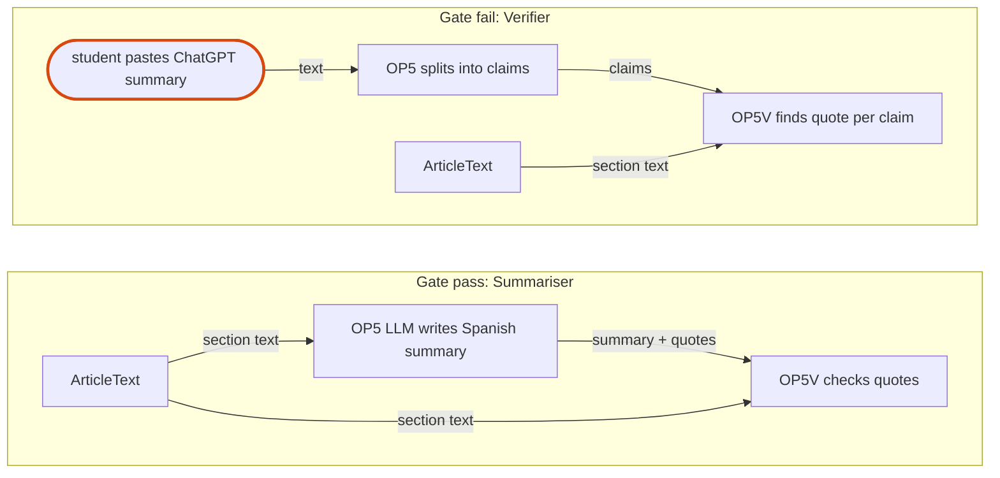

# 0008 — Concierge-first: test differentiation with expert-written summaries before building the LLM summariser

Status: Proposed · Date: 2026-11-05 · Type 1-lite (decides what gets built in the most expensive phase)

## Context
Discovery ([discovery-process-map.md](../discovery/discovery-process-map.md), Gate 1) returned **Go with risks** with one amber flag: differentiation. Free general LLMs (ChatGPT, Gemini) already give Spanish summaries, and free extensions (Citicious, Retraction Alert, Zotero + Retraction Watch) already flag retractions. BioVidGen's remaining edge is the combination plus quotes verified to exist in the paper. Hypothesis H-V2 (students prefer the verified summary over a free ChatGPT summary) is untested. The summariser (OP4 full + OP5 + eval) is the most expensive part of the plan, at 9–14 developer-weeks plus 105–135 expert-hours (ASSUMPTION).

## Decision
1. In P1, experts produce 10 evidence summaries by hand (OP11 in concierge mode), using the same schema as the runtime Summary. These are also the first gold-set batch.
2. Run a blind comparison with students: the concierge summary vs a free ChatGPT/Gemini summary of the same paper, plus a planted-error detection task.
3. Gate:
   - **Pass** (≥60% preference and more planted errors detected) → P2/P3 summariser as planned.
   - **Fail** → P3′ "verifier": the student pastes any summary and the extension checks each claim against the paper and shows status flags. Entities, OP4, OP5V and the views stay; OP5 shrinks to claim splitting.
   - **Inconclusive** (n too small, mixed) → run one more batch of 5 papers before deciding.
4. P0 (skeleton) and P1 flags work go ahead regardless. They do not depend on H-V2.

*Figure — What the gate decides: only the source of the Spanish text changes (highlighted). ArticleText, the OP5V quote check and the views are identical in both options, so P0–P2 work is not wasted either way.*

## Alternatives rejected
- **Build the summariser first, test with the real tool**: the test happens at the end of the most expensive phase, so a failure means 2–3 months of misdirected work.
- **Skip the test and rely on protocol evidence**: that evidence shows the pain (reading time, English level). It does not show that this solution beats the free incumbent.

## Consequences
+ Converts the riskiest hypothesis into a 2–3 week human experiment whose output is reused as gold data.
+ The pivot path is defined before sunk cost accumulates.
− Expert time is front-loaded in P1. If it is unavailable, the critical path slips.
− A concierge summary is better than the future LLM output. A pass is necessary but not sufficient, and H-S1 (the LLM reaches ≥80% agreement) is still tested in P3.

## Revisit when
The blind test cannot recruit ≥15 students. Browser-native AI adds verified quotes (that erodes the edge, so re-run the comparison). The team gets paid model access (changes cost assumptions, not this gate).
