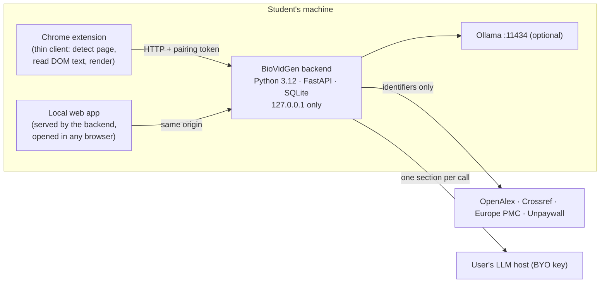

# 0010 — One local Python backend shared by the Chrome extension and a standalone local app

Status: **Accepted** (owner, 2026-11-05) · Date: 2026-11-05 · Type 1 (runtime topology, privacy promise, install model, licences)
Amends: 0006 (adopts its rejected alternative "Extension + mandatory local Python companion"). Affects: 0007 (provider strategy), CLAUDE.md rules 1, 2, 4, 8.

## Context
- New requirement from the owner on 2026-11-05: BioVidGen ships **two surfaces**.
  1. The Chrome extension.
  2. A standalone local app that works without Chrome, for example by pasting a DOI or opening a PDF.
- Both surfaces share **one Python backend** on the user's machine. The owner chose this over two alternatives: Python only behind the app, or a shared TypeScript core.
- ADR-0006 deferred a mandatory Python companion because installing it is hard for students. None of ADR-0006's revisit triggers has been measured yet (S1, S2, share of PDF-only papers). This decision is driven by the new requirement, not by spike data.
- State today:
  - SVC0 extension scaffold done.
  - OP5V written in TypeScript on `feat/op5v-validate-evidence`: 86 of 87 unit tests green, not merged.
  - `eval/` (Python 3.12 + uv) is planned but not started.
  - `app/backend/` holds v1 notes only.

## Decision

1. **Backend** (`backend/`, Python 3.12, uv, ruff, pytest, hypothesis):
   - Owns all domain logic: OP3 Resolve, OP12 Status, OP4 Text segmentation, OP5 Summarise, OP5V Validate (sole writer of Summary), OP13 Export.
   - Owns all storage in SQLite, in the user data directory.
   - Binds to `127.0.0.1` only, never `0.0.0.0`.
2. **The local app** is a web UI served by the same backend process at `http://127.0.0.1:<port>/`, opened in the user's browser. There is no second runtime: one Python process serves both surfaces.
3. **The extension becomes a thin client.** It detects the paper (OP1), reads the page DOM (it is the only part that can see pages behind the student's login), sends the text to the backend, and renders results with `textContent`. Its own Dexie stores and the scholarly/LLM calls planned for the extension move to the backend.
4. **Gemini Nano exception.** Nano (Chrome Prompt API) runs only inside Chrome. If S1 keeps Nano as a provider, the extension calls Nano and posts the drafts to the backend; OP5V still validates and writes them. The app surface then has no Nano and offers Ollama or BYO key only.
5. **Security boundary of the local server.** Any website can send requests to localhost, so:
   - A random per-install pairing token is required on every request.
   - The extension stores the token in `chrome.storage.local`. The app gets it from a page the backend serves itself.
   - Strict `Origin` allowlist: the extension's id and the backend's own origin.
   - `Host` header check against DNS rebinding.
   - No wildcard CORS.
   - Request size limits.
   - No endpoint fetches a URL supplied by the client (no SSRF): scholarly hosts stay a fixed allowlist in code.
6. **Port OP5V to Python first, test-first.** The TypeScript work becomes the reference:
   - Its JSON fixtures (`extension/fixtures/op5v/`) and adversarial cases become shared test vectors.
   - The normaliser spec (NFKC, case fold, dash/quote fold, invisibles, whole-cluster and word-boundary matching) is ported unchanged under `NORMALISER_VERSION 1`.

## Alternatives considered
| Option | Upside | Cost | Why not chosen |
|---|---|---|---|
| A. Python backend only behind the app; the extension keeps a TS core | extension needs no install | OP5V and other rules implemented twice; drift risk on the core guarantee | owner chose one backend |
| B. Shared TS core, Python only for eval/PDF tooling | smallest change to 0006; no install for extension users | the app needs a TS desktop shell (Tauri/Electron); the team prefers Python | owner chose Python |
| C. Hosted backend | no install | hosting bills, privacy and legal exposure; breaks the $0 rule | rejected again (as in 0006) |
| **D. One local Python backend (this ADR)** | one implementation of the logic; Python ecosystem (PDF, OCR, eval share code with `eval/`); full app without Chrome | install and run a local service; the extension stops working when it is off | — |

## Consequences
Good:
- One implementation of OP5V and the other rules.
- `eval/` can import the production validator directly instead of a JSON Schema copy.
- PDF and OCR (pypdfium2, ADR-0004) become possible.
- No browser limits apply: service-worker lifetime (S4), CORS, IndexedDB.

Bad:
- **Install friction**, the top adoption risk named in 0006. Students must install and start a background program; school PCs may block it. Chromebooks cannot run it at all.
- The extension does nothing useful while the backend is off. It needs a clear "start BioVidGen" state.
- **Packaging.** Rule 8 ("no GPL anywhere") rules out two tools: PyInstaller (GPL-2.0-or-later with a bootloader exception) and Nuitka (AGPL-3.0). Briefcase (BSD-3-Clause) is the only candidate left. All three were checked on PyPI on 2026-11-05.
- Three operating systems to build and test (Windows, macOS, Linux). CI time grows.
- **New attack surface:** a local HTTP server. The mitigations in Decision 5 need their own stop-ship tests.
- Wasted work: about 40% of the SVC0 extension core (Dexie repos, http/limiter, network allowlist e2e) is no longer used by the extension. The backend needs Python equivalents.
- S2 (extension → localhost access under Chrome's local-network rules) moves onto the critical path. Without it, the extension surface fails.

## Rules that change (need the owner's sign-off)
- **Rule 1 (privacy).** Add `127.0.0.1:<backend port>` as an extension egress host. The backend inherits the scholarly/LLM allowlist and the "identifiers only" rule.
- **Rule 2 (secrets).** API keys move from `chrome.storage.local` to the backend. Storage options: OS keychain via `keyring` (MIT) `[verify]`, or a file readable only by the user. The pairing token is a new secret.
- **Rule 4 (one writer).** Enforced in Python with `import-linter` contracts (BSD-2) `[verify]`.
- **Rule 8 (licences).** Add a Python licence gate to CI (pip-licenses, MIT). Two conflicts with the current runtime allowlist (MIT/BSD/Apache-2.0/ISC) need a decision:
  - `typing-extensions` (PSF-2.0, permissive) is required by pydantic, so FastAPI cannot run without it. Proposal: add PSF-2.0 to the runtime allowlist.
  - `certifi` (MPL-2.0) comes in with httpx. Proposal: call the scholarly APIs with the stdlib (`urllib.request`, OS certificate store) instead of httpx, which keeps MPL out of the runtime.
- Versions and licences checked on PyPI on 2026-11-05:
  - fastapi 0.162.0 (MIT), uvicorn 0.54.0 (BSD-3), starlette 1.10.0 (BSD-3), pydantic 2.14.3 (MIT)
  - keyring 25.7.0 (MIT), import-linter 2.15 (BSD-2)
  - pytest 9.2.0 (MIT), hypothesis 6.170.14 (MPL-2.0, dev only), ruff 0.17.3 (MIT)

## Incremental plan (each step leaves the system working)
| # | Ships | Verified by | Rollback |
|---|---|---|---|
| 0 | Accept this ADR; S2 spike: can the extension reach `127.0.0.1` with a token under current Chrome? | spike notes in memory.md | stay on 0006 |
| 1 | `backend/` skeleton: FastAPI on 127.0.0.1, `/health`, pairing token, Origin/Host checks, SQLite, structured log with runId, CI (ruff, pytest, licence gate, gitleaks) | security tests: no token → 401; foreign Origin → 403; rebinding Host → 403 | delete the folder |
| 2 | OP5V in Python, test-first, against the shared vectors (0 false accepts, PROP-01..04, CFG-01 hash guard) | `uv run pytest`; mutation run (`backend/scripts/mutation_run.py`, delta D34: mutmut does not run on native Windows) | TS OP5V branch stays as reference |
| 3 | Extension client: pairing UI, "backend off" state (page text moves to OP4 and the OP5 stub, API keys to OP5: delta D35) | e2e with a stub backend; real CORS by hand (`docs/runbooks/be1.md`) | extension keeps the empty state |
| 4 | Local web app shell served by the backend | Playwright against 127.0.0.1 | — |
| 5 | Packaging for one OS (Windows first: team machines) | install on a clean VM | ship as `uv run` for developers only |

Rough effort for steps 1–3: 6–10 developer-days, low confidence. Packaging (step 5) is the biggest unknown.

## Revisit when
- S2 shows the extension cannot reliably reach localhost.
- More than 30% (proposed) of pilot students cannot install or start the backend.
- Chromebooks are a meaningful share of target users (Q3 hardware survey).
- No packaging tool satisfies rule 8.
