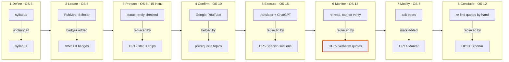
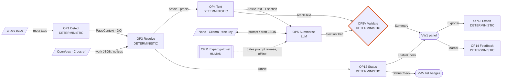
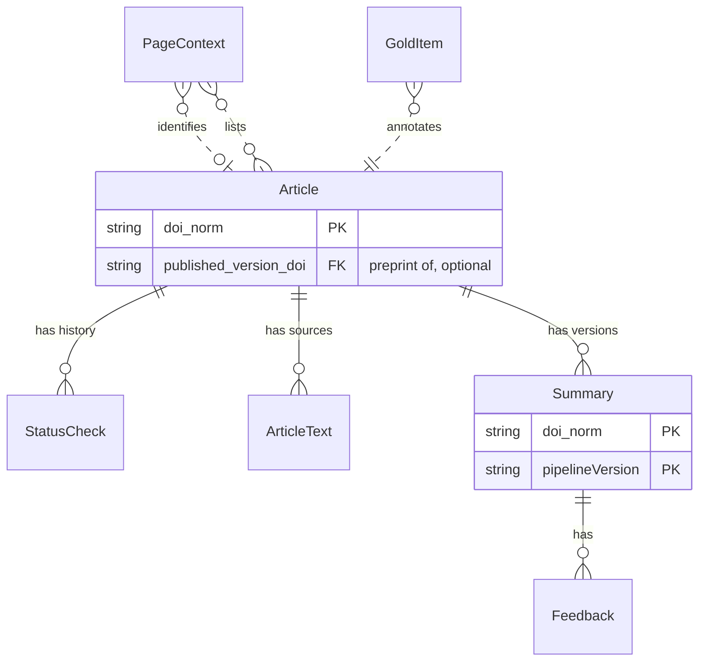
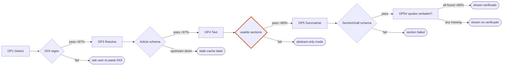
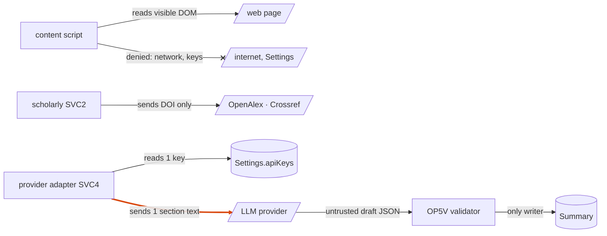

# BioVidGen — Discovery → Process Map

Date: 2026-11-05 · Method: discovery-process-mapper · Knowledge base: [kb.md](kb.md) · YAML: [spec.yaml](spec.yaml)
Inputs: [process-map.md](../process-design/process-map.md) (v1, includes the removed trial), [tech-spec-v2-local-extension.md](../process-design/tech-spec-v2-local-extension.md), ADR-0001…0007, [dependency-register.md](../process-design/dependency-register.md), web research in this session.
Notation: `[specify: …]` unknown · `ASSUMPTION:` inference · confidence 🟢 primary source / 🟡 secondary or single study / 🔴 assumption · `[pending]` not measured.

**Mode: Light discovery + full-depth mapping, non-commercial adaptation.**
Why Light: code is a stub, no MVP, no users, no interviews possible in this run. Why full mapping: a full v1 map and a v2 spec already exist and the next stages (`process-tech-spec`, `process-impl-plans`) need full depth.
Non-commercial adaptation: price is $0 by requirement (MIT, local-first). Investor thresholds (SAM in US$, LTV/CAC, gross margin) are replaced by **users reached**, **$0 recurring cost to the team**, **free-quota headroom for the user**, and **maintenance hours the team can carry**.

---

# PHASE A — DISCOVERY

## D0 · Intake

| Field | Value | Source |
|---|---|---|
| Project | BioVidGen | repo |
| Offer | Chrome extension: on any article page, Spanish structured summary (main topic, prerequisite topics, methodology, results, conclusions) where every claim links to a verbatim quote, plus authors/keywords and preprint/retraction/expression-of-concern status; badges and filters on result lists | tech-spec v2 §1 🟢 |
| Problem | English papers cost Spanish-speaking students disproportionate time; students cannot cheaply tell retracted/preprint papers from sound ones | process-map P1, P3 🟢 |
| Market | Mexico | repo 🟢 |
| Segments | health-science undergraduates (user); instructors / journal-club moderators (influencer, channel); research team (builder, experts) | repo + inference 🔴 |
| Competitors | ChatGPT/Gemini free, SciSpace, Elicit, Consensus, Citicious & other retraction extensions, translator | research 🟡 |
| Model | none: free, MIT, $0 recurring; academic project | ADR-0006 🟢 |
| B2B/B2C | B2C use, B2B2C channel (through instructors/institutions) | ASSUMPTION |
| Test budget | `[specify]`; assumed ≈ team time only, $0 cash | ASSUMPTION |
| Stage / horizon | idea; 24 months (protocol ran Oct 2026 – Nov 2027) | repo 🟢 |
| Process today | student finds paper (PubMed/Scholar) → reads with translator or pastes into ChatGPT → writes appraisal for class/club | ASSUMPTION 🔴 |
| Sensitive data | none collected by design (no accounts, no telemetry); article text sent to the user's chosen LLM; Mexico LFPDPPP applies only if personal data were collected | ADR-0006 🟢 |
| Owners | `[specify: product lead, dev lead, QFB lead, physician]` | — |

Execution plan run: D0 → tasks 1, 3, 5 (market) → 7 (JTBD + Job Map) → 10, 11, 12, 14 (strategy) → 15, 16 (hypotheses and tests, kept because they drive Phase B acceptance criteria) → 18a → Gate 1 → Bridge → Phase B → Gate 2.
Skipped (Light mode): 2 Trends, 4 Teardown, 6 PESTEL (short legal check kept below), 8 CJM, 9 Interviews, 13 Alternative scenarios, 17 PMF measurement (defined, not measured).

## D1 · Market

### Task 1 — Market card
| Item | Value | Conf. |
|---|---|---|
| Health-science students in Mexican higher education, 2023-24 | **1,291,096** (13.1% of 4,926,166; ANUIES, by field of study; probably licenciatura/TSU only) | 🟡 |
| English reading ability | UAM entering medical students: 67.8% failed an English reading test, mean 52.5 (one institution) | 🟡 |
| Reading-time penalty | up to +90.8% reading time for low-proficiency non-native readers (Amano et al. 2023, cited in protocol) | 🟡 |
| GenAI already in use | 72.7% of surveyed Puerto Rico med students use GenAI, 89.9% of those ChatGPT, mostly academic (n=194, 2024) | 🟡 |
| Market growth (CAGR) | `[specify]` — not researched (Light) | — |
| Market type | **Resegmented**: AI paper assistants exist; BioVidGen resegments on language (Spanish), price ($0), privacy (local) and pedagogy (evidence, no verdict) | 🔴 |

Implication of "Resegmented": success depends on a niche the incumbents under-serve, so the differentiation hypothesis (H-V2) is the one that decides the project.

### Task 3 — Competitive landscape
| Competitor | Type | Positioning | Price (free tier) | Channel | Weakness for this segment | Conf. |
|---|---|---|---|---|---|---|
| ChatGPT / Gemini / Copilot (free) | Indirect | general assistant; paste/upload paper, ask for Spanish summary | free with caps | already installed habit | no verbatim evidence check; hallucination risk; no retraction/preprint status; copy-paste friction | 🔴 |
| AI built into the browser or PubMed/publisher sites (e.g., Gemini in Chrome) | Potential | one-click page summary | free | default in browser | generic summary; no appraisal structure; status checks not shown | 🔴 not verified |
| SciSpace | Direct | explain/chat with papers; extension | free, capped Copilot; Premium ≈ $12–20/mo | web, extension | caps exhaust in exam weeks; paid; English-first | 🟡 |
| Elicit | Direct | systematic-review extraction tables | free tier (caps disputed); Pro ≈ $49/mo per one source | web | built for researchers, not undergrads; English | 🟡 |
| Consensus | Direct | search + synthesis across papers | free unlimited search, ~10 Pro messages/mo; Pro ≈ $10–15/mo | web | question answering, not single-paper appraisal | 🟡 |
| Citicious (MIT, Chrome), Retraction Alert, RetractCheck, Manusights Reference Sentry, Zotero + Retraction Watch | Substitute (status flags only) | retraction badges and banners | free | Chrome store, Zotero | no summaries; English UI; small user bases | 🟡 |
| Browser translation (Chrome/Edge/DeepL) | Substitute | whole-page translation | free | built-in | translation ≠ structure; scientific terms mistranslated | 🔴 |
| Do nothing | — | read slowly, ask peers/teacher | free | — | time; exhaustion | — |

Differentiation that is left: **(1) every Spanish claim has a quote that is verified to exist in the paper, (2) status flags combined with the summary on the same card, (3) $0 with no caps when on-device/Ollama, (4) appraisal-oriented structure built with domain experts.** Every individual piece exists somewhere; the combination does not, as far as this run found. That is a narrow moat.

### Task 5 — TAM / SAM / SOM (users)
| Level | Formula | Value | Conf. |
|---|---|---|---|
| TAM | health-science students, Mexico | 1.29 M | 🟡 |
| SAM | TAM × share in courses/years that require reading English articles (0.4–0.6, ASSUMPTION) × share with own laptop running desktop Chrome/Chromium (0.6–0.75, ASSUMPTION) | **310k–580k** | 🔴 |
| SOM (24 mo) | cohorts reachable via partner instructors/journal clubs | **1,000–5,000 installs** | 🔴 |

Threshold adaptation: the US$10M SAM flag does not apply to a free tool. Used instead: SAM ≥ 10k reachable users (passes), SOM ≥ 500 active users to produce meaningful evidence (passes only if the instructor channel works, H-D1).

### Legal quick check (from PESTEL, Light)
| Factor | Significance (1–3) | Probability (1–5) | Note |
|---|---|---|---|
| Copyright: sending article text to a third-party LLM | 2 | 2 | transient processing; text not stored by default; OA preferred. No licence plan needed for personal study use (ASSUMPTION — not legal advice) |
| LFPDPPP (personal data) | 1 | 1 | nothing collected; keep it that way (no telemetry, local-only feedback) |
| Chrome Web Store AI/permissions policy | 2 | 3 | load-unpacked fallback; minimal permissions |
| Free-tier provider terms (training on inputs) | 2 | 4 | disclose; never send unpublished text to free tiers |
No regulatory blocker.

## D2 · Customers

### Task 7 — Jobs-to-be-Done

**Student (user).** Functional: understand and appraise an assigned or self-chosen English article quickly enough to discuss it. Emotional: not feel lost or behind; less exhaustion. Social: look competent in class/journal club.
**Instructor / moderator (channel, decision-maker for adoption).** Functional: students arrive having actually understood the methods; no one cites a retracted paper. Emotional: less remedial explaining. Social: run a credible club/course.
**Research team (builder).** Functional: produce evidence that the tool saves time without degrading appraisal (H2/H3).

Job stories (numbers are ASSUMPTIONS 🔴, to be replaced by measurement):
1. *When* I am assigned an English RCT for journal club, *I spend* ~60–120 min with a translator and ChatGPT *to* understand methods and results, *and still* cannot tell if the summary I got is what the paper says, 2–4 times a month.
2. *When* I search PubMed for a class assignment, *I spend* ~10–20 min deciding which results to open *to* pick credible papers, *and still* sometimes cite a preprint or retracted paper without noticing, 2–6 times a month.
3. *When* I prepare my appraisal sheet, *I spend* ~30–45 min re-finding sentences that support each point *to* defend my reading, *and still* get corrected on methodology, 2–4 times a month.
4. (Instructor) *When* I moderate a session, *I spend* ~20 min re-explaining basic design concepts *to* get to the discussion, *and still* half the group has not read beyond the abstract, every session.

Persona cards:
| Persona | Context | Hardware | WTP |
|---|---|---|---|
| "Ana", 3rd-year medicine, public university | reads 2–4 English papers/month for courses; uses ChatGPT free | mid-range laptop, 8 GB RAM, no GPU (ASSUMPTION) | $0 (would not pay; will install if instructor recommends) |
| "Luis", 5th-year nutrition, journal-club member | reads weekly; wants to look prepared | 16 GB RAM laptop (ASSUMPTION) | $0 |
| "Dra. M.", instructor / club moderator | assigns papers; checks appraisal sheets | — | $0 cash; will spend time to recommend if it helps |

Hardware note: Gemini Nano needs ≥22 GB free disk and >4 GB VRAM or 16 GB RAM + 4 cores (dependency register 🟡). "Ana" probably cannot run it, so the default path for many students is a free API key, which needs setup. This is a solution risk (H-S1, H-D1).

### Job Map (customer's as-is process) — scores ASSUMED 🔴, no interviews
| Stage | Customer action | Pain / cost | Time | Current tool | Imp. | Sat. | OS |
|---|---|---|---|---|---|---|---|
| 1 Define | decide topic / receive assignment | low | 5 min | syllabus | 6 | 6 | 6 |
| 2 Locate | search, pick candidate papers | relevance unclear | 10–20 min | PubMed, Scholar | 7 | 6 | 8 |
| 3 Prepare | get full text; check status (peer-reviewed, preprint, retracted) | status rarely checked; paywalls | 5–10 min | publisher site | 6 (student) / 9 (instructor) | 4 / 3 | **8 / 15** |
| 4 Confirm | understand prerequisite concepts | jargon, stats | 10–20 min | Google, YouTube | 7 | 4 | 10 |
| 5 Execute | read & comprehend methods, results, conclusions in English | slow, tiring | 45–90 min | translator, ChatGPT | 9 | 3 | **15** |
| 6 Monitor | check that the understanding/summary matches the paper | cannot verify ChatGPT output | 10–20 min | re-reading | 8 | 3 | **13** |
| 7 Modify | re-read, ask peers | social cost | 10 min | WhatsApp, peers | 6 | 5 | 7 |
| 8 Conclude | write appraisal sheet / club notes | re-finding quotes | 30–45 min | Word, sheet | 8 | 4 | **12** |

`OS = Imp + max(Imp − Sat, 0)`. Critical (≥15): Execute; Prepare *for instructors*. Significant (10–15): Monitor, Conclude, Confirm.
Finding: retraction/preprint checking is a **normative** need (instructors, experts) more than a felt need (students). Flags will not drive student adoption on their own; they need the instructor channel or must ride along with the summary.


*Figure — Job Map, as-is (top) vs to-be (bottom) per stage: the tool replaces the student's current tool exactly at the high-OS stages (Prepare, Execute, Monitor, Conclude). Highlighted: verbatim quotes at Monitor, the one change no free competitor offers.*

### Tasks 8, 9 — N/A (Light). Interview guide is still worth writing before the pilot: see Open questions Q1.

## D3 · Strategy

### Task 10 — Lean Canvas (non-commercial)
| Block | Content |
|---|---|
| Problem | 1 English papers take too long (Execute, OS 15). 2 Students cannot verify AI summaries (Monitor, OS 13). 3 Retracted/preprint papers pass unnoticed (Prepare, OS 15 instructor). Existing alternatives: ChatGPT free, translator, SciSpace free tier, Citicious |
| Customer segments | Health-science undergrads in Mexico; **early adopters**: students in partner journal clubs/courses whose instructor recommends the tool |
| Unique value proposition | "Entiende cualquier artículo en inglés en español, con la frase exacta del artículo que respalda cada punto y su estado de retractación o preprint — gratis, en tu navegador." |
| Solution | Side-panel Spanish evidence summary; status chips + list badges; export to appraisal sheet |
| Channels | instructors/journal clubs (primary), GitHub release + load-unpacked guide, Chrome Web Store (optional) |
| Revenue | none. Sustained by academic project time `[specify: grant/institutional support?]` |
| Cost structure | developer time (2 devs), expert annotation hours (gold set), $5 Chrome Web Store fee (one-off), $0 infrastructure |
| Key metrics | weekly active % of an invited cohort; papers summarised per active user per week; quote validity (100%); expert agreement (≥80%); minutes per article vs baseline |
| Unfair advantage | QFB + physician experts who can build a gold set; direct access to cohorts; open source and no data collection (trust) |

### Task 11 — SWOT (each item traced)
| | Item | Traced to |
|---|---|---|
| S | Domain experts for gold set and prompt review | D0 team |
| S | $0, local, no account, privacy | D0 model; ADR-0006 |
| S | Evidence-verified quotes: a structural guarantee competitors do not advertise | Task 3 |
| W | Two developers; per-site DOM breakage is ongoing work | D0; tech-spec v2 risks |
| W | Default $0 LLM path needs hardware many students lack or an API-key setup | Persona "Ana"; dependency register |
| W | Scores and sizes are assumptions; no interviews | Job Map 🔴 |
| O | 67.8% English reading failure at entry (one institution): large felt pain | Task 1 |
| O | Students already use GenAI for papers → habit exists; BioVidGen can be the "verified" version | Task 1 |
| O | MIT retraction extensions exist (Citicious): reuse instead of build | Task 3 |
| T | Browser-native AI summaries (free, zero install) | Task 3 potential |
| T | Free LLM tiers change or vanish | ADR-0007 |
| T | Chrome Web Store policy / review delays | Legal check |

### Task 12 — Opportunity Solution Tree
```
Outcome: cut minutes per English article by ≥30% with no loss of appraisal accuracy (H2, H3)
├── Opp. Execute — comprehension in English (OS 15)
│   ├── Sol. Spanish section summaries (methods/results/conclusions)
│   │   ├── Exp. Concierge: experts hand-write evidence summaries for 10 club papers; measure time + accuracy
│   │   └── Exp. Blind comparison vs free ChatGPT summary (preference, errors found)
│   └── Sol. Prerequisite topics list (labelled "background, not from the paper")
├── Opp. Monitor — verify the summary (OS 13)
│   └── Sol. Verbatim quote per claim + "no verificado" state
│       └── Exp. Error-spotting task: can students detect a planted wrong claim faster with quotes?
├── Opp. Conclude — appraisal sheet (OS 12)
│   └── Sol. Export summary + quotes into the club's appraisal sheet (Markdown/clipboard)
│       └── Exp. Fake door: "Exportar a hoja de evaluación" button in concierge PDF/sheet; count use
└── Opp. Prepare — status (OS 15 instructor / 8 student)
    └── Sol. Status chips + result-list badges/filters (reuse Citicious logic if licence allows)
        └── Exp. Instructor demo; count instructors who mandate it
```

### Task 14 — RICE (reach per semester = one pilot cohort ≈ 500, ASSUMPTION; effort in person-months)
| Solution | Reach | Impact | Confidence | Effort | RICE |
|---|---|---|---|---|---|
| Export to appraisal sheet | 300 | 1 | 0.7 | 0.5 | **420** |
| Status chips + list badges | 500 | 1 | 0.8 | 1.5 | **267** |
| Prerequisite topics (part of summary prompt) | 500 | 0.5 | 0.4 | 0.5 | 200 |
| Spanish evidence summary (incl. text acquisition, validator) | 500 | 3 | 0.5 | 4 | **188** |
| Mapa citation graph | 100 | 1 | 0.3 | 3 | 10 |
Reading: the summary is the core value but the riskiest and most expensive; export and flags are cheap wins. Mapa stays deferred.

## D4 · Validation

### Task 15 — Hypothesis pool
| ID | Type | Statement | Risk | Method | Pass criterion |
|---|---|---|---|---|---|
| H-N1 | Need | Students spend >45 min per English article and use translator/ChatGPT to cope | Med | 10 story-based interviews (Mom Test) | ≥7/10 confirm with a recent concrete example |
| H-D1 | Demand | When an instructor recommends it, students install and use it | **High** | Pilot cohort offer | ≥40% of invited cohort installs within 2 weeks; ≥40% of installers active in week 4 (proposed) |
| H-V1 | Value | Evidence summary cuts minutes per article ≥30% without lowering appraisal accuracy | **High** | Concierge (expert-written summaries) then live tool, within-subject | ≥30% time reduction; accuracy non-inferior (margin `[specify]`) |
| H-V2 | Value (differentiation) | Students prefer the evidence-verified summary over a free ChatGPT/Gemini summary of the same paper | **High** | Blind A/B on 5 papers, error-spotting task | ≥60% preference AND more planted errors detected |
| H-S1 | Solution | A $0 provider reaches ≥80% expert agreement and 100% quote validity on student-grade hardware or a free key | **High** | Gold set eval per provider | gate met by ≥1 $0 path available to ≥70% of the cohort |
| H-S2 | Solution | ≥70% of target article pages yield usable section text (DOM/OA, no OCR) | Med | 50-page sample across publishers | ≥70% usable |
| H-C1 | Channel | Instructors at ≥2 institutions agree to recommend it | Med | demo to 5–8 instructors | ≥2 commit |
| H-Sc1 | Scalability | Team cost stays $0/month and maintenance ≤8 h/month at 5,000 users | Med | track selector breakages and quota reports | holds for one semester |

### Task 16 — Rapid tests (adapted to $0 / Light)
| Hypothesis | Method | Time | Pass |
|---|---|---|---|
| H-N1 | Story-based interviews (guide: past behaviour only) | 1–2 wk | ≥7/10 |
| H-V1, H-V2 | **Concierge / Wizard of Oz**: experts produce 10 evidence summaries (this is also the first gold-set batch) | 2–3 wk | see pool |
| H-D1, H-C1 | Instructor demo + install offer to one cohort (after E0 flags MVP) | 2 wk | see pool |
| H-S1 | Spikes S1/S5 + gold-set eval | 1–2 wk after gold set | see pool |
| H-Sc1 | Model only (this document, Gate 2) | done | quota headroom ≥3× |

### Task 17 — PMF indicators (defined, not measured)
Sean Ellis (≥40% "very disappointed") by pilot survey; week-4 active share of installers; papers per active user per week; OS for Execute/Monitor re-scored after the pilot. **Constraint**: no telemetry by design, so these come from pilot surveys and opt-in exported usage counts, never from silent tracking.

### Task 18a — Main scenario
| Parameter | Value |
|---|---|
| Segment | health-science undergrads in partner journal clubs/courses (Mexico) |
| Value proposition | UVP above |
| Monetisation | none; MIT; $0 |
| "Price" | $0 to user; user-side cost = free quota or own hardware |
| Acquisition | instructor recommendation; "CAC" = ~1 h instructor time per cohort (ASSUMPTION) |
| Churn | semester-bound; expected high outside course weeks |
| Growth | cohort by cohort; 1,000–5,000 installs in 24 months (🔴) |

## GATE 1 · Red flags and verdict

| Signal | Value | Status |
|---|---|---|
| SAM too small | 310k–580k users (🔴); $ threshold N/A | ✅ no flag |
| No real pain | top OS 15 (assumed 🔴); external evidence 🟡 supports it | ✅ no flag (unvalidated) |
| Interviews don't confirm pain | not run | ⚪ untested |
| Unit model broken | N/A in $; Gate 2 shows $0 team cost and ≥12× quota headroom | ✅ no flag |
| **No differentiation** | every component exists free elsewhere (general LLMs summarise in Spanish; Citicious et al. flag retractions); only the combination + verified quotes + pedagogy is unique | 🟠 **amber flag** |
| Regulatory blocker | none | ✅ |

**Readiness (adapted, 8 criteria)**: pain confirmed OS ≥12 — 0 (assumed only) · size — 1 · sustainability ($0, maintenance fits) — 1 · retention — 0 (no data) · relevant team (experts + devs) — 1 · traction — 0 · maintenance ≤ capacity — 0.5 (unknown) · unique advantage (gold-set experts + cohort access) — 1 → **4.5 / 8**.

```
✅ DISCOVERY VERDICT — BioVidGen       Mode: Light + full mapping (non-commercial)   Tasks: 12/18
🎯 Verdict: Go with risks — 1 amber flag (differentiation vs free LLMs + free retraction extensions); readiness 4.5/8 (adapted); $0 team cost; top OS 15 (Execute)
💡 Value proposition: "Entiende cualquier artículo en inglés en español, con la frase exacta que respalda cada punto y su estado de retractación o preprint — gratis, en tu navegador."
   Segment: health-science undergrads in partner journal clubs/courses (MX)   Monetisation: none, $0, MIT
📊 TAM 1.29M 🟡 / SAM 310k–580k 🔴 / SOM 1k–5k installs 🔴 · team cost $0/paper 🟢 · free-quota headroom ≥12× 🟡 · break-even N/A
🚩 Top 3 risky hypotheses → test, deadline
   H-V2 beats free ChatGPT/Gemini on verified value → blind comparison on concierge summaries → before E2 build starts
   H-S1 a $0 provider meets the gate on students' hardware/free key → spikes S1/S5 + gold-set eval → end of E1
   H-D1 instructor channel drives installs/use → cohort offer after E0 flags MVP → first pilot semester
▶️ Continued to process mapping per the user's instruction (run full pipeline).
```

**Pivot option kept ready (adjacent signal)**: if H-V2 fails (students prefer ChatGPT's summary), pivot from "summariser" to **"verifier"**: the extension checks any summary (including a ChatGPT one the student pastes) claim by claim against the paper's text and shows status flags. Same entities, same validator, smaller LLM role.

---

# BRIDGE — Discovery → process map

| Discovery output | Becomes in the map | Applied here |
|---|---|---|
| Job Map as-is | As-is baseline | Execute 45–90 min, Monitor 10–20, Conclude 30–45 (🔴) |
| OST solutions | To-be operations | summary → OP4, OP5, OP5V; status → OP12; export → OP13; prerequisites → OP5 field |
| OS per stage | Impact in worth-it gate | Execute 15, Monitor 13, Prepare 15 (instr.), Conclude 12 |
| RICE effort | Effort in worth-it gate | export 0.5 pm, flags 1.5, summary 4 |
| Personas, segments | Entities | no user entity (no accounts); hardware/provider choice lives in `Settings` |
| CJM touchpoints (not run) | Interfaces | side panel, result-list badges, options page, exported Markdown |
| OST outcome | Objective | minimise minutes per article s.t. accuracy non-inferior, quote validity 100%, agreement ≥80% |
| Hypothesis pool | Step 5 acceptance + step 6 rollout | H-S1 → OP5 gate; H-S2 → OP4; H-V1/V2 → pilot rollout |
| Concierge test | Operations start HUMAN | **OP11 Expert summary = concierge stage of OP5**; its outputs are the gold set |
| PMF indicators | Step 7 telemetry | via pilot surveys + opt-in export (no tracking) |
| Red flags / pivot | Step 8 adapt rules | H-V2 fail → "verifier" pivot; Sean Ellis <40% after 2 cohorts → re-segment to instructors |
| Legal check, data | Governance + access control | no personal data; free-tier disclosure; gold set only from CC-BY papers if committed publicly |
| Unit economics | Cost/unit budget | team $0/paper; user quota headroom ≥3× |
| Confidence colours | Certainty on properties | Measured/Derived/Inferred/Assumed in ontology |

---

# PHASE B — PROCESS MAPPING (v3, delta on tech-spec v2)

## M0 · Framing & gate

### Problems solved
| # | Who | What happens | Measurable symptom |
|---|---|---|---|
| P1 | student | English methods/results take too long to understand | minutes per article (baseline `[pending]`) |
| P2 | student | cannot verify an AI summary against the paper | % claims the student can trace to a sentence; planted-error detection rate |
| P3 | student, instructor | retracted/preprint/EoC papers used unknowingly | % flagged papers recognised as such in an appraisal task |
| P4 | student | appraisal sheet takes long to assemble | minutes to complete sheet |

### Abstractions
Entities: **PageContext, Article, StatusCheck, ArticleText, Summary (with Evidence), Feedback, Settings, GoldItem**. Operations: detect, resolve, check status, acquire/segment text, summarise, validate evidence, export, capture feedback, expert-summarise/audit.

### Process map (to-be, SIPOC)
Suppliers: article page (DOM), OpenAlex, Crossref (+Retraction Watch data), Unpaywall/Europe PMC, chosen LLM provider, experts. Customers: student, instructor, research team.

| ID | Operation | Input → Output | Class | Job stage | OS | MVP |
|---|---|---|---|---|---|---|
| OP1 | Detect paper | page DOM/URL → PageContext{doi?, pmid?, kind} | DETERMINISTIC | Locate | 8 | yes (E0) |
| OP3 | Resolve metadata | DOI → Article{authors, keywords, topics, type, oa_url} | DETERMINISTIC | Prepare/Confirm | 8–10 | yes (E0) |
| OP12 | Check status | Article DOI(s) → StatusCheck{preprint, retraction, EoC, sources, checked_at} | DETERMINISTIC | Prepare | 8 / 15 | yes (E0) |
| OP4 | Acquire & segment text | page DOM / OA link / PDF → ArticleText{sections, source} | DETERMINISTIC (+heuristics) | Execute | 15 | yes (E1) |
| OP5 | Summarise section | ArticleText.section → draft {summary_es, evidence[]} | LLM | Execute | 15 | yes (E2, after gate) |
| OP5V | Validate evidence | draft + ArticleText → Summary.section{status verified/no_verificado} | DETERMINISTIC | Monitor | 13 | yes (E2) |
| OP13 | Export appraisal sheet | Summary + Article + StatusCheck → Markdown/clipboard | DETERMINISTIC | Conclude | 12 | yes (E2) |
| OP14 | Capture feedback | user mark on a section → Feedback | DETERMINISTIC | Modify | 7 | yes (E2) |
| OP11 | Expert summary & gold set (concierge) | article → expert evidence summary; double annotation → GoldItem, κ | HUMAN | Execute/Monitor | 15 | yes (E1, precedes OP5) |
| OP7 | Mapa | — | DETERMINISTIC | — | — | **no (deferred; no requirement)** |


*Figure — To-be process: one LLM operation (OP5) sits between deterministic steps, and its output reaches the student only through the deterministic validator OP5V (highlighted), which also reads the source text. The HUMAN operation OP11 is offline: its gold set gates which prompt is released. OP14 feedback flows back to OP11 by manual export (not drawn).*

Change vs tech-spec v2: OP5 split into OP5 (LLM) + OP5V (deterministic) because one operation was mixing classes; OP4b folded into OP4 as a sub-step (same class, same owner); OP13 added (top RICE); OP11 promoted from dev-time annotation to **concierge stage** that also tests H-V1/H-V2 before E2 code is written.

### As-is baseline (from Job Map, 🔴 until measured in pilot)
| Metric | Value |
|---|---|
| Cycle time per article (Locate→Conclude) | ≈ 2–3.5 h |
| Throughput | 2–4 articles/student/month |
| Cost/unit | student time only; $0 cash (ChatGPT free) |
| Defect rate | unknown: % of appraisals citing retracted/preprint unknowingly `[pending]`; % ChatGPT summary claims unsupported `[pending]` |
| Bottleneck | Execute (comprehension in English) |

### Worth-it gate (impact = OS × frequency × pain; effort = RICE)
| Rank | Operation | Impact | Effort | Decision |
|---|---|---|---|---|
| 1 | OP11 concierge/gold set | unlocks H-V1/V2/S1 and OP5 | med (human hours) | **do first**, in parallel with E0 |
| 2 | OP1+OP3+OP12 | Prepare OS 15 for instructors; cheap; channel opener | low | engineer first (E0); evaluate Citicious reuse |
| 3 | OP13 export | Conclude OS 12; RICE 420 | very low | ship with first summary release |
| 4 | OP4 | prerequisite for OP5 | med | E1 |
| 5 | OP5 + OP5V | Execute 15 / Monitor 13 | high | E2, **gated by H-V2 concierge result** |
| 6 | OP14 | label source | low | E2 |
| — | OP7 | no requirement | — | stays manual/not built |

## Ontology

### PageContext (ephemeral)
Key: tab id + URL. Storage: memory only.
| Property | Type | Unit | Source field | Certainty | Visibility |
|---|---|---|---|---|---|
| url | string | — | location | Measured | internal |
| kind | enum {article, result_list, other} | — | OP1 rules | Inferred | internal |
| doi / pmid | string | — | `citation_doi`, `dc.identifier`, JSON-LD, URL regex | Measured (meta) / Inferred (regex) | public |
| result_ids[] | list | — | list-page parser | Inferred | internal |
Invariant: `kind = article ⇒ doi ∨ pmid ∨ title present`.

### Article
Key: normalised DOI (lowercase, no `https://doi.org/`); fallback OpenAlex ID; fallback URL hash. Dedup: normalised DOI; preprint↔published linked via `published_version_doi`, never merged.
Storage: IndexedDB (document). Interface: `upsertFromOpenAlex`, `upsertFromCrossref`, `read`.
| Property | Type | Unit | Source | Certainty | Visibility |
|---|---|---|---|---|---|
| doi, openalex_id | string | — | OpenAlex/Crossref | Measured | public |
| title, journal, year | text/int | year | OpenAlex | Measured | public |
| authors[] | list | — | OpenAlex `authorships` | Measured | public |
| keywords[] | list{term, source} | — | page meta ∪ OpenAlex keywords/topics | Measured (tag source) | public |
| main_topic_openalex | string | — | OpenAlex `primary_topic` | Measured | public |
| type | enum | — | OpenAlex `type`, Crossref `type` | Measured | public |
| oa_url | url | — | Unpaywall/OpenAlex | Measured | internal |
| fetched_at | timestamp UTC | — | system | Measured | internal |
Field traps: `year` may be the preprint year; OpenAlex abstract is an inverted index (reassembled → Derived); keywords from publishers and OpenAlex differ in vocabulary.

### StatusCheck
Key: (article_key, checked_at). Storage: IndexedDB, TTL 24 h (re-check on display).
Invariants: `retraction_found` only from a retraction source (OpenAlex `is_retracted`, Crossref update `retraction`); `status_text` never says "not retracted" — only "no retraction found in {sources} on {date}"; expression of concern and correction are separate values, not retraction.
| Property | Type | Certainty | Visibility |
|---|---|---|---|
| is_preprint | bool | Derived (rule over type + DOI prefix) | public |
| published_version_doi | string? | Measured | public |
| retraction_nature | enum {none_found, retraction, expression_of_concern, correction, reinstatement} | Measured (source-limited) | public |
| sources[] | list{name, retrieved_at} | Measured | public |
| checked_at | timestamp | Measured | public |

### ArticleText
Key: (article_key, content hash). Storage: memory/session by default (copyright); user may pin.
| Property | Type | Certainty | Visibility |
|---|---|---|---|
| source | enum {dom, oa_html, oa_xml, pdfjs, abstract_only} | Measured | public |
| sections{name→text} | map | Derived (heading rules) | internal |
| language | iso-639 | Inferred | public |
| usable | bool | Derived (min chars per required section) | internal |
Invariant: `abstract_only ⇒ Summary shows "solo resumen" banner`.

### Summary
Key: (article_key, pipeline_version = prompt_hash + model_id + schema_version). Storage: IndexedDB until cleared.
Invariants: every `summary_es` has ≥1 evidence quote **or** status `no_verificado`; every quote is a substring of `ArticleText.sections[section]` after normalisation; every number in `summary_es` appears in an evidence quote; `prerequisite_topics` carries label `background_knowledge` and is never marked verified; no field holds a quality verdict.
| Property | Type | Certainty | Visibility |
|---|---|---|---|
| main_topic | text | Inferred | public |
| prerequisite_topics[] | list | Assumed (model background knowledge) | public, labelled |
| methodology{summary_es, design?, n?, statistics?, evidence[]} | struct | Inferred → Derived where quote-validated | public |
| results{…}, conclusions{…} | struct | same | public |
| section_status | enum {verified, no_verificado, abstract_only, failed} | Derived (OP5V) | public |
| provider, model_id, prompt_hash | string | Measured | internal |

### Feedback
Key: auto id. Storage: IndexedDB; export-only (never sent). `(summary_key, section, kind {wrong, unclear, good}, note, at)`.

### Settings
Storage: `chrome.storage.local` (not `sync`). Provider choice, API key(s) (protected), OpenAlex key + contact email, filter mode, enabled sites, "send to free tier" acknowledgement.

### GoldItem (dev-time, `eval/`)
Key: (doi, annotator, version). Storage: files in `eval/gold/` (only CC-BY or equivalently licensed OA articles if the repo is public; otherwise private store `[specify]`). Expert sections with quotes, adjudicated version, κ per field.

### Relationships
| A | Relation | B | Card. | Optional | Ownership |
|---|---|---|---|---|---|
| PageContext | identifies | Article | N:1 | yes | reference |
| PageContext (list) | lists | Article | 1:N | yes | reference |
| Article | has | StatusCheck | 1:N (history) | no after OP12 | composition |
| Article | has | ArticleText | 1:N (sources) | yes | composition |
| Article | has | Summary | 1:N (versions) | yes | composition |
| Summary | has | Feedback | 1:N | yes | composition |
| Article | is preprint of | Article | 1:1 | yes | reference |
| GoldItem | annotates | Article | N:1 | — | reference (dev-time) |


*Figure — Ontology: Article is the aggregate root. Solid lines = composition (deleted with the Article on "clear all"); dashed lines = reference (PageContext is ephemeral, GoldItem lives in the eval repo). Settings has no relationships and is omitted.*

### CRUD
| Property | C | R | U | D |
|---|---|---|---|---|
| PageContext.* | OP1 | SP orchestrator | on navigation | on tab close |
| Article.* | OP3 | all views, OP4, OP5, OP13 | refresh after 30 days | user "clear all" |
| StatusCheck | OP12 | VW-A, VW-B, OP13 | new record each check (append) | TTL GC + clear all |
| ArticleText | OP4 | OP5, OP5V | replace if better source | end of session unless pinned |
| Summary | OP5V (only validated drafts are stored) | VW-A, OP13 | never (new version) | clear all |
| Feedback | OP14 | export | note edit | clear all |
| Settings.api_key | options page | SP provider adapter only | user | user |
| GoldItem | OP11 | eval runner | new version | team decision |

## Top-level 8-step cycle

1. **Problem.** Gap: minutes per article `[pending]` → ≥30% lower; verifiability ≈0% → 100% of shown claims linked to a verified quote. Target variable: `minutes_per_article` (pilot, self-timed or observed). Objective: **minimise minutes_per_article subject to appraisal accuracy non-inferior (H3), quote validity = 100%, field agreement ≥80%, team cost = $0/month.**
   | Variable | Role | Type | Unit | Range | Source |
   |---|---|---|---|---|---|
   | provider | control | enum | — | nano/ollama/key | Settings |
   | text_source | state | enum | — | 5 | OP4 |
   | section_status | output | enum | — | 4 | OP5V |
   | quote_validity | output | % | % | 0–100 | OP5V |
   | field_agreement | output | % | % | 0–100 | eval vs gold |
   | minutes_per_article | target | num | min | ≥0 | pilot |
   | appraisal_accuracy | constraint | % | % | 0–100 | rubric vs expert |
   | status_recall | output | % | % | 0–100 | known-retracted set |
   KPIs (business): install rate of invited cohort ≥40%; week-4 active ≥40% of installers; Sean Ellis ≥40%; papers/active user/week `[specify]`. Engineering: quote validity `= verified quotes / shown quotes` = 100%; agreement `= matched fields / gold fields` ≥80%; status recall ≥95% on known-retracted sample; p95 flags ≤2 s (25 results, warm); p95 summary `[specify]` s per provider; team cost $0/month.
2. **Raw data.** Page DOM (per view); OpenAlex/Crossref/Unpaywall JSON (per article); Retraction Watch data via Crossref (daily updates); LLM responses (4 per paper); gold set (target 60 articles × 2 annotators, ASSUMPTION); pilot measurements (cohort × timepoint). Instruments: OpenAlex/Crossref coverage gaps (measure missing-field %), retraction lag (measure on known sample), DOM extraction quality (measure on 50-page sample), self-timed minutes (noisy; observed sessions preferred). **Governance**: no personal data collected; article text goes only to the user's chosen LLM; free-tier disclosure; no unpublished text to free tiers; gold set licence check.
3. **Data → Information.** Read/write map:
   | Op | Reads | Writes |
   |---|---|---|
   | OP1 | DOM meta, URL | PageContext |
   | OP3 | PageContext.doi | Article |
   | OP12 | Article.doi(s), type | StatusCheck |
   | OP4 | DOM clone, Article.oa_url | ArticleText |
   | OP5 | ArticleText.sections, Article.title | draft (memory) |
   | OP5V | draft, ArticleText | Summary |
   | OP13 | Summary, Article, StatusCheck | export file/clipboard |
   | OP14 | Summary | Feedback |
   | OP11 | article text, expert input | GoldItem |
   Ingestion checks: DOI regex + normalisation; schema validation (Zod) on every API and LLM response; `year ≤ current year`; section min length; language detected.
4. **Train/adjust.** Baselines: (a) unaided reading; (b) free ChatGPT summary (for H-V2); (c) trivial extractor (regex for n, randomized, blinding) for methodology fields. Method from objective: OP1/3/12/4/5V/13/14 fully specifiable → DETERMINISTIC; OP5 free-text comprehension with few labels → LLM bounded by OP5V; OP11 needs accountability → HUMAN. Tunable: prompts, section chunking, model, normalisation rules in validator, heading dictionary (es/en), per-site selectors. Labels: OP11 gold set; OP14 feedback.
5. **Evaluation.** Per op: OP1 detect precision/recall on fixtures; OP12 status recall/precision on known samples; OP4 usable-text %; OP5+OP5V agreement and validity per provider `[pending]`. End to end: % of detected papers that end with ≥3 verified sections; pilot H-V1/H-V2. Acceptance: hypothesis criteria above. Protocol: gold-set holdout (no prompt tuning on it), blind preference test, recorded API fixtures.
6. **Deploy.** Action: side-panel card, list badges, export. Mode: real-time on user action (summary), event on page load (detect, flags). Interfaces: side panel, content-script badges, options page, Markdown export. Rollout: shadow (team only, load-unpacked) → pilot cohort (1 instructor) → 2 institutions → public release (GitHub + optional store). Rollback: release previous zip; disable summary feature flag if quote-validity bug found; provider adapter can be disabled. Label capture: OP14 `(summary key, section, model text, user mark, note, at)` exported voluntarily; OP11 adjudications.
7. **Monitor.** No remote telemetry. Sources: local debug panel; opt-in "export diagnostics/usage counts"; pilot surveys; eval harness in CI.
   | Metric | Health signal | Freq. | Instrument | Alert threshold | Owner |
   |---|---|---|---|---|---|
   | Quote validity | quality | every summary + CI | OP5V + eval | any unverified quote shown as verified | dev lead |
   | Field agreement | quality | per prompt/model change | eval vs gold | <80% | QFB lead |
   | Status recall | quality | weekly CI | known-retracted fixture refresh | <95% | dev lead |
   | Usable-text % | input drift | per release | 50-page fixture set | <70% | dev lead |
   | Selector breakages | ops | continuous (issues) | GitHub issues | >2/week | dev lead |
   | Provider errors / quota hits | ops | per pilot | diagnostics export | >10% of summaries | dev lead |
   | Team cost | cost | monthly | bills | >$0 | product lead |
   | Install %, week-4 active %, Sean Ellis | business/PMF | per cohort | pilot survey + opt-in counts | <40% | product lead |
   | Injection fixtures | security | CI | test suite | any fail | dev lead |
8. **Adapt.** Agreement <80% after 2 error-analysis rounds → field to `no_verificado` by default or HUMAN-only; consider DSPy offline (ADR-0003). Usable text <70% → companion PDF path (ADR-0006 revisit). Quota hits >10% → shorten inputs, prefer Nano/Ollama, document. Selector breakages >2/week → prioritise generic meta/JSON-LD over per-site rules. **H-V2 fails → "verifier" pivot. Sean Ellis <40% after 2 cohorts → re-segment (instructors as primary users, e.g., preparing club material).** Root cause: Pareto of failures by field/site/provider. Decides: product lead; clinical content: QFB/physician.

## Operation cards

### OP1 · Detect paper — DETERMINISTIC     Job stage: Locate · OS 8 · MVP yes
Why: meta tags/regex are fully specifiable. Knowledge: Highwire `citation_*`, Dublin Core, JSON-LD ScholarlyArticle, DOI/PMID syntax. Hybrid: generic meta → per-site selector config → user pastes DOI. Migration: none.
Properties: encapsulated (returns PageContext only) · idempotent (pure function of DOM) · deterministic (rules versioned) · side effects none · atomic n/a · reversible n/a · retry on DOM mutation (debounced) · ordering: latest navigation wins · stateless.
| Mode | Effect | S | O | D | RPN | Mitigation |
|---|---|---|---|---|---|---|
| DOI of a *cited* reference detected instead of the article | summary of wrong paper | 7 | 4 | 4 | 112 | prefer `citation_doi` meta over body regex; show title for confirmation |
| Non-article page detected as article | noise | 3 | 4 | 3 | 36 | require meta or JSON-LD; regex alone → "¿Es este el artículo?" |
| Site layout change | detection fails | 4 | 5 | 3 | 60 | fixtures per site; meta first |
FP (wrong paper) is worse than FN (manual DOI entry). Cost/unit $0. Governance: URL never leaves machine. Owner: dev lead. Actor: content script (no network, no storage of keys). Tests: H-S2 (indirectly). Cycle: 1 precision/recall ≥97/90% on fixtures · 2 DOM · 3 PageContext · 4 rules calibration · 5 fixtures ≥10 publishers · 6 event on load · 7 breakage issues · 8 add site rule.

### OP3 · Resolve metadata — DETERMINISTIC     Job stage: Prepare/Confirm · OS 8–10 · MVP yes
Why: structured lookups. Knowledge: OpenAlex Works schema, Crossref schema. Hybrid: OpenAlex → Crossref → page meta; stale cache with label on outage. Migration: none.
Properties: encapsulated (`Article.upsert*`) · idempotent (upsert by DOI) · deterministic modulo upstream (store `fetched_at`) · side effect: external GET (DOI only) · atomic per article · reversible (cache) · retry 3× exp. backoff + jitter, 5 s timeout · per-host limiter · stateless.
| Mode | Effect | S | O | D | RPN | Mitigation |
|---|---|---|---|---|---|---|
| API outage/quota | no metadata | 4 | 3 | 2 | 24 | cache, stale label, backoff |
| Wrong match by title | wrong authors shown | 6 | 2 | 4 | 48 | DOI-only resolution in v1; title search only on user request |
| Missing keywords/authors | sparse card | 3 | 4 | 2 | 24 | merge sources, tag source |
Cost/unit: single-entity lookup free (🟢 register). Governance: only DOI sent. Owner: dev lead. Actor: SP orchestrator. Cycle: 1 coverage % · 2 JSON · 3 Article · 4 merge rules · 5 recorded fixtures · 6 on detect · 7 error rate · 8 add source.

### OP12 · Check status — DETERMINISTIC     Job stage: Prepare · OS 8 (student) / 15 (instructor) · MVP yes
Why: retraction/preprint are lookups, not inference. Knowledge: OpenAlex `is_retracted`, `type`; Crossref `update-to`/`updated-by` with type retraction/expression_of_concern, Retraction Watch data in Crossref; preprint DOI prefixes. **Build-vs-reuse**: Citicious (MIT per search, 🟡) implements Crossref/RW checks with EoC separation — inspect code and licence before building (tech-spec decision). Hybrid: two sources OR-ed; list pages batched (≤100 DOIs/filter call). Migration: none.
Properties: encapsulated · idempotent · deterministic modulo source lag · side effect GET · atomic per DOI · append-only history · retry as OP3 · stateless.
| Mode | Effect | S | O | D | RPN | Mitigation |
|---|---|---|---|---|---|---|
| Retraction missed (lag/coverage) | student trusts retracted work | 9 | 3 | 7 | **189** | wording "no se encontró retractación en {fuentes} al {fecha}"; two sources; re-check on display; recall test on RW sample |
| EoC shown as retraction | over-alarm | 5 | 3 | 3 | 45 | separate enum |
| Preprint not detected (unknown prefix) | weak evidence treated as published | 6 | 3 | 5 | 90 | type + prefix + Crossref posted-content; prefix list in config |
| List page over budget (keyless $0.10/day) | badges missing | 3 | 3 | 2 | 18 | batch filter calls; free single lookups fallback; ask for free key |
FN (missed retraction) ≫ FP. Cost/unit ≈ $0.0001 per list page (filter call), $0 per single article (🟢). Governance: DOIs only. Owner: dev lead; wording reviewed by physician. Tests: H-C1 (instructor value). Cycle: 1 recall ≥95%, precision ≥98% · 2 API JSON · 3 StatusCheck · 4 rule calibration · 5 known-retracted/preprint/clean sets · 6 event on load + list pages · 7 weekly CI on refreshed sample · 8 add source/prefix.

### OP4 · Acquire & segment text — DETERMINISTIC (+heuristics)     Job stage: Execute · OS 15 · MVP yes (E1)
Why: Readability + heading rules are specifiable; no reasoning. Knowledge: IMRaD headings es/en, publisher HTML patterns, Europe PMC XML, pdf.js. Hybrid: DOM (Readability on cloned doc) → OA HTML/XML (Unpaywall/Europe PMC) → pdf.js → abstract-only (explicit). Migration: if usable <70%, add optional companion (ADR-0006).
Properties: encapsulated · idempotent (content hash) · deterministic · side effects GET for OA · atomic per article · reversible · retry on network only · stateless (session cache).
| Mode | Effect | S | O | D | RPN | Mitigation |
|---|---|---|---|---|---|---|
| Wrong section boundaries | summary quotes from wrong section | 6 | 4 | 4 | 96 | heading dictionary + fixtures; validator checks quote within declared section |
| Paywalled page with only abstract | thin summary | 4 | 6 | 2 | 48 | explicit "solo resumen" state; OA lookup |
| Hidden/injected page text | prompt injection reaches OP5 | 7 | 2 | 5 | 70 | visible-text only, DOMPurify, text-only transport; OP5 has no tools |
Cost/unit $0. Governance: text kept in session; not stored by default. Owner: dev lead. Tests: H-S2. Cycle: 1 usable ≥70%, boundary accuracy ≥85% · 2 DOM/XML/PDF · 3 ArticleText · 4 heading rules · 5 50-page sample · 6 on summary request · 7 usable % per release · 8 companion trigger.

### OP5 · Summarise section — LLM     Job stage: Execute · OS 15 · MVP yes (E2, gated)
Why: free-text comprehension, Spanish generation, few labels. Knowledge: section text only (no retrieval, **no tools**). Hybrid: LLM drafts → OP5V validates → `no_verificado` on failure → expert (OP11) for gold set. Migration: starts as **OP11 concierge (HUMAN)**; becomes LLM when gold set ≥60 articles and agreement ≥80% on holdout; offline DSPy only if manual iteration plateaus (ADR-0003). LLM context: sources = the section text; tools = none; scopes = none.
Properties: encapsulated (port `Summarizer.summarizeSection`) · idempotent per (text hash, pipeline_version) via cache · determinism: temperature 0 where supported, prompt hash + model id pinned · side effect: external call to chosen provider · atomic per section · reversible (discard draft) · retry 2× on 429/5xx with backoff + jitter, 60 s timeout, no DLQ (user retries) · ordering: 4 independent calls · stateless.
| Mode | Effect | S | O | D | RPN | Mitigation |
|---|---|---|---|---|---|---|
| Claim not supported by quoted sentence (semantic gap) | wrong understanding | 8 | 4 | 6 | **192** | numbers-in-quote rule; quote beside claim in UI; agreement eval; "verifica con la cita" copy |
| Fabricated quote | false trust | 9 | 3 | 1 | 27 | OP5V substring check (detection near-certain) |
| Prompt injection from page text | wrong/malicious output | 7 | 2 | 4 | 56 | no tools; output schema; text rendered as text; injection fixtures |
| Quota/hardware unavailable | no summary | 4 | 5 | 1 | 20 | provider fallback chain; metadata + flags still shown |
| Spanish quality poor on Nano | low value | 5 | 4 | 4 | 80 | per-provider eval; recommend provider by score |
FP (wrong claim shown as verified) ≫ FN (section hidden as `no_verificado`). Cost/unit: 4 calls/paper; $0 on Nano/Ollama; within free quota for keys (Gate 2). Governance: article section text only; disclosure for free tiers; never unpublished text to free tier. Owner: dev lead (code), QFB lead (prompt content). Actor: SP provider adapter. Tests: H-S1, H-V1, H-V2. Cycle: 1 agreement ≥80%, validity 100% · 2 sections · 3 draft · 4 prompt iteration on train split · 5 holdout per provider · 6 feature flag, shadow → pilot · 7 validator reject rate, provider errors · 8 adapt rules above.

### OP5V · Validate evidence — DETERMINISTIC     Job stage: Monitor · OS 13 · MVP yes
Why: substring and number checks are exact. Knowledge: normalisation rules (whitespace, hyphenation, ligatures, unicode quotes, case). Hybrid: none — it is the fallback for OP5. Migration: none.
Properties: encapsulated (only path to write Summary) · idempotent · deterministic · no side effects · atomic per summary · reversible · stateless.
| Mode | Effect | S | O | D | RPN | Mitigation |
|---|---|---|---|---|---|---|
| Over-normalisation accepts a near-quote | weak guarantee | 7 | 2 | 5 | 70 | property tests; minimum quote length; report edit distance 0 only |
| Under-normalisation rejects true quote | section hidden needlessly | 3 | 4 | 3 | 36 | fixtures from real PDFs/HTML |
| Number in summary not in quote | unsupported number shown | 7 | 3 | 2 | 42 | number-extraction rule (decimals, %, ±, CI) |
Cost/unit ≈ 0. Owner: dev lead. Cycle: 1 false-accept rate 0 on adversarial set · 5 property + fixture tests · 7 reject rate per provider · 8 rule refinement.

### OP13 · Export appraisal sheet — DETERMINISTIC     Job stage: Conclude · OS 12 · MVP yes
Why: templating. Knowledge: club's appraisal sheet format `[specify]` (CASP-like?). Hybrid: Markdown + clipboard; template file editable. Migration: none.
Properties: idempotent · deterministic · side effect: clipboard/file download (user-initiated) · stateless.
| Mode | Effect | S | O | D | RPN | Mitigation |
|---|---|---|---|---|---|---|
| Unverified sections exported as if verified | over-trust spreads off-tool | 7 | 3 | 3 | 63 | export carries status marks and quotes; `no_verificado` excluded by default |
| Status missing in export | retracted paper used | 8 | 2 | 2 | 32 | status line mandatory in template |
Cost/unit 0. Owner: dev lead; template owner: moderator. Tests: H-V1 (Conclude time). Cycle: 1 minutes-to-sheet · 5 snapshot tests · 7 export count (opt-in) · 8 template changes.

### OP14 · Capture feedback — DETERMINISTIC     Job stage: Modify · OS 7 · MVP yes
Why: local record. Label capture for OP5. Properties: idempotent per (summary, section, kind); local only; export user-initiated. RPN max: feedback lost on "clear all" (S2 O3 D2 = 12) → warn before clear. Owner: dev lead.

### OP11 · Expert summary & gold set (concierge) — HUMAN     Job stage: Execute/Monitor · OS 15 · MVP yes (E1)
Why: accountability, no labels yet, and the **concierge stage** of OP5 that tests H-V1/H-V2 before code. Knowledge: clinical research methods (QFB, physician). Hybrid: two annotators → adjudication; later LLM pre-fills, expert corrects (only after OP5 gate, flagged in data to avoid anchoring bias). Migration: when gold set ≥60 articles and OP5 ≥80% agreement → OP11 shrinks to audit (≈10 articles per prompt/model change).
Properties: idempotent per (doi, annotator, version) · reversible (versioned) · stateful (adjudication state).
| Mode | Effect | S | O | D | RPN | Mitigation |
|---|---|---|---|---|---|---|
| Annotator disagreement | noisy gold | 6 | 5 | 3 | 90 | written guideline, κ per field, adjudication |
| Fatigue/backlog | gate delayed | 5 | 5 | 2 | 50 | 60 articles in batches of 10; time budget |
| Non-redistributable texts committed to public repo | licence breach | 7 | 3 | 3 | 63 | only CC-BY/OA-licensed papers in `eval/gold/`; others private |
Cost/unit: 45–60 min × 2 annotators + 15 min adjudication per article ≈ 1.75–2.25 expert-hours (ASSUMPTION); 60 articles ≈ **105–135 h**. Owner: QFB lead (A), physician (C). Tests: H-V1, H-V2, H-S1. Cycle: 1 κ ≥0.6 `[specify]` · 4 checklist · 5 inter-annotator agreement · 7 hours/article · 8 guideline revision.

### OP7 · Mapa — N/A in this map: no requirement traces to it (tech-spec v2 §10 orphan). Revisit if instructors ask for citation context.

## Chain integrity

Data contracts:
| From → To | Contract | Checks | On violation |
|---|---|---|---|
| OP1 → OP3 | `{doi: normalised string}` or `{pmid}` | DOI regex `^10\.\d{4,9}/\S+$` | ask user to confirm/paste DOI |
| OP3 → OP12/OP4 | Article with `doi`, `type` | Zod schema | stale-cache label / manual |
| OP4 → OP5 | `sections{name→text}`, `usable=true` | min chars per section, language | abstract-only mode |
| OP5 → OP5V | `{summary_es: string ≤N chars, evidence[{quote, section}] }` | Zod; section ∈ known set | section `failed`, not stored |
| OP5V → views/OP13 | Summary with `section_status` | invariants above | UI shows `no_verificado` |

Error budget (per detected article page, proposed):
| Op | Target yield |
|---|---|
| OP1 correct detection (supported sites) | 0.97 |
| OP3 resolved | 0.97 |
| OP4 usable text | 0.80 |
| OP5+OP5V ≥3 of 4 sections verified | 0.85 |
| **End-to-end full verified summary** | **≈0.64** (target ≥0.60) |
Metadata + status path (OP1·OP3·OP12) target ≥0.94; that path always degrades gracefully.


*Figure — Contract gates between operations: every failed check routes to a named, visible degraded state, never to a crash or a silent drop (there is no dead-letter queue because every step is user-triggered and re-runnable). Highlighted: usable text (≈80%) is the weakest link in the error budget.*
Traceability: `run_id` (UUID) per side-panel request, carried on every op log entry in the local debug panel and in exported diagnostics.

## Access-control layer (local extension)

| Actor (identity) | Resource | C | R | U | D | Condition |
|---|---|---|---|---|---|---|
| Content script (CS) | PageContext | ✓ | ✓ | ✓ | ✓ | own tab; no network; no storage access to Settings |
| CS | page DOM | — | ✓ | badges only | — | match-pattern hosts only |
| Side-panel orchestrator (SP) | Article, StatusCheck, ArticleText, Summary, Feedback | ✓ | ✓ | ✓ | ✓ | user-initiated or on detected article |
| SP provider adapter | Settings.api_key | — | ✓ | — | — | only the selected provider's key |
| SP | external scholarly APIs | — | — | — | — | send DOI/title only |
| LLM provider (external) | ArticleText.section | — | receives | — | — | one section per call; no Settings, no Feedback, no URL history |
| Service worker | caches | — | ✓ | — | ✓ | TTL GC only |
| Options page (user) | Settings | ✓ | ✓ | ✓ | ✓ | user |
| Annotators (repo) | GoldItem | ✓ | ✓ | ✓ (versioned) | — | PR review by QFB lead |

*Figure — Risky edges only: the single place article text leaves the machine is the highlighted adapter → LLM call (one section per call). LLM output comes back as untrusted data and can only reach Summary through the validator. Content scripts touch the page but have no network and no keys.*

Model: RBAC by extension context. LLM boundary: page text and model output are untrusted data; OP5 has no tools; output rendered as text; no confirmations needed because there are no side-effecting actions. Separation of duties: prompt changes need QFB review + eval pass. Secrets: API keys in `chrome.storage.local`, never in repo, logs, prompts or exports; user rotates at provider. Audit: local debug log of last N ops (no article text); repo audit = git history for prompts and gold set. Least privilege: optional host permissions for list sites.

## GATE 2 · Unit-economics reconciliation ($0 adaptation)

```
Price per paper to user                                 P = $0
Team recurring cash cost per paper (C_ops)              $0      🟢 (all ops run on user's machine)
Team infra per month                                    $0      🟢 (no backend; GitHub free; $5 one-off store fee)
User-side cash cost per paper                           $0      🟡 within free quotas
  OpenAlex single lookup (OP3)                          free/unlimited 🟢
  OpenAlex list filter (OP12, per result page)          ≈$0.0001 of a free $1/day (key) or $0.10/day (keyless) budget 🟢
  LLM (OP5) 4 calls/paper                               Nano/Ollama $0; free key 100–1,500 RPD ⇒ 25–375 papers/day 🟡
User quota headroom = capacity / demand                 25 papers/day ÷ ≤2 papers/day (exam-week peak, ASSUMPTION) ≥ 12× → target ≥3× ✅
Fixed human cost (not per unit)                         gold set 105–135 expert-h (OP11) + audits ≈10 h per prompt/model change 🔴
Maintenance                                             selectors + provider churn ≈4–8 h/month (ASSUMPTION) vs capacity `[specify]`
```
Gross margin and LTV/CAC: **N/A** (no revenue). Reconciliation passes on cash. The binding constraints are **human hours** (OP11, maintenance) and **user hardware/quota** (H-S1), not money.
Pareto of cost: OP11 expert hours ≫ maintenance ≫ everything else. Gap closer: OP11 → audit-only after OP5 passes the gate (saves ≈90% of expert hours after month ~4, ASSUMPTION). If a paid provider is ever considered (e.g., institution pays), cost per paper must be re-estimated from current prices `[specify]`; this would break the $0 promise and needs an ADR.

## Summary table

| Operation | Job stage | OS | Class | Why | Key metric | Cost/unit | Max RPN | MVP | Owner |
|---|---|---|---|---|---|---|---|---|---|
| OP1 Detect | Locate | 8 | DETERMINISTIC | meta/regex rules | detect precision ≥97% | $0 | 112 | E0 | dev lead |
| OP3 Resolve | Prepare | 8–10 | DETERMINISTIC | structured lookup | coverage % | $0 | 48 | E0 | dev lead |
| OP12 Status | Prepare | 8/15 | DETERMINISTIC | lookups; reuse candidate | retraction recall ≥95% | ≈$0.0001/list | 189 | E0 | dev lead + physician (wording) |
| OP4 Text | Execute | 15 | DETERMINISTIC | Readability + headings | usable ≥70% | $0 | 96 | E1 | dev lead |
| OP11 Concierge/gold | Execute/Monitor | 15 | HUMAN | no labels; accountability; tests H-V | κ ≥0.6, hours/article | ≈2 expert-h/article | 90 | E1 | QFB lead |
| OP5 Summarise | Execute | 15 | LLM | comprehension + Spanish | agreement ≥80% | $0 (quota) | 192 | E2 | dev + QFB |
| OP5V Validate | Monitor | 13 | DETERMINISTIC | exact checks | validity 100% | ≈0 | 70 | E2 | dev lead |
| OP13 Export | Conclude | 12 | DETERMINISTIC | template | minutes to sheet | 0 | 63 | E2 | dev lead |
| OP14 Feedback | Modify | 7 | DETERMINISTIC | local labels | marks/summary | 0 | 12 | E2 | dev lead |

## Open questions & assumptions

| # | Question / assumption | Who answers | Changes |
|---|---|---|---|
| Q1 | Run 10 Mom-Test interviews (H-N1) and replace assumed Importance/Satisfaction | product lead + 1 instructor | Job Map, OS, worth-it gate |
| Q2 | Partner instructors/institutions for the pilot (H-C1, H-D1) | team lead | SOM, rollout |
| Q3 | Target student hardware (RAM/GPU/disk) — decides Nano vs key default | survey of cohort | H-S1, default provider, onboarding |
| Q4 | Inspect Citicious code and licence; reuse/fork vs build OP12 | dev lead | OP12 effort, tech-spec |
| Q5 | Verify whether browser-native AI (Gemini in Chrome) already gives one-click Spanish page summaries in Mexico | dev lead | differentiation flag severity |
| Q6 | Appraisal sheet format used by the club (CASP? custom?) | moderator | OP13 template |
| Q7 | Gold set licensing: only CC-BY papers in public repo? | QFB lead | OP11 storage |
| Q8 | Expert hours available per month | QFB lead, physician | OP11 timeline, E2 start |
| Q9 | Non-inferiority margin for appraisal accuracy (H3) | physician | H-V1 criterion |
| Q10 | Research protocol artifact `ChMWi4yjj8Qtq5W3xVJ7WN` not reachable; confirm figures quoted in process-map.md | team | Task 1 numbers |
| A1 | ASSUMPTION: SAM shares 0.4–0.6 and 0.6–0.75 | Q3 survey | SAM |
| A2 | ASSUMPTION: demand ≤2 papers/day peak | pilot | quota headroom |
| A3 | ASSUMPTION: 4 LLM calls per paper suffice | spike S1 | quota math |
| A4 | ASSUMPTION: 105–135 expert hours for 60-article gold set | QFB lead | E1 duration |

Sources (this session): ANUIES indicators https://ampliacioncobertura.anuies.mx/indicadores · SEP principales cifras https://www.planeacion.sep.gob.mx/Doc/estadistica_e_indicadores/principales_cifras/principales_cifras_2023_2024_bolsillo.pdf · UAM English study https://revistas.ucr.ac.cr/index.php/reducacion/article/view/873 · Puerto Rico GenAI survey https://www.ncbi.nlm.nih.gov/pmc/articles/PMC12135314/ · Elicit https://costbench.com/software/ai-research-tools/elicit/free-plan · SciSpace https://costbench.com/software/ai-research-tools/scispace/ · Consensus https://intercom.help/consensus-d118a252369c/en/articles/10087865-subscription-plans · Citicious https://gh.r-mj.com/choxos/citicious · Retraction Alert https://chromewebstore.google.com/detail/retraction-alert/lcpdiodcbbmlgindmohlahaeglflacjb · Zotero/RW https://retractionwatch.com/category/rw-announcements/page/6
