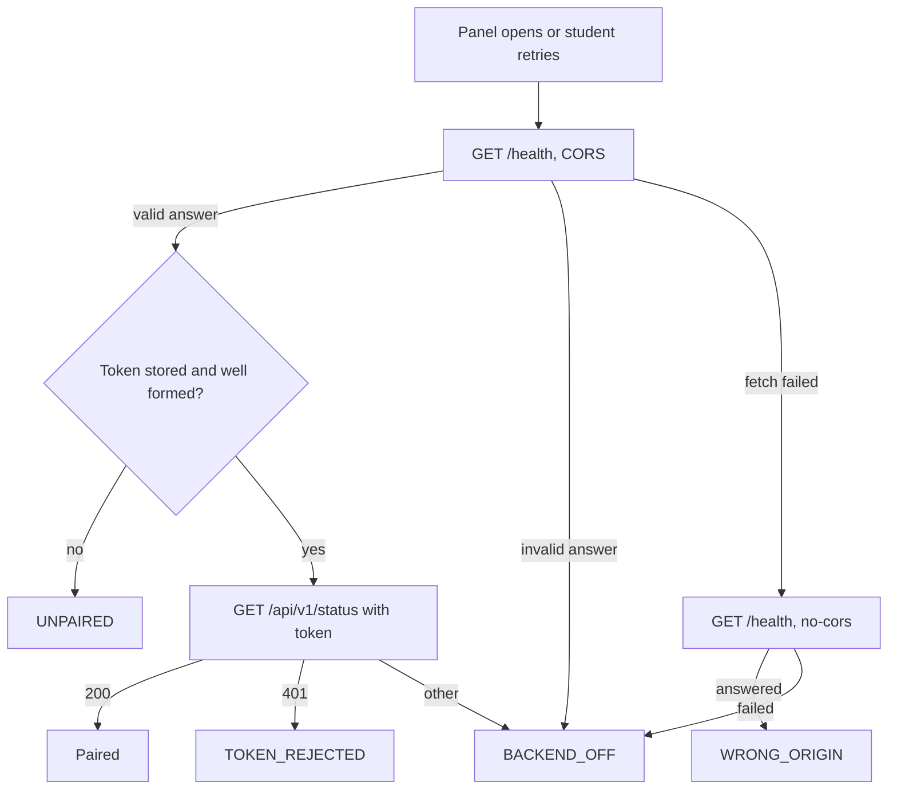

# BE1: Extension client for the local backend

ADR-0010 step 3. Tests: catalog §1.11. Runbook: `docs/runbooks/be1.md`.

## Objective
The side panel knows whether the local backend is usable, says what to do when it isn't, and pairs with it. Later units (OP3, OP12, OP4, OP5) call the backend through this client.

**Metric:** every state below is correct in Google Chrome against the real backend, with real CORS. Done 2026-11-06.

## Out of scope (delta D35)
| Item in the ADR | Moves to | Why |
|---|---|---|
| POST page text, render the result | OP4 and the OP5 stub | Nothing produces page text or drafts yet. An endpoint now would have no caller |
| OP5V HTTP endpoint | OP5 stub | Same |
| API keys move to the backend (rule 2) | OP5 | There are no API keys yet |

Also not built: a port setting. The extension knows only port 8765. Add a setting when someone needs another port.

## States
| Code | Meaning | Panel shows |
|---|---|---|
| `BACKEND_OFF` | Nothing, or another program, answers on 8765 | How to start it, retry |
| `WRONG_ORIGIN` | The backend runs but does not allow this extension's id | The exact `BIOVIDGEN_EXTENSION_IDS=<id>` to set, retry |
| `UNPAIRED` | No token stored | Where to find the token, field |
| `TOKEN_REJECTED` | The backend answered 401 | Field and error |
| `BAD_TOKEN_FORMAT` | Typed input is not 64 lowercase hex characters. Nothing is sent | Field and error |
| (ok) | Paired | "Conectado" |

## Logic

**Why the no-cors probe.** When the backend refuses an Origin, the browser reports the same failure as a closed port. Without the probe, the most likely setup mistake reads as "not running". A no-cors GET carries no Origin, so a running backend answers it. The response is opaque, and only the fact of an answer is used. It is sent without the token.

**Why `/health` comes first.** Another program on 8765 fails the schema check and never receives the token.

**Storing.** A token is stored only after the backend accepts it, so a typo cannot replace a working one.

## Security
- **Egress (rule 1):** one new host, `127.0.0.1:8765`, plain http. No new permission: `storage` was already approved, and the S2 spike showed extension pages reach loopback with no host permission. The manifest snapshot (SYS-SEC-22) does not change.
- **Token (rule 2):** kept in `chrome.storage.local`. It is sent only as `X-BVG-Token`, to the API path. It is never returned, logged or left in the page.
- **When it runs:** only when the panel opens or the student retries. Browsing with the panel closed sends nothing (SYS-SEC-03).
- **What is sent:** two fixed GET addresses with nothing about the page (BE1-SEC-03).

## Known limits
- **The student pastes a code from a file.** Acceptable while only developers run this with `uv run`. Packaging (step 5) must replace it.
- **The extension id.** An unpacked id depends on the folder path, so each developer sets `BIOVIDGEN_EXTENSION_IDS`. A store build has one fixed id, which the packaged backend should allow by default (step 5).
- **No recheck on its own.** If the backend stops while the panel is open, the panel notices on the next call or retry.
