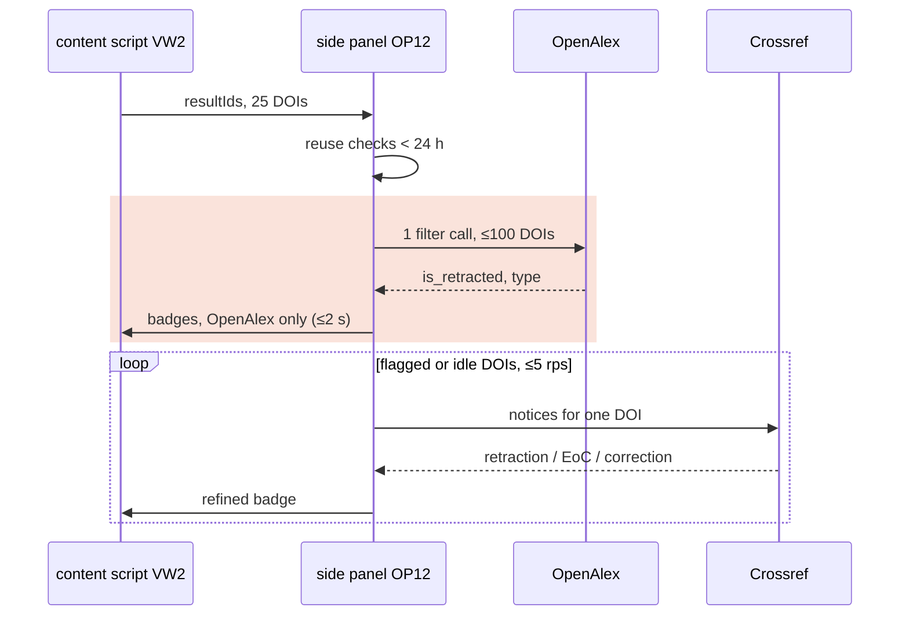

# OP12 · Check status (preprint / retraction / expression of concern) — Type: Search/Retrieve (batch lookup) + Classify (decision table) · Class: DETERMINISTIC · Service: SVC2 `scholarly`

Phase P0 (single article, OpenAlex + Crossref) → P1 (lists, batching, budget) · Depends on OP3, spikes S3 (exact queries) and S6 (Citicious reference, ADR-0009). Highest-severity op in the map (RPN 189).

## 1. Objective & metrics
- Objective: **maximise retraction recall subject to precision ≥98%, wording that never asserts "not retracted", list p95 ≤2 s (25 results, warm) and ≤$0 user cost (within OpenAlex free budget)**. Serves H-C1/H-D1 (instructor value) and appraisal accuracy.
- Formulation: input = 1 DOI (panel) or ≤100 DOIs (list page). Output = `StatusCheck` per DOI. n per call ≤100; calls per user/day ≤ ~50 list pages (ASSUMPTION). OpenAlex list+filter = $0.10 per 1,000 calls, keyless budget $0.10/day ≈ 1,000 filter calls; free key $1/day (🟢 register).

| Metric | Formula | Unit | Target | Instrument | Alert |
|---|---|---|---|---|---|
| retraction_recall | flagged retraction / known retracted in sample | % | ≥95 | weekly CI on refreshed Retraction Watch sample | <95 |
| retraction_precision | true retraction / flagged retraction | % | ≥98 | same with clean sample | <98 |
| eoc_separation | EoC labelled EoC (not retraction) / known EoC | % | ≥95 | same | <90 |
| preprint_recall / precision | on preprint + CSHL-journal sample | % | ≥95 / ≥98 | fixture set | <90 / <95 |
| badge_p95 | list annotate time (OpenAlex pass) | s | ≤2 (25 results warm) | Playwright perf | >2 |
| budget_used | OpenAlex filter calls today × $0.0001 | $ | ≤ 80% of daily budget | `chrome.storage.local` counter | ≥90% → degrade |

## 2. Hypothesis tests
| Hypothesis | Falsifier | Data | Protocol | Threshold | If false → |
|---|---|---|---|---|---|
| H1 Input: OpenAlex `is_retracted` alone reaches ≥90% recall on RW retractions in health sciences | <90% | 300 retracted DOIs (Retraction Watch CSV via Crossref GitLab, biomedical, 2010–2026) + 300 clean | S3 spike | ≥90% | Crossref becomes mandatory on lists too (slower, progressive) |
| H2 Method: OpenAlex ∨ Crossref (updates incl. retraction-watch source) ≥95% recall, ≥98% precision | below | same | S3 | ≥95/≥98 | add offline RW CSV (companion, ADR-0006 revisit) |
| H3 Crossref query that answers "updates to DOI X" exists and returns `update-to.type` + `source` | not available | 20 known DOIs | S3: test `GET /works?filter=updates:{doi}` and `/works/{doi}` `updated-by` [verify both] | works for ≥19/20 | fall back to `relation` fields; document |
| H4 Preprint rule with patterned prefixes beats plain prefix list (CSHL journals share 10.1101) | patterned precision ≤ prefix-only | 100 bioRxiv/medRxiv + 50 Genome Research/Genes & Dev DOIs | fixtures | patterned precision ≥98% | refine patterns |
| H5 Problem: ≥1% of DOIs on typical health-science result pages carry a flag | <0.1% | 50 PubMed searches from course topics `[specify]` | count | ≥1% | badges still shown; reconsider list feature priority (VW2) |

## 3. Security tests
- Identity: side panel (calls) + content script (renders badges via `detect.renderBadges`). Grants: C/R StatusCheck; outbound only to OpenAlex/Crossref.
- Tests: (1) outbound payload = DOIs + key/mailto only. (2) Badge rendering uses DOM APIs with `textContent`, no `innerHTML`; badge root is a shadow DOM with closed mode so page CSS/JS cannot restyle it into "clean" — test that page script cannot read badge text via `querySelector` (closed shadow). (3) Wording invariant: no string resource or code path produces "no retractado"/"not retracted" (grep test over `_locales` + snapshot of every StatusCheck rendering). (4) Budget counter cannot be reset by page context (stored in `chrome.storage.local`). (5) Malformed upstream JSON → `UPSTREAM_INVALID`, previous StatusCheck kept, badge shows "?".

## 4. Unit tests
- Decision table (exhaustive table tests, every row):
  | OpenAlex is_retracted | Crossref notices (types, latest date) | → retractionNature |
  |---|---|---|
  | false | none | none_found |
  | true | none | retraction (sources: openalex) |
  | false | retraction | retraction (sources: crossref[+rw]) |
  | any | expression_of_concern only | expression_of_concern |
  | any | correction only | correction (not a retraction; shown as info) |
  | any | retraction then reinstatement (later) | reinstatement |
  | true | reinstatement later | reinstatement (log `SOURCE_CONFLICT`) |
  | any | retraction + EoC | retraction (precedence retraction > EoC > correction) |
- Preprint: `type==="preprint"` → true; `crossrefType==="posted-content"` → true; DOI matches pattern list (`^10\.1101/(\d{4}\.\d{2}\.\d{2}\.)?\d{6,}(v\d+)?$`, `^10\.48550/arxiv\.`, `^10\.21203/rs\.`, `^10\.2139/ssrn\.`, `^10\.20944/preprints`, `^10\.1590/scielopreprints\.` — ⚠️ verify in S3) → true; `10.1101/gr.123` → false.
- `publishedVersionDoi` from Crossref `relation.is-preprint-of[0].id` or OpenAlex version info [verify S3].
- Wording function (property): for every nature value and source list, `statusText()` never contains forbidden phrases; `none_found` text includes every source name and the date.
- Batch: 250 DOIs → 3 OpenAlex calls (100/100/50); duplicates removed; order of output matches input.
- Cache: list path uses StatusCheck <24 h; panel path always re-checks (map: re-check on display) but renders cached immediately with "comprobando…".
- Budget: at 90% used → list path switches to single free lookups for ≤10 visible items, others badge "sin comprobar"; at day rollover (UTC) counter resets.
- Idempotency: same DOIs same day → no new calls (cache); append-only history keeps ≤5 per DOI.

## 5. Type tests
```ts
type RetractionNature = "none_found" | "retraction" | "expression_of_concern" | "correction" | "reinstatement";
interface StatusCheck {           // StatusCheckSchema v1
  doi_norm: string; checkedAt: string;
  retractionNature: RetractionNature;            // no "not_retracted" member, by design
  isPreprint: boolean; publishedVersionDoi: string | null;
  notices: { type: RetractionNature; date: string | null; source: "publisher" | "retraction-watch" | "openalex"; noticeDoi: string | null }[];
  sources: { name: "openalex" | "crossref"; retrievedAt: string; ok: boolean }[];   // ok=false → that source failed this time
  completeness: "both_sources" | "openalex_only" | "crossref_only";
  schemaVersion: 1;
}
checkStatus(dois: string[], mode: "panel" | "list"): Promise<Map<string, Result<StatusCheck, "UPSTREAM_DOWN"|"BUDGET_EXCEEDED"|"UPSTREAM_INVALID">>>
```
- `completeness` keeps "Crossref not asked/failed" distinct from "Crossref asked, nothing found". VW1 wording uses only the sources with `ok=true`.
- Contract tests: consumer VW1/VW2 snapshot per nature; consumer OP13 requires a status line → schema guarantees non-empty `sources`.

## 6. Value tests
| Consumer | Decision | Value metric | Baseline | Acceptance | Protocol |
|---|---|---|---|---|---|
| VW1 chips | student does not rely on retracted/preprint paper | appraisal task: % students who notice flagged paper | without tool (pilot) | ≥ +30 pp `[specify with physician]` | P4 pilot task |
| VW2 list | student skips flagged results | flagged results opened | — | measured (no target in P1) | pilot observation |
| Instructor (H-C1) | recommends tool | instructors committing | 0 | ≥2 | demo |
Cost/unit ≈ $0.0001 per list page; value positive if recall target holds.

## 7. Performance tests
| Scenario | Load | Target | Measured | Fails when |
|---|---|---|---|---|
| PubMed page, 25 results, warm cache | 1 page | p95 ≤2 s (OpenAlex pass) | [pending] | >2 s |
| Same, cold | 1 page | p95 ≤3 s | [pending] | >4 s |
| 200 results (Europe PMC max page) | 1 page | ≤3 OpenAlex calls; ≤4 s | [pending] | >4 calls |
| Panel single DOI, both sources | 1 | p95 ≤1.5 s | [pending] | >3 s |
| Daily budget | 50 list pages/day | ≤ $0.005 | [pending] | > $0.05 |

## 8. Spec & logic
| Candidate | Time | Calls per 25-item page | Quality | Fit |
|---|---|---|---|---|
| **OpenAlex batch filter (≤100 DOIs/call) for lists + Crossref per DOI for panel and for list items OpenAlex flags or when idle** | O(n) | 1 + k | recall per H1/H2 | **chosen** |
| Crossref per DOI for every list item | O(n) | 25 | best | too slow for 2 s; used progressively only |
| Offline Retraction Watch CSV in IndexedDB | O(1) lookup, ~60k rows | 0 | high, daily lag | needs download + licence check ⚠️; reopen if H2 fails |

```text
checkStatus(dois, mode):
  ids = dedupe(normalize(dois))
  fresh = mode=="list" ? db.status_checks.latestMany(ids, maxAge=24h) : {}        # compound index [doi+checkedAt]
  todo = ids − keys(fresh)
  if mode=="list" and budget.wouldExceed(ceil(len(todo)/100)): todo = visibleFirst(todo)[:10]; useSingle = true
  oa = {}
  for chunk in chunks(todo, 100):
      r = useSingle ? map(single OpenAlex lookup, chunk)                 # free
                    : http.get(OA + "/works?filter=doi:" + join(chunk,"|") + "&per-page=100&select=doi,is_retracted,type,ids")
      budget.add(useSingle ? 0 : 1); oa ∪= index r by doi
  emit StatusChecked(partial) for each doi from oa                      # badges paint now (≤2 s)
  crTargets = mode=="panel" ? todo : [d in todo if oa[d].is_retracted or preprintCandidate(d)] + idleQueue(rest)
  for d in crTargets (limiter ≤5 rps): cr[d] = crossrefNotices(d)        # exact query from S3
  for d in todo: sc = decide(oa[d], cr[d]); db.status_checks.add(sc); trimHistory(d, 5); emit StatusChecked(sc)
  return merge(fresh, computed)

decide(oa, cr): notices = normalizeNotices(cr) ∪ (oa.is_retracted ? [{type:"retraction", source:"openalex"}] : [])
                nature = precedence(notices, byDate)       # table in §4
                isPreprint = oa.type=="preprint" or cr.type=="posted-content" or matchesPreprintPattern(doi)
                return StatusCheck{..., completeness from which sources ok}
```

*Figure — Two-pass list badges (spec delta D5): the highlighted OpenAlex pass is the only part inside the 2 s budget; Crossref refines badges afterwards, one DOI at a time, so per-DOI latency never blocks first paint.*

Access patterns:
| Pattern | Query | Freq | Volume | Latency | Structure | Store |
|---|---|---|---|---|---|---|
| latest by DOI | `where([doi+checkedAt]).between([d,MIN],[d,MAX]).last()` | per panel | ≤5 rows/DOI | ≤20 ms | compound index | IndexedDB `status_checks` |
| latest many | same, `Promise.all` over ≤100 | per list page | ≤100 | ≤100 ms | compound index | same |
| append | `add` | per check | 1 | ≤10 ms | PK | same |
| budget counter | get/set `{date, calls}` | per batch | 1 | ≤5 ms | key-value | `chrome.storage.local` |
Config: `scholarly/preprint-patterns.json` (versioned), `scholarly/status-wording` in `_locales` (reviewed by physician).
Properties: idempotent per (DOI, day) for lists; append-only history; retry via SVC0 (3×, full jitter); Crossref per-host limiter 5 rps (polite, numeric limits not published 🔎); ordering: progressive updates may arrive in any order — VW keyed by DOI, last write wins by `checkedAt`.

## 9. Bottlenecks & trade-offs
- Crossref per-DOI calls dominate list latency → two-pass progressive badges (OpenAlex pass inside 2 s; Crossref refinement after). Gives up: first paint is OpenAlex-only (`completeness: openalex_only`, wording names only OpenAlex).
- Budget: keyless $0.10/day ≈ 1,000 filter calls — ample (ASSUMPTION 50 pages/day ⇒ 50 calls). Single-lookup fallback keeps it $0.
- Precision vs recall: OR across sources favours recall (FN dangerous); precision protected by notice-type parsing and EoC separation.
- Switch point: if H2 recall <95% → add offline RW CSV (requires licence check and companion or IndexedDB import ~10 MB ASSUMPTION).

## 10. Dependencies
| Dependency | Kind | Pinned | Failure behaviour | Blocks |
|---|---|---|---|---|
| OpenAlex filter + single lookup | external | fixtures; field list | timeout 5 s, retry; badges "?"; panel shows "no se pudo comprobar" | 5 |
| Crossref notices query | external | S3 result | OpenAlex-only + wording | 5 |
| Retraction Watch sample (Crossref GitLab CSV) | test data | snapshot date | — | 1 |
| Citicious (reference only) | code reading | commit hash | — | 1 |
| OP3 Article.type | operation | ArticleSchema v1 | missing → pattern-only preprint rule | — |
| SVC1 renderBadges | service | message v1 | — | 7 |

| # | Task | Depends | Estimate | Done when |
|---|---|---|---|---|
| 1 | S3 + S6: build samples (300 retracted, 300 clean, 100 EoC, 150 preprint/CSHL), test queries, read Citicious | — | 2 d | H1–H4 numbers recorded; ADR-0009 updated |
| 2 | Decision-table, wording, preprint, batch, budget tests — red | 1 | 1 d | failing |
| 3 | Security tests (closed shadow DOM, wording grep, payload) — red | — | 0.5 d | failing |
| 4 | Perf harness (PubMed fixture page + recorded responses) — red | 1 | 0.5 d | runs |
| 5 | Implement panel path (P0): OpenAlex single + Crossref, decide, store | 2 | 1.5 d | P0 tests green |
| 6 | Physician review of Spanish wording strings | 5 | 0.5 d (expert) | approved in `_locales` |
| 7 | List path (P1): batching, budget, progressive emit, idle Crossref queue | 5 | 1.5–2 d | perf + budget tests green |
| 8 | Weekly CI job refreshing RW sample and asserting recall/precision | 1 | 0.5 d | job green |
| 9 | Rollout: P0 team shadow (panel) → P1 flags-only cohort build | 7, 8 | — | recall ≥95%, precision ≥98%, badge p95 ≤2 s |
