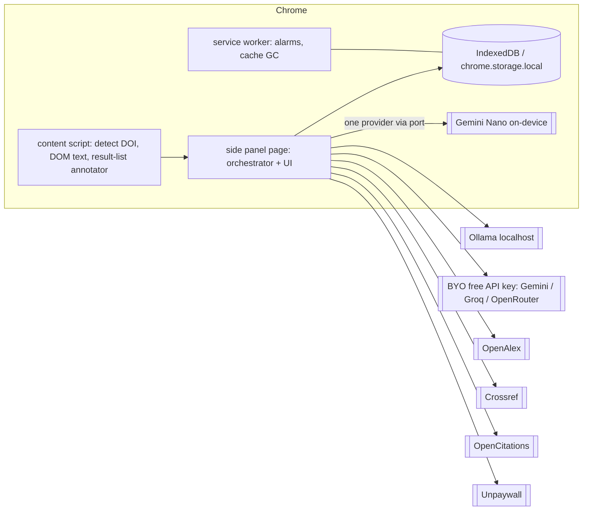

# BioVidGen — Technical Specification v2 (local-first Chrome extension)

Supersedes the product-side scope of [tech-spec.md](tech-spec.md). Inputs: [process-map.md](process-map.md), [dependency-register.md](dependency-register.md) (all prices/licences/versions there were checked 2026-10-08; `⚠️` = not checked), and your latest requirements.
Notation: `[specify]` unknown · `ASSUMPTION:` my inference.

## 0. What changed (map deltas)

| Item | v1 said | v2 decides | Reason |
|---|---|---|---|
| Trial & EUBE (OP8 Club tooling, OP9 allocate/measure, OP10 analysis, SVC5 study service, VW5–VW7, VW10, VW11, ADR-0005) | Built | **Dropped from the software.** The journal club can still happen as a human activity; it has no tooling here | Requirement: omit EUBE test. This also removes the whole compliance reason for ADR-0001's isolated study service |
| Deployment | Hosted web app (Postgres, queue, PaaS) | **Open-source, runs on the user's machine; Chrome MV3 extension is the product** | Requirement; $0 hosting; privacy |
| OP2 topic classifier | NLP classifier | **Removed**: OpenAlex already returns `topics`/`primary_topic` and keywords for free per work | Do less; deterministic |
| Summary content | study design, n, statistics, COI, Spanish abstract | **Author, Keywords, Prerequisite topics, Main topic, Methodology, Results, Conclusions, Preprint/Retraction flags** (your list); design/n/statistics kept as structured sub-fields of Methodology | Requirement; a sub-field I kept from the protocol — confirm |
| OP5 + OP6 | separate | merged into one summarize step that outputs Spanish | one call instead of two (matters under free-tier quotas); trade-off in §6 |
| Preprint/retraction | flags on the card | **A filter**: badge + optional hide, also on search-result pages | Requirement |
| OP4 text | PDF/OCR first | **DOM text first** (Readability), pdf.js second, companion third | most journals/PMC serve HTML; avoids OCR |

## 1. Scope

**Goals**: on a Chrome article page (or a search-results page), (1) identify the paper, (2) show authors, keywords, preprint and retraction status with source and check date, (3) produce a Spanish structured summary where every claim links to a verbatim quote from the paper, (4) filter/badge preprints and retracted papers on result lists. Open source (MIT), runs locally, **$0 recurring cost**.
**Non-goals**: no hosted backend or accounts; no EUBE/trial/analytics collection; no telemetry by default; no Firefox/Edge/mobile in v1 (Gemini Nano is Chrome-desktop only); no model training; no claim that a summary is "correct" (UI shows evidence, never a verdict); no Mapa until E4.
**Constraints**: MIT with commercial reuse ⇒ permissive dependencies only; free data/LLM tiers whose limits change without notice; students' laptops are unknown hardware `[specify: target spec]`; team five, two developers.
**Quality targets (proposed)**: evidence-quote validity 100% (shown quotes are verbatim); section-summary agreement with expert ≥80% on the gold set (carried from the protocol gate); flag page time ≤2 s p95 for a 25-result page with warm cache; summary time ≤`[specify]` s on the default provider; **0 bytes of user data sent anywhere except the chosen scholarly APIs and chosen LLM**.

## 2. Architecture options (Type 1: decides repo layout and install story)

| Option | How it works | Upside | Cost | What gets hard |
|---|---|---|---|---|
| **A. Extension-only** | TypeScript MV3 extension; scholarly APIs called directly; LLM = Chrome Gemini Nano, or Ollama on localhost, or user's free API key | One install (store or load-unpacked); no server; works offline for Nano | Single codebase (TS) | Small context windows; PDF-only papers; browser sandbox limits (service-worker lifetime, CORS, localhost access) |
| **B. Extension + local Python companion** | A plus FastAPI/SQLite on 127.0.0.1 for PDF parsing, offline retraction DB, caching, heavy NLP | Better PDFs, bigger local pipelines | Two runtimes, install friction for non-technical students | Packaging, port/CORS/auth to localhost, updates |
| **C. Hosted service** | Server + extension client | Easiest for users | Hosting + LLM bill, privacy/legal exposure | Contradicts "runnable locally, free" |

**Recommendation: A first, B only as an optional add-on when measured need appears.** Rationale: install friction is the biggest adoption risk for students; DOM text covers most pages; everything in the protocol's KPI path (summary, flags) works in A. Keep B reversible by hiding the PDF and cache work behind a `TextProvider` port (extension implementation now, companion later) — adding it later is additive, not a rewrite. *Revisit when*: >`[specify]`% of target papers are PDF-only and pdf.js text is unusable; or the offline retraction file is wanted; or Nano/Ollama prove too weak without server-side orchestration. Python stays in the repo for the **evaluation harness and DSPy prompt optimization (dev-time)**, not at runtime (ADR-0003 option C).

The orchestrator runs in the **side panel page** (an extension page stays alive while open), not the MV3 service worker, whose idle shutdown would kill long LLM calls `[verify in spike]`.

## 3. Operations (renumbered from the map, kept IDs where possible)

| ID | Operation | Class | Where it runs | Phase |
|---|---|---|---|---|
| OP1 | Detect paper & intake (DOI/PMID from `citation_*`/JSON-LD meta, URL patterns, selected text) | DETERMINISTIC | content script | E0 |
| OP3 | Resolve & enrich: authors, keywords, topics, type, OA, venue | DETERMINISTIC | side panel → OpenAlex (single lookup by DOI: free) + Crossref | E0 |
| OP12 | **Preprint & retraction filter** (single paper + list-page annotator) — new | DETERMINISTIC | content script + side panel | E0 |
| OP4 | Acquire text: Readability (DOM clone) → Europe PMC/Unpaywall OA link → pdf.js → abstract-only | DETERMINISTIC (+NLP heuristics) | content script / side panel | E1 |
| OP4b | Section segmentation (Abstract/Intro/Methods/Results/Discussion/Conclusion by headings) | DETERMINISTIC | side panel | E1 |
| OP5 | **Summarize** → Spanish structured summary with evidence quotes (merges old OP6) | LLM + deterministic validator | side panel → provider port | E2 |
| OP7 | Mapa citation graph (OpenCitations + OpenAlex `referenced_works`) | DETERMINISTIC | side panel | E4 (optional) |
| OP11 | Gold set & expert audit (dev-time) | HUMAN | `eval/` + annotation spreadsheet | E1 |
| — | Feedback ("this is wrong") stored locally, exportable | DETERMINISTIC | side panel | E2 |

Removed: OP2, OP8, OP9, OP10.

## 4. Data model (local)

No database server. `IndexedDB` (via a small wrapper; Dexie is MIT ⚠️) for caches/history; `chrome.storage.local` for settings; user can export/import JSON; "clear all" button.

| Entity | Key | Fields (constraints) | Retention |
|---|---|---|---|
| Article | normalized DOI (fallback OpenAlex ID / URL hash) | title, **authors[]** (OpenAlex), **keywords[]** (page meta ∪ OpenAlex keywords/topics, tagged with source), journal, year, `type`, `is_preprint`, `published_version_doi?`, `is_retracted`, `retraction_nature` (retraction / expression of concern / correction), `flags_checked_at`, `flags_sources[]`, `oa_url?` | cache TTL 24 h for flags (re-check on display), 30 days metadata |
| ArticleText | article key + hash | `source` {dom, oa_html, pdfjs, abstract_only}, `sections{name→text}`, `language` | session only by default (copyright); user can pin |
| Summary | (article key, pipeline_version) | `authors`, `keywords` (copied, deterministic), `prerequisite_topics[]` (LLM, labelled **"model background knowledge, not from the paper"**), `main_topic`, `methodology{summary_es, study_design?, sample_size?, statistics?, evidence[]}`, `results{summary_es, evidence[]}`, `conclusions{summary_es, evidence[]}`, `validator{per-section status}`, `provider`, `model_id`, `prompt_hash` | until cleared |
| Feedback | auto | summary id, section, user note, timestamp | local; export-only |
| Settings | — | provider choice, API keys (stored locally, never synced), OpenAlex key & contact email, filter mode (badge / hide preprints / hide retracted) | — |

`evidence[] = {quote_en, section, start, end}`: **the quote is in the paper's language and must be a substring** of `ArticleText.sections[section]` after whitespace/hyphenation normalization. Sections whose evidence fails validation are shown as "no verificado" (greyed, with the model text hidden behind a click). Honest limit: the validator proves the quote exists; it does **not** prove the Spanish sentence follows from the quote. Mitigation: numbers in `summary_es` must appear in an evidence quote; UI shows quote beside claim; gold-set agreement measures the rest.

## 5. Views

| View | Where | Purpose | Actions |
|---|---|---|---|
| VW-A Paper panel (side panel) | any article page | Header: authors, keywords, **status chips** (Preprint / Retraction / Expression of concern, with source + "checked <date>"); sections: Temas necesarios, Tema principal, Metodología, Resultados, Conclusiones, each with expandable evidence quotes | summarize, change provider, mark wrong, copy/export Markdown |
| VW-B Result-list annotator | PubMed / Europe PMC / Google Scholar / publisher TOCs (match patterns in manifest; start with PubMed + Europe PMC) | Small badges next to each DOI/PMID; toggle "hide preprints", "hide retracted"; counts | filter mode, open panel |
| VW-C Options page | extension | provider setup (Nano availability check, Ollama URL, API key), OpenAlex key + email, privacy statement, clear data | — |
| VW-D Mapa (E4) | side panel tab | citation neighbourhood with flag badges | open node |
| VW-E Eval report (dev) | `eval/` HTML | per-field agreement, quote validity, cost, latency | — |

Accessibility: keyboard focus order, contrast, ARIA labels (WCAG 2.1 AA target); UI strings in es-MX with i18n files from day one (`_locales/`).

## 6. Method infrastructure & per-operation stack

### 6.1 Stack (all $0, all permissive)

| Layer | Choice | Alternatives rejected | Note |
|---|---|---|---|
| Extension framework | **WXT (MIT)** + TypeScript, Preact or React for UI | Plasmo (maintenance concerns 🔎), raw Vite | Manifest V3, side panel API |
| Content extraction | **Mozilla Readability (Apache-2.0)** on a cloned DOM + DOMPurify | server-side scraping | clone the document: `parse()` mutates the DOM |
| PDF in browser | **pdf.js (Apache-2.0)** | PyMuPDF (AGPL ❌) | scanned PDFs: unsupported in v1 → abstract-only |
| HTTP | `fetch` + small retry/backoff/jitter and per-host rate limiter | libraries | cache in IndexedDB |
| Validation | Zod schemas for provider output and API responses | hand parsing | |
| Local state | IndexedDB / `chrome.storage.local` | server DB | |
| Tests | Vitest, Playwright (extension e2e), recorded API fixtures | — | CI on GitHub Actions free tier ⚠️ |
| Dev-time eval/optimization | Python: `eval/` runner, **DSPy 3.4.0 (MIT)** optional | runtime DSPy | frozen prompts exported to `extension/src/prompts/*.txt` |
| Companion (optional, E3+) | Python 3.12, FastAPI (MIT), SQLite, pypdfium2 / pdfminer.six, optional Tesseract / Docling | GROBID by default (image size 🔎) | only if needed |
| Release | GitHub releases (zip for load-unpacked) + optional Chrome Web Store ($5) | — | |

### 6.2 Per-operation: what is needed

| Op | Needed | Acceptance |
|---|---|---|
| OP1 | meta-tag parsers (`citation_doi`, `dc.identifier`, JSON-LD `ScholarlyArticle`), DOI/PMID regex + normalization, per-site selectors (small config file) | fixtures from ≥10 publishers incl. PMC, Europe PMC, bioRxiv/medRxiv, Elsevier, Springer, Wiley, MDPI `[specify list]`; false-detect rate on non-article pages |
| OP3 | OpenAlex `GET /works/doi:{doi}` (single lookup = free, unlimited); Crossref work; cache; user's OpenAlex key + `mailto` optional | field coverage report (authors/keywords present %), outage → cached/stale label |
| OP12 | **Preprint rule** = OpenAlex `type` preprint ∨ Crossref `posted-content` ∨ known preprint DOI prefixes (bioRxiv/medRxiv 10.1101, arXiv 10.48550, Research Square 10.21203, SSRN 10.2139 ⚠️ confirm) + link to published version when present. **Retraction rule** = OpenAlex `is_retracted` ∨ Crossref retraction update (`update-to` source `retraction-watch`/`publisher`) ; show *Expression of concern* separately; wording: "no retraction found in <sources> on <date>" — **never "not retracted"**. List pages: batch ≤100 DOIs per OpenAlex filter call (list+filter $0.10/1,000 calls) or free single lookups; keyless budget is $0.10/day ≈ 1,000 filter calls | recall on a known-retracted DOI sample (Retraction Watch CSV), precision on a known-clean sample; ≤2 s p95 per page warm |
| OP4 / OP4b | Readability, heading-based segmenter with Spanish/English headings, fallbacks, language detect | section-boundary accuracy on 30-paper sample; % pages with usable text; abstract-only is explicit |
| OP5 | provider port (§6.3), prompt per section (map-reduce so each call fits small contexts), JSON schema output, quote validator, Spanish output | gold-set agreement ≥80%; quote validity 100%; injection fixtures (page text saying "ignore instructions") |
| OP7 | OpenCitations (180 req/min/IP) + OpenAlex references, node cap, Cytoscape.js (MIT ⚠️) | render ≤2 s at cap |
| OP11 | annotation sheet + `eval/` runner, two annotators, κ measured | gold set ≥`[specify]` articles |

### 6.3 LLM strategy (free first)

**Provider port** `Summarizer.summarizeSection(section, text, schema) → JSON` with adapters; chosen per user at runtime:
1. **Chrome Gemini Nano** (on-device, $0): needs ≥22 GB free, >4 GB VRAM *or* 16 GB RAM + 4 cores, desktop Chrome, extension must acknowledge Google's prohibited-uses policy. Zero setup after one model download. Unknown: context size, Spanish scientific quality → measure in spike.
2. **Ollama** at `localhost:11434` ($0, your hardware): model chosen per its card licence; student laptops without GPU may be too slow ⚠️ unmeasured.
3. **BYO free API key** (Gemini Flash-class, Groq, OpenRouter `:free`): $0 inside quotas that change without notice; quotas of ≈100–1,500 requests/day (sources disagree) ⇒ at 4 calls per paper ≈ 25–375 papers/day. Papers are public, but **warn that free-tier Gemini inputs may be used to improve Google products**; never send user-uploaded unpublished manuscripts to a free-tier provider.
Default order in the UI: Nano if `availability()` is ready → Ollama if reachable → "add a free API key".

**Map-reduce prompts** (design driver: small context windows): call 1 abstract+intro → `main_topic`, `prerequisite_topics`; call 2 Methods → `methodology`; call 3 Results; call 4 Discussion/Conclusion; no final merge call. Each returns `{summary_es, evidence[]}`.

**DSPy vs plain (updated ADR-0003)**: runtime = plain prompts + Zod schema + validator in TypeScript. DSPy (MIT) runs **offline in `eval/`** to search prompts against the gold set; the winning prompt is exported as text and reviewed by the QFB/physician. Adopt only when ≥`[specify: ~100]` gold sections exist and manual iteration plateaus.

**Laya evaluation** (from the Flowtivity post you shared; one source, 🔎): Laya is a *decision* model (choice / score / yes-no), not a summarizer; context 512–1024 tokens; zero-shot accuracy 0.362 is below the 0.461 majority baseline and it needs fine-tuning on your own labels plus calibration; CPU-only latency reported ≈49 s (T4 GPU 32.8 ms); released 2026-09-18, so very young; runs in Python/GPU, which conflicts with extension-first. **Verdict**: not in v1. Possible later use as a *local classifier* for narrow decisions where we will have labelled data (e.g. "is this page a research article?", "study design" choice among ≤20 options) — but rules and OpenAlex metadata already cover both at zero cost. Revisit if we accumulate ≥`[specify]` labelled corrections and a companion exists; the `laya-multilingual` checkpoint (322M, 100+ languages) would be the candidate.

## 7. Cross-cutting

- **Privacy** (the product's main promise): no analytics, no remote logging; only calls = scholarly APIs (DOI/title only) + chosen LLM (article section text). Show a "what leaves your computer" table in options. Keys stored in `chrome.storage.local` (not `sync`). Host permissions requested minimally; optional host permissions for result-list sites.
- **Security**: page text is hostile input: content script returns text only; side panel renders model output as text (no `innerHTML`); strict CSP; DOMPurify for any extracted HTML; no remote code; dependency lockfile, `npm audit`/`pip-audit`, licence scan in CI (fail on AGPL/GPL), secret scan; no API keys in the repo.
- **Reliability**: backoff + jitter, per-host limiters (OpenAlex ≤100 req/s hard cap; OpenCitations 180/min; Unpaywall ≤100k/day), cache first, degrade matrix: scholarly API down → cached/stale label; LLM down → metadata + flags only; no text → abstract-only; quote validation fails → "no verificado".
- **Observability (local)**: debug panel with last N operations, timings, provider, token counts, error codes; "copy diagnostics" for bug reports (no article text unless the user opts in). Dev eval dashboard in `eval/`.
- **Config/flags**: provider, filter mode, enabled sites; feature flags in code constants for E4.
- **i18n/a11y**: es-MX primary, en secondary; summaries in Spanish; evidence quotes in original language.

## 8. Risks

| Risk | Impact | Likelihood | Mitigation | Phase |
|---|---|---|---|---|
| Free LLM tiers/limits change or vanish | Summary feature breaks | High | Port + three provider paths; nothing hard-coded; Nano/Ollama independent of vendors | E2 |
| Gemini Nano too small/weak in Spanish | Poor summaries | Med–High | Spike measures on gold set before committing; map-reduce per section; fall back to BYO key | E0 |
| Students' hardware cannot run Nano/Ollama | Feature unavailable offline | Med–High | Requirements shown in options; BYO key path | E2 |
| Extension→localhost blocked/prompted by Chrome LNA, Ollama origin rejection | Ollama path unusable | Med | Spike; documented `OLLAMA_ORIGINS` setting | E0 |
| Over-trust in summaries | Wrong appraisal | High | evidence-first UI, "no verificado" state, no score, caveat text; mark prerequisite topics as background knowledge | E2 |
| Retraction missed (data lag) | Trust in retracted work | Med | two sources, check date, careful wording, expression-of-concern shown | E0 |
| Per-site DOM breakage | Detection/extraction fails | High (ongoing) | per-site selectors in config + fixtures; generic meta-tag first | all |
| MV3 service-worker lifetime kills calls | Summaries fail midway | Med | orchestrate in side panel page; retry | E0 |
| Licence contamination (AGPL/GPL) | Breaks MIT promise | Med | CI licence gate; register | E0 |
| Copyright on article text | Legal | Low–Med | text kept in session, not redistributed, not stored by default | E1 |
| Chrome Web Store review / policy (AI usage, permissions) | Delay | Med | load-unpacked path always available; minimal permissions | E5 |
| Two-dev bus factor, scope creep (Mapa, companion) | Slip | Med | Non-goals, ADRs, E4+ optional | all |

## 9. Implementation plan (estimates are ranges for 2 devs, low confidence, no velocity data)

| Phase | Goal | Units | Exit criteria | Estimate |
|---|---|---|---|---|
| **E0 Spikes + flags MVP** | Prove risky assumptions and ship the cheap high-value feature | spikes S1–S5 (below), OP1, OP3, OP12, VW-A header, VW-B on PubMed, WXT skeleton, CI (licence/secret/lint) | Loads unpacked in Chrome; badges correct on a 100-DOI sample (recall/precision measured vs Retraction Watch CSV); all spike answers written to ADR-0006/0007 | 3–5 wks |
| **E1 Text & gold set** | Text acquisition + annotation | OP4, OP4b, OP11, `eval/` skeleton | usable-text % and section accuracy reported; gold set double-annotated κ ≥ `[specify]` | 4–6 wks (parallel annotation) |
| **E2 Summaries** | Spanish structured summary with evidence | OP5 + validator, provider adapters (Nano, Ollama, BYO key), feedback, VW-A full, VW-C | gold-set agreement ≥80% (gate), quote validity 100%, injection fixtures pass, p95 summary time within target on the default provider | 5–8 wks |
| **E3 Prompt optimization (optional)** | DSPy offline vs manual | `eval/` + DSPy | measured gain ≥ `[specify]` pp at same or lower token cost, else drop | 1–3 wks |
| **E4 Mapa / companion (optional)** | Citation graph; PDF companion | OP7, VW-D; or companion | only if triggered by §2 revisit signals | 4–6 wks each |
| **E5 Hardening & release** | Store submission, docs, privacy page, a11y audit | all | axe clean, docs allow a student to install in ≤15 min `[specify]`, release zip + (optional) store listing | 2–4 wks |

**Spikes (E0, ~1 week total)**: S1 Nano `availability()`, context limit, Spanish quality on 10 abstracts; S2 extension fetch to `localhost` (LNA) and Ollama origins; S3 exact Crossref + OpenAlex retraction/preprint queries on known samples; S4 side-panel-vs-service-worker call lifetime; S5 free-tier quota reality for Gemini/Groq/OpenRouter (read live consoles).

**Critical path**: S1/S5 (LLM feasibility) → gold set (E1, human time) → E2 gate. The flags MVP (E0) is independent and already delivers value.

**Not doing**: hosted backend, accounts, telemetry, Firefox/Edge, OCR, GROBID/Docling by default, runtime DSPy/LiteLLM, vector DB, auto-selection of papers, any participant-data handling.

**Definition of done (any unit)**: tests + fixtures pass; privacy table unchanged or updated; strings in `_locales`; a11y check; licence scan green; ADR updated if a decision changed.

## 10. Traceability

| Requirement | Ops | Views | Test | Metric |
|---|---|---|---|---|
| Author, Keywords | OP3 | VW-A | field-coverage fixtures | % articles with authors/keywords |
| Temas necesarios / Tema principal | OP5 | VW-A | gold set (prerequisites flagged unverified by design) | agreement on main topic |
| Metodología / Resultados / Conclusiones | OP4b, OP5 | VW-A | gold set + quote validator | agreement ≥80%, quote validity 100% |
| Preprint & retraction filter | OP12 | VW-A, VW-B | known-retracted/preprint sets | recall, precision, p95 latency |
| Chrome extension, local, free | all | VW-C | install test; $0 bill check | install time; recurring cost = $0 |
| Open source MIT | repo | — | CI licence gate | 0 AGPL/GPL |

Orphans: OP7 (Mapa) has no requirement in your list → optional; "Club" has no software requirement.

## 11. Open questions
1. Keep design/sample size/statistics as sub-fields of Methodology, or only the five prose sections you listed?
2. Which result-list sites matter first (PubMed, Europe PMC, Google Scholar, publisher sites)?
3. Target student hardware (RAM/GPU/OS) — decides whether Nano/Ollama are realistic defaults.
4. Is "filtro" a hide/show toggle, a badge, or both? (assumed both)
5. Should Wave/trial work continue separately (a different repo) since it is no longer part of this software?
6. Any institutional preference for one free LLM provider, or constraints on sending article text to third parties?
7. Who is the Chrome Web Store account owner ($5), and is store publication needed or is load-unpacked enough?
