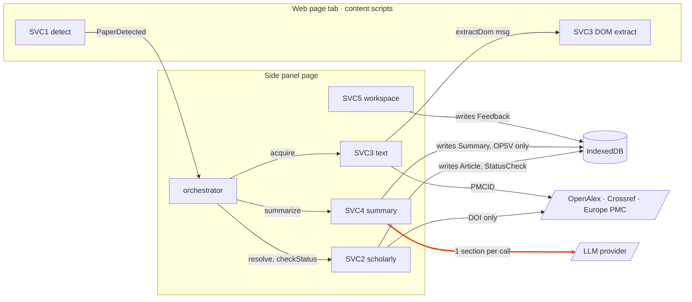

# BioVidGen — Technical Specification v3

Date: 2026-11-05 · Stage 2 of the process-mapper pipeline · Status: Proposed
Source process spec: [docs/discovery/spec.yaml](../discovery/spec.yaml) (narrative: [discovery-process-map.md](../discovery/discovery-process-map.md)).
Supersedes: [tech-spec-v2-local-extension.md](tech-spec-v2-local-extension.md) for scope, decomposition, interfaces, views, plan. **Still valid from v2 and not repeated here**: §6.1 stack table, §6.3 provider strategy and Laya evaluation, §7 privacy statement. Licences/prices: [dependency-register.md](dependency-register.md).
Machine-readable: [system-spec-v3.yaml](system-spec-v3.yaml). New ADRs: [0008](../adr/0008-concierge-first-gate-before-llm-build.md), [0009](../adr/0009-status-check-build-own-with-reference-implementation.md).
Notation: `[specify: …]` unknown · `ASSUMPTION:` inference · estimates are ranges for two developers with no velocity data (low confidence).

## What changed from v2

| Item | v2 | v3 | Why |
|---|---|---|---|
| Sequencing | build summariser in E2 after gold set | **concierge first**: experts write 10 evidence summaries; blind test vs free ChatGPT (H-V2) gates LLM work (ADR-0008) | discovery amber flag: differentiation unproven |
| OP5 | LLM + validator in one op | **OP5 (LLM) + OP5V (deterministic)**; OP5V is the only writer of `Summary` | one op was mixing classes; makes the 100% validity guarantee structural |
| OP4b | separate | folded into OP4 | same class, owner, data |
| OP13 export | absent | added (top RICE 420) | Conclude stage OS 12 |
| OP12 | build | build own, Citicious as reference only after licence check (ADR-0009) | small op, our wording invariants differ |
| Views | VW-A…VW-E | VW1…VW7, incl. annotation work queue for OP11 | every HUMAN op needs a view |
| Pilot metrics | implicit | measured by pilot protocol + opt-in export; no telemetry | privacy promise |

---

## 1 Scope

**Goals** (from objective + KPIs)
1. On a Chrome article page: identify the paper; show authors, keywords and status (preprint / retraction / expression of concern) with sources and check date.
2. Produce a Spanish structured summary (main topic, prerequisite topics, methodology, results, conclusions) where **every shown claim has a verified verbatim quote** (validity 100%) and expert agreement ≥80%.
3. Badge and filter preprints/retracted papers on result lists (PubMed, Europe PMC first).
4. Export summary + quotes + status to the appraisal sheet.
5. Support the pilot: cut minutes per article ≥30% with non-inferior appraisal accuracy; install ≥40% of an invited cohort; week-4 active ≥40%.

**Non-goals**: hosted backend, accounts, telemetry, analytics; Firefox/Edge/mobile; OCR; Mapa (OP7); any participant/EUBE data; in-product time tracking (pilot measures time by protocol); quality verdicts or scores on papers; model training.

**Constraints**: MIT with commercial reuse → permissive dependencies only (ADR-0004); $0 recurring cost (ADR-0006); free LLM tiers change without notice (ADR-0007); two developers; expert hours limited `[specify: Q8]`; students' hardware unknown `[specify: Q3]`.

**Assumptions**: ASSUMPTION: ≤2 papers/day/user at peak; 4 LLM calls per paper suffice; DOM text is usable on ≥70% of target pages; pilot cohort ≈500.

## 2 Architecture & service decomposition

Style: **modular monolith inside one Chrome MV3 extension** (ADR-0006), plus a dev-time Python `eval/` tool. No module is a separate deployable; the only "boundaries" are Chrome execution contexts (content script, side panel, service worker, options page), which are a browser security boundary, not a design choice.

| ID | Module | Responsibility | Owned entities (only writer) | Ops | Classes | Runs in | Reason separate |
|---|---|---|---|---|---|---|---|
| SVC0 | `core` | storage wrapper, HTTP client (retry, per-host limiter), run_id, debug log, feature flags, i18n | — (infra), debug log | — | — | all contexts | module |
| SVC1 | `detect` | detect paper, list-page ids, render badges | PageContext | OP1 | DET | content script | module; must run in page context (DOM access) |
| SVC2 | `scholarly` | resolve metadata, status checks | Article, StatusCheck | OP3, OP12 | DET | side panel | module |
| SVC3 | `text` | acquire + segment text | ArticleText | OP4 | DET | content script (DOM clone) + side panel (OA fetch, pdf.js) | module |
| SVC4 | `summary` | provider adapters, section prompts, validator | Summary | OP5, OP5V | LLM, DET | side panel | module; holds the LLM trust boundary |
| SVC5 | `workspace` | feedback, export | Feedback | OP13, OP14 | DET | side panel | module |
| SVC6 | `settings` | options, provider selection, keys | Settings | — | — | options page | module; only place keys are written |
| SVC7 | `eval` (repo tool, Python) | annotation queue, adjudication, κ, eval runner, optional DSPy | GoldItem | OP11 (+ evaluates OP5/OP5V/OP4/OP12) | HUMAN, DET | developer machine / CI | **separate tool**: different runtime, never shipped to users |

Dependency rules (enforced in CI by `eslint-plugin-boundaries` or `dependency-cruiser`, MIT ⚠️ verify):
- `core` imports nothing app-level. Every module may import `core`.
- A module writes only its own stores; others read through its exported functions (`scholarly.getArticle`, …).
- `summary` may read `text` and `scholarly`; `workspace` may read `summary`, `scholarly`; `detect` imports only `core`.
- `summary/providers/*` are the only files allowed to call LLM endpoints; `scholarly/clients/*` the only ones calling scholarly APIs (network allowlist test, §7).


*Figure — Module boundaries: each module writes only its own stores; only `scholarly` and `text` reach scholarly hosts (DOI/PMCID only), and only `summary` reaches the LLM (highlighted). Settings, service worker and the dev-time eval tool are omitted: they do not change these boundaries.*

## 3 Data architecture

One IndexedDB database `biovidgen` (Dexie, MIT ⚠️ verify), one object store per entity, schema version in DB metadata; `chrome.storage.local` for Settings. No server data.

| Entity | Owner | Store | Key / schema essentials | Access-pattern requirements (→ stage 3) | Consistency | Retention / deletion |
|---|---|---|---|---|---|---|
| PageContext | SVC1 | memory (per tab) | `{tabId, url, kind, doi?, pmid?, title?, resultIds[]}` | get by tabId; replace on navigation | strong (single writer, single thread) | tab close |
| Article | SVC2 | `articles` | key `doi_norm`; `openalexId`, `title`, `authors[]`, `keywords[{term,source}]`, `primaryTopic`, `type`, `year`, `oaUrl?`, `publishedVersionDoi?`, `fetchedAt` | get by DOI; bulk get ≤100 DOIs (list page) | strong locally; eventual vs upstream (refresh 30 d) | 30 d cache; "clear all" |
| StatusCheck | SVC2 | `status_checks` | key `[doi_norm, checkedAt]`; `isPreprint`, `retractionNature`, `sources[{name, retrievedAt}]` | latest by DOI; bulk latest for ≤100 DOIs | eventual vs upstream; **TTL 24 h, re-check on display** | keep last 5 per DOI; clear all |
| ArticleText | SVC3 | memory; `texts` only if pinned | key `[doi_norm, contentHash]`; `source`, `sections{name→text}`, `language`, `usable` | get by DOI; size up to ~200 KB | strong | session; pinned → until unpinned (copyright) |
| Summary | SVC4 (**OP5V only**) | `summaries` | key `[doi_norm, pipelineVersion]`; sections `{summaryEs, evidence[{quote, section, start, end}], status}`, `mainTopic`, `prerequisiteTopics[] (label background)`, `provider`, `modelId`, `promptHash`, `createdAt` | get latest by DOI; list recent 50 | strong | until cleared |
| Feedback | SVC5 | `feedback` | auto key; `summaryKey`, `section`, `kind`, `note`, `at` | by summaryKey; export all | strong | until cleared (warn first) |
| Settings | SVC6 | `chrome.storage.local` | `provider`, `apiKeys{provider→key}`, `openalexKey?`, `contactEmail?`, `filterMode`, `enabledSites[]`, `freeTierAck` | read at run start | strong | user |
| GoldItem | SVC7 | files `eval/gold/{doi}/{annotator}.v{n}.json` (+ `adjudicated.json`) | schema = Summary schema + `annotator`, `guidelineVersion` | iterate all; diff annotators | git | git history; non-CC-BY texts in private store `[specify: Q7]` |

Invariants enforced at the write path: Summary writes only through `summary.validateAndStore()` (OP5V); StatusCheck has no `not_retracted` value; Settings keys never enter `sync`.
Migrations: Dexie versioned upgrades, additive fields only within a major; on a breaking change, drop caches (Article, StatusCheck, ArticleText are re-fetchable) but **migrate** Summary and Feedback; export JSON offered before any destructive migration.

## 4 Interfaces

### 4.1 Internal commands (module functions / `chrome.runtime` messages)
| Command | Module | Input | Output | Idempotency key | Caller (role) | Errors |
|---|---|---|---|---|---|---|
| `detect.getPageContext` (msg) | SVC1 | tabId | PageContext | tabId+url | side panel | `NO_ARTICLE` |
| `detect.renderBadges` (msg) | SVC1 | `[{id, status}]`, filterMode | void | ids hash | side panel | `PAGE_CHANGED` |
| `text.extractDom` (msg) | SVC3 (CS part) | tabId | `{html_sanitised_text, headings[]}` | url+DOM hash | side panel | `NO_TEXT` |
| `scholarly.resolve` | SVC2 | doi | Article | doi_norm | orchestrator | `NOT_FOUND`, `UPSTREAM_DOWN` (→ stale) |
| `scholarly.checkStatus` | SVC2 | doi[] (≤100) | StatusCheck[] | sorted DOIs + day | orchestrator, badges | `UPSTREAM_DOWN`, `BUDGET_EXCEEDED` |
| `text.acquire` | SVC3 | doi, tabId | ArticleText | doi+hash | orchestrator | `ABSTRACT_ONLY` (not an error), `NO_TEXT` |
| `summary.summarize` | SVC4 | doi, providerId | Summary | doi+pipelineVersion (cache) | orchestrator (user action) | `PROVIDER_UNAVAILABLE`, `QUOTA`, `TIMEOUT`, `SCHEMA_INVALID` |
| `summary.validateAndStore` | SVC4 (OP5V) | draft, ArticleText | Summary | doi+pipelineVersion | `summary.summarize` only | `ALL_SECTIONS_FAILED` |
| `workspace.export` | SVC5 | summaryKey, templateId | Markdown string | summaryKey+templateId | VW1 | `NO_STATUS` (blocks) |
| `workspace.mark` | SVC5 | summaryKey, section, kind, note | Feedback | summaryKey+section+kind | VW1 | — |

### 4.2 External calls (outbound allowlist)
| Host | Call | Sent | Limits handled |
|---|---|---|---|
| api.openalex.org | `GET /works/doi:{doi}`; `GET /works?filter=doi:{a\|b…≤100}` | DOI(s), optional key/email | per-host limiter ≤10 req/s (well under 100/s cap); daily budget counter |
| api.crossref.org | `GET /works/{doi}` (+ update/relation fields; exact retraction query from spike S3) | DOI, `mailto` | backoff on 429 |
| api.unpaywall.org | `GET /v2/{doi}?email=` | DOI, email | ≤100k/day |
| www.ebi.ac.uk/europepmc | full-text XML for OA PMC ids | PMCID | backoff |
| LLM | Chrome Prompt API (local) · `http://localhost:11434/api/chat` · OpenAI-compatible `/v1/chat/completions` | one section text + prompt | provider-specific 429 handling |

### 4.3 Events (in-process bus in the side panel; ephemeral)
| Event | Producer | Consumers | Payload | Ordering key | Delivery |
|---|---|---|---|---|---|
| `PaperDetected` | SVC1 | orchestrator | `{runId, tabId, doi?, pmid?, kind}` | tabId | at_most_once (re-emitted on navigation) |
| `ArticleResolved` | SVC2 | VW1, SVC3 | `{runId, doi}` | doi | at_most_once |
| `StatusChecked` | SVC2 | VW1, SVC1 badges | `{runId, doi, retractionNature, isPreprint}` | doi | at_most_once |
| `TextAcquired` | SVC3 | SVC4, VW1 | `{runId, doi, source, usable}` | doi | at_most_once |
| `SectionValidated` | SVC4 | VW1 (progressive render) | `{runId, doi, section, status}` | doi+section | at_most_once |
| `SummaryStored` | SVC4 | VW1, SVC5 | `{runId, summaryKey}` | doi | at_most_once |
Loss is acceptable: state is in IndexedDB and every step is re-runnable and idempotent.

### 4.4 Contract versioning
Zod schemas in `extension/src/contracts/` for: PageContext, Article, StatusCheck, ArticleText, SectionDraft (LLM output), Summary, Feedback, Export template. `schemaVersion` on persisted records; additive-only within a major; `pipelineVersion = hash(promptText, modelId, SectionDraft schema major)`. LLM output that fails the SectionDraft schema is a section failure, never a crash. Eval (`SVC7`) imports the same JSON Schemas generated from Zod (`zod-to-json-schema`, MIT ⚠️) so gold items and runtime outputs are comparable.

## 5 Views catalog

| ID | Type | Audience | Purpose | Data shown | Actions → ops | Freshness | Access |
|---|---|---|---|---|---|---|---|
| VW1 Paper panel | screen (side panel) | student | understand + verify + export | Article.{title, authors, keywords}, StatusCheck.{retractionNature, isPreprint, sources, checkedAt}, Summary.* with quotes and status | Resumir → OP4, OP5, OP5V; Marcar → OP14; Exportar → OP13; Re-check status → OP12 | status ≤24 h, re-check on open; summary cached by pipelineVersion | local user |
| VW2 Result-list badges | screen overlay (content script) | student | spot preprints/retractions in lists; filter | StatusCheck per listed DOI | toggle hide preprints/retracted; open VW1 | ≤24 h | enabled sites only (optional host permissions) |
| VW3 Options | screen | student | provider setup, keys, privacy table, clear data | Settings.*, "what leaves your computer" | test provider; clear all | live | local user |
| VW4 Export preview | screen (modal in VW1) | student | check what is exported | Markdown from OP13 | copy / download | live | local user |
| VW5 Diagnostics | screen (hidden tab in VW1) | student, dev (via export) | debug failures without remote logs | last 200 op runs: runId, op, duration, provider, error code; no article text | copy diagnostics (opt-in text) | live | local user |
| VW6 Annotation queue | work_queue (eval tool: CLI + local HTML form) | QFB, physician | OP11 concierge summaries, double annotation, adjudication | queue of DOIs with state {todo, annotated A/B, adjudicated}, guideline, κ so far | annotate; adjudicate; export concierge PDF for pilot | per batch | repo access; annotators only |
| VW7 Eval report | report (static HTML in `eval/out/`) | dev, QFB lead | gate decisions | agreement per field/provider, quote validity, status recall, usable-text %, cost (calls), latency | — | per run (CI on PR touching prompts/rules) | repo |

UI language es-MX (i18n `_locales/` from day one); evidence quotes in original language; WCAG 2.1 AA target.

## 6 Method infrastructure

**DETERMINISTIC (OP1, OP3, OP12, OP4, OP5V, OP13, OP14)**: rules in code with data tables in versioned config files: `detect/sites.json` (per-site selectors), `scholarly/preprint-prefixes.json`, `text/headings.json` (es/en IMRaD synonyms), `summary/normaliser.ts` (versioned), `workspace/templates/*.md`. Each config file carries a version that enters `pipelineVersion` when it affects outputs. Fixture tests per config.

**LLM (OP5)**: provider port and selection order from v2 §6.3 (Nano → Ollama → BYO key). Model choice criterion: highest field agreement on the gold holdout among $0 paths available on the user's machine, subject to validity 100% after OP5V. Prompts are plain text files `extension/src/summary/prompts/{section}.v{n}.txt`, reviewed by QFB lead (separation of duties). Knowledge source: the section text only; **no tools, no retrieval, no browsing**. Temperature 0 where supported. Output: SectionDraft JSON (`summaryEs`, `evidence[{quote, section}]`, optional `design`, `n`, `statistics`). Fallback: next provider → section `no_verificado` → metadata-only card. Eval harness in SVC7 replays fixtures per provider.

**HUMAN (OP11)**: queue = `eval/queue.csv` + VW6; assignment: each DOI to two annotators (QFB, physician), adjudicator is whoever did not annotate it or a third expert `[specify]`; SLA: batch of 10 within 2 weeks `[specify]`; escalation: κ <0.4 on a batch → guideline revision meeting; guideline `eval/guideline.md` versioned. Concierge output for the pilot (H-V1/H-V2) is rendered from adjudicated items as PDF/Markdown by VW6.

**Label capture**: OP14 Feedback (local) → user-initiated JSON export → team triage (`eval/feedback-inbox/`, manual) → candidate gold items → OP11. OP11 adjudications are the only source of eval labels. No automatic upload.

NLP / TRAINABLE ML: not present.

## 7 Cross-cutting

**Security**
- Identities: execution contexts (content script, side panel, service worker, options page) implement the access matrix; content scripts get no `chrome.storage` access to keys (keys read only in side panel provider adapters).
- AuthN: none (local tool). Provider keys entered by user; stored in `chrome.storage.local`, masked in UI, excluded from exports, diagnostics and logs (unit test asserts).
- LLM trust boundary: page text is untrusted; visible-text only; DOMPurify; model output rendered with `textContent`, never `innerHTML` (lint rule `no-unsanitized`, MPL-2.0 ⚠️ dev-only, allowed); no tools; injection fixture suite in CI.
- Manifest: minimal permissions (`sidePanel`, `storage`, `activeTab`); host permissions for API hosts; **optional** host permissions per result-list site; strict CSP, no remote code.
- **Network allowlist fitness function**: Playwright e2e intercepts all requests; test fails on any host outside §4.2 list or on any payload containing a key outside its provider call.
- Supply chain: lockfile, `npm audit`, licence scan failing on AGPL/GPL (ADR-0004), secret scan, SBOM per release, signed tags.
- Audit: local debug log (VW5); git history for prompts, rules, gold set.

**Observability (local only)**: structured log entries `{runId, op, start, durationMs, outcome, errorCode, provider?, calls?}` in a ring buffer (200); `runId` created per side-panel request and passed through every command; VW5 shows them; "copy diagnostics" for bug reports. Team-side metrics come from CI eval (VW7) and pilot surveys. Alert routing: CI failure → dev lead; eval agreement drop → QFB lead; GitHub issues labelled `site-breakage` → dev lead.

**Reliability**: `core/http` default retry 3× exponential backoff with full jitter (base 500 ms, cap 8 s), timeouts 5 s scholarly / 60 s LLM per section; per-host token-bucket limiter; no DLQ (user-triggered, re-runnable); idempotency via cache keys; no multi-step sagas (nothing irreversible). Degrade matrix from v2 §7 holds. Backup/restore: user "export all" JSON + import; restore test in e2e suite.

**Environments & flags**: dev (load-unpacked, mock providers), pilot build (feature flags: `summary.enabled`, `providers.allowed`, `lists.sites`), release build. Shadow mode = team-only build where summaries are visible but export is disabled.

## 8 Non-functional requirements

| NFR | Target | Applies to | Verified by |
|---|---|---|---|
| Quote validity | 100% of shown verified quotes | OP5V | property tests + eval |
| Field agreement | ≥80% on gold holdout, per section | OP5 per provider | VW7 |
| Retraction recall / precision | ≥95% / ≥98% | OP12 | known-sample CI weekly |
| Detect precision | ≥97% on fixtures | OP1 | fixture suite (≥10 publishers) |
| Usable text | ≥70% of 50-page sample | OP4 | fixture suite |
| Badge latency | p95 ≤2 s for 25 results, warm cache | OP12, VW2 | Playwright perf test |
| Panel metadata latency | p95 ≤1.5 s warm, ≤3 s cold (proposed) | OP3, OP12, VW1 | e2e timing |
| Summary latency | p95 ≤60 s free key, ≤120 s Nano/Ollama (proposed, `[specify]` after S1) | OP4+OP5+OP5V | spike + pilot diagnostics |
| Team recurring cost | $0/month | system | monthly check |
| User quota headroom | ≥3× typical demand | OP5 | Gate 2 model; pilot diagnostics |
| Privacy | 0 requests outside allowlist; 0 keys in exports/logs | system | network allowlist e2e; unit tests |
| Install time | ≤15 min for a non-technical student (proposed) | release | observed install with 5 students |
| Accessibility | WCAG 2.1 AA, axe clean | VW1–VW4 | axe in e2e |
| Bundle size | ≤2 MB excl. pdf.js worker (proposed) | extension | CI size check |
| RTO / RPO | RTO ≤10 min to roll back a release (previous zip); RPO for user data = last user export (local-only by design) | release, user data | release runbook drill |

## 9 Risks

| Risk | Impact | Likelihood | Mitigation | Owner | Phase |
|---|---|---|---|---|---|
| OP5 claim not supported by its quote (RPN 192) | wrong understanding | Med | numbers-in-quote rule, quote beside claim, agreement gate, copy "verifica con la cita" | dev + QFB | P3 |
| OP12 retraction missed (RPN 189) | trust in retracted work | Med | wording invariant, two sources, recheck on display, weekly recall CI | dev + physician | P1 |
| OP1 wrong DOI (cited ref) (RPN 112) | summary of wrong paper | Med | meta first, title confirmation | dev | P0 |
| Differentiation: free LLMs / browser-native AI good enough (amber flag) | low adoption | Med–High | ADR-0008 gate; verifier pivot ready | product lead | P1 |
| No $0 provider meets gate on student hardware (H-S1) | summary unavailable | Med–High | spikes S1/S5 first; per-provider eval; BYO key path | dev | P0, P3 |
| Expert hours insufficient for gold set | P2/P3 slip | Med | batches of 10; concierge doubles as gold; audit-only later | QFB lead | P1–P2 |
| Free tiers change | summary breaks for key users | High | port + 3 paths; nothing hard-coded | dev | P3 |
| Per-site DOM breakage | detect/text fail | High (ongoing) | meta/JSON-LD first; fixtures; issue label | dev | all |
| Chrome localhost (LNA) blocks Ollama | Ollama path unusable | Med | spike S2; documented `OLLAMA_ORIGINS` | dev | P0 |
| MV3 lifetime kills long calls | failed summaries | Med | orchestrate in side panel (S4) | dev | P0 |
| Licence contamination | MIT promise broken | Low–Med | CI licence gate | dev | P0 |
| Gold-set copyright in public repo | legal | Low–Med | CC-BY only in repo (Q7) | QFB lead | P1 |
| Web Store review/policy | release delay | Med | load-unpacked path; minimal permissions | product lead | P4 |
| Bus factor (2 devs) | stall | Med | ADRs, DoD runbooks, small modules | team lead | all |

## 10 Map deltas & open questions

| Item | Map said | Spec decides | Reason |
|---|---|---|---|
| OP4 actor | one op | split execution: DOM extraction in content script, OA/pdf.js/segmentation in side panel; single owner SVC3 | DOM is only reachable from the page context |
| OP12 metric "flags_p95" | ≤2 s | kept; batch filter call ≤100 DOIs + 24 h cache | — |
| OP5 retry | 2× | 2× within provider, then next provider in chain (once) | quota errors are provider-specific |
| VW numbering | VW-A…E (v2) | VW1…VW7 | stable IDs for stage 3 |
| `app/agent/main.py`, `ocr.py` | v1 server stub | not part of v3 layout; keep as notes until P0 skeleton lands, then move notes to docs and delete `[specify: owner approval]` | Chesterton: they record the original user flow |

Open questions (carried from map Q1–Q10, plus): Q11 lint/boundary tool choice and Dexie/zod-to-json-schema licences (verify) · Q12 adjudicator identity for OP11 · Q13 which pilot instrument measures minutes per article (observed vs self-timed).

---

# Implementation plan

Principles applied:
1. **Walking skeleton first** (P0): every operation present end to end; OP5 stubbed by a DETERMINISTIC extractive stub (first sentence of each section as both `summaryEs` placeholder "[pendiente]" and quote), so OP5V, VW1, OP13 and contracts are exercised before any LLM work.
2. **Baseline before improvement**: P1 measures status recall and detect precision; concierge (OP11) produces the human baseline and the blind test vs free ChatGPT before LLM build.
3. **Replace stubs by worth-it rank**: OP12 → OP13 → OP4 → OP5 (rank from the map), each shadow → pilot.
4. **Highest risk early**: OP12 wording invariant and recall test in P1; OP5V property tests in P0 (validator exists before any model); network allowlist and licence gate in P0.

| Phase | Goal | Units | Exit criteria | Estimate |
|---|---|---|---|---|
| **P0 Spikes + walking skeleton** | prove risky assumptions; thin slice | S1–S7 spikes; SVC0, SVC1/OP1, SVC2/OP3, OP12 (single source), SVC3/OP4 (DOM only), SVC4/OP5 stub + OP5V, SVC5/OP13, SVC6/VW3 basic, VW1 skeleton, VW5, CI gates | loads unpacked; one paper flows detect → export on 3 publishers; OP5V property tests pass (0 false accepts on adversarial set); network allowlist + licence + secret gates green; spike results written into ADR-0006/0007/0009 | 2–4 wks |
| **P1 Flags MVP + concierge** | ship cheap value; test differentiation | OP12 (two sources, lists), VW2 (PubMed, Europe PMC), OP1 hardening; SVC7 skeleton, VW6, OP11 batch 1 (10 papers); H-V2 blind test; H-C1 demos; first cohort offer (flags-only build) | recall ≥95%, precision ≥98% on RW sample; detect precision ≥97% on ≥10 publishers; badge p95 ≤2 s; κ on batch 1 recorded; **H-V2 result recorded and ADR-0008 gate decided** | 3–5 wks (parallel human work) |
| **P2 Text + gold set** | text acquisition; labels | OP4 full (OA XML, pdf.js, segmentation); OP11 batches 2–6 (to 60); VW7 eval report | usable text ≥70% on 50-page sample; section-boundary accuracy ≥85%; gold ≥60 adjudicated, κ ≥0.6 | 4–6 wks |
| **P3 Summaries** (only if gate = summariser) | LLM summary with verified evidence | OP5 adapters (Nano, Ollama, BYO key), prompts v1, OP5V numbers rule, OP14, VW1 full, VW4, VW3 full | ≥1 $0 provider ≥80% agreement on holdout; validity 100%; injection suite passes; p95 summary within NFR; shadow 2 wks with no validity incident | 5–8 wks |
| **P3′ Verifier** (if gate = pivot) | check a pasted summary against the paper | OP5 repurposed: claim splitter + quote finder; OP5V unchanged | claim-to-quote match ≥80% vs gold; validity 100% | 4–6 wks |
| **P4 Pilot + release** | evidence + public release | pilot cohort, PMF survey, a11y audit, docs, GitHub release (+ optional store) | install ≥40% in 2 wks; week-4 active ≥40%; time reduction measured (target ≥30%); axe clean; install ≤15 min observed | 2–4 wks + one semester |
| P5 optional | DSPy offline, companion PDF, Mapa | — | only on revisit triggers (ADR-0003/0006) | 1–6 wks each |

Spikes (P0, ≈1–1.5 wks total): S1 Nano availability/context/Spanish quality on 10 abstracts · S2 extension → localhost Ollama · S3 exact OpenAlex/Crossref retraction + preprint queries on known samples · S4 side-panel call lifetime · S5 live free-tier quotas (Gemini, Groq, OpenRouter) · **S6 Citicious code + licence inspection (ADR-0009)** · **S7 browser-native AI summary availability in Mexico (Q5)**.

```mermaid<br/>flowchart TD<br/>  S[P0 spikes S1-S7] --> SK[P0 walking skeleton\nOP1 OP3 OP12 OP4dom OP5stub OP5V OP13]<br/>  SK --> F[P1 flags MVP\nOP12 lists VW2]<br/>  SK --> C[P1 concierge OP11 batch1 + VW6]<br/>  C --> G{ADR-0008 gate\nH-V2}<br/>  F --> PILOT0[flags-only cohort offer\nH-D1 H-C1]<br/>  G -->|pass| T[P2 OP4 full + gold to 60]<br/>  G -->|fail| V[P3' verifier]<br/>  T --> L[P3 OP5 providers + eval gate]<br/>  L --> P[P4 pilot + release]<br/>  V --> P<br/>  PILOT0 --> P<br/>```
**Critical path**: S1/S5 → OP11 batch 1 → H-V2 gate → gold set to 60 (expert hours) → OP5 eval gate → P4 pilot. Expert hours, not code, set the pace.

| Workstream | Units | Skills | Owner |
|---|---|---|---|
| Extension platform | SVC0, SVC6, VW1, VW3–VW5, CI gates | TypeScript, WXT, MV3, a11y | `[specify: dev 1]` |
| Scholarly & detection | SVC1, SVC2, OP1, OP3, OP12, VW2 | APIs, DOM, testing | `[specify: dev 2]` |
| Text & summary | SVC3, SVC4, OP4, OP5, OP5V, SVC5, OP13, OP14, VW4 | DOM/PDF parsing, LLM prompting | dev 1 + dev 2 |
| Evidence & eval | SVC7, OP11, VW6, VW7 | clinical methods (QFB, physician), Python | `[specify: QFB lead]` |
| Pilot & channel | H-V2 test, cohort offers, PMF survey | research coordination | `[specify: product lead]` |

**Definition of done (any unit)**: contract (Zod) tests pass; fixtures for its rules; local log entries emitted with runId; access rules respected (boundary lint + allowlist e2e green); strings in `_locales`; a11y check for views; licence scan green; short runbook section in `docs/runbooks/` (what fails, how to see it in VW5, how to fix); its acceptance metric measured and recorded; ADR updated if a decision changed.

---

# Traceability matrix

| Objective / KPI | Operations | Module | Views | Test / eval | Monitored metric |
|---|---|---|---|---|---|
| time_reduction ≥30% (H-V1) | OP4, OP5, OP5V, OP13, OP11 (concierge) | SVC3, SVC4, SVC5, SVC7 | VW1, VW4, VW6 | pilot protocol | minutes_per_article (pilot) |
| appraisal accuracy non-inferior | OP5, OP5V, OP12 | SVC4, SVC2 | VW1 | pilot rubric vs expert | appraisal_accuracy (pilot) |
| H-V2 preference ≥60% | OP11, OP5V | SVC7, SVC4 | VW6 | blind comparison | preference %, planted-error detection |
| quote validity 100% | OP5V | SVC4 | VW1, VW7 | property + eval | quote_validity |
| field agreement ≥80% | OP5, OP11, OP14 | SVC4, SVC7, SVC5 | VW7 | gold holdout | field_agreement |
| retraction recall ≥95% | OP12, OP3 | SVC2 | VW1, VW2 | known sample CI | retraction_recall |
| install ≥40%, week-4 ≥40% (H-D1) | OP1, OP3, OP12 (flags-first offer), all | SVC1, SVC2 | VW2, VW1 | cohort offer | install_rate, week4_active (survey/opt-in) |
| Sean Ellis ≥40% | all | — | — | PMF survey | sean_ellis |
| team cost $0 | all | — | — | monthly check | team cost |
| privacy promise | all | SVC0 | VW3, VW5 | allowlist e2e | requests outside allowlist = 0 |
Orphans: none among operations (OP14 → field_agreement via labels). KPI without in-product metric by design: install/week-4/Sean Ellis/time (pilot-measured; privacy constraint).

---

# Unit index (handoff to process-impl-plans)

| Unit | Kind | Name | Module | Phase | Depends on | Notes for stage 3 |
|---|---|---|---|---|---|---|
| SVC0 | service | core (storage, http, runId, log, flags, i18n) | SVC0 | P0 | — | retry/limiter defaults §7; ring-buffer log; Dexie schema v1 |
| SVC6 | service | settings | SVC6 | P0 | SVC0 | key storage rules; provider availability probes |
| OP1 | operation | Detect paper | SVC1 | P0 | SVC0 | meta > JSON-LD > regex; cited-DOI trap; sites.json |
| OP3 | operation | Resolve metadata | SVC2 | P0 | OP1 | DOI-only; merge OpenAlex + Crossref; abstract inverted index |
| OP12 | operation | Check status | SVC2 | P0–P1 | OP3, S3, S6 | wording invariant; batch ≤100; EoC separate; recall sample |
| OP4 | operation | Acquire & segment text | SVC3 | P0 (DOM) – P2 (full) | OP3 | Readability on clone; headings.json; pdf.js; abstract-only |
| OP5V | operation | Validate evidence | SVC4 | P0 | OP4 | normaliser, numbers rule, property tests; only writer of Summary |
| OP5 | operation | Summarise section | SVC4 | P0 (stub) – P3 | OP4, OP5V, OP11 gate, S1, S5 | provider port, prompts per section, schema, fallback chain |
| OP13 | operation | Export appraisal sheet | SVC5 | P0 – P3 | OP5V | template from moderator (Q6); exclude no_verificado |
| OP14 | operation | Capture feedback | SVC5 | P3 | OP5V | local only; export |
| OP11 | operation | Expert summary & gold set | SVC7 | P1 – P2 | SVC7 | guideline, double annotation, κ, concierge render |
| SVC1 | service | detect | SVC1 | P0 | SVC0 | content-script messaging, badge rendering |
| SVC2 | service | scholarly | SVC2 | P0 | SVC0 | clients, cache TTLs, budget counter |
| SVC3 | service | text | SVC3 | P0 | SVC0, SVC1 | CS ↔ panel split |
| SVC4 | service | summary | SVC4 | P0 | SVC0, SVC3, SVC6 | provider adapters, LLM boundary |
| SVC5 | service | workspace | SVC5 | P0 | SVC4 | templates, feedback store |
| SVC7 | service | eval (Python tool) | SVC7 | P1 | contracts | JSON Schemas from Zod; runner; VW7 |
| VW1 | view | Paper panel | — | P0 – P3 | SVC2, SVC4, SVC5 | progressive render; quote beside claim; states |
| VW5 | view | Diagnostics | — | P0 | SVC0 | no article text |
| VW3 | view | Options | — | P0 – P3 | SVC6 | privacy table; provider tests |
| VW2 | view | Result-list badges | — | P1 | OP12, SVC1 | PubMed, Europe PMC first; hide toggles |
| VW6 | view | Annotation queue | — | P1 | SVC7 | CLI + local HTML; concierge PDF |
| VW7 | view | Eval report | — | P2 | SVC7 | per field/provider |
| VW4 | view | Export preview | — | P3 | OP13 | modal |

System YAML: [system-spec-v3.yaml](system-spec-v3.yaml).
