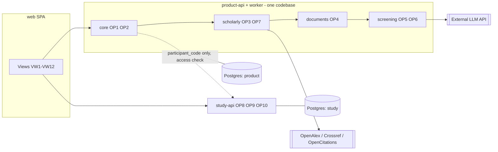
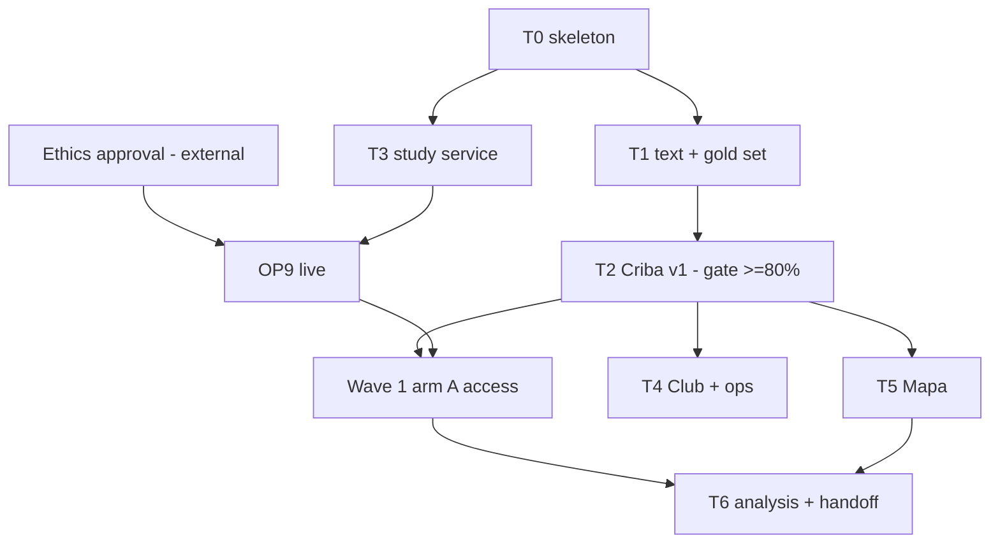

# BioVidGen — Technical Specification

Input: [process-map.md](process-map.md) (stage 1). Role: senior engineer planning the product build.
Status: **design**. Repo today = `app/agent/main.py` (comment stub) and an empty `ocr.py`; nothing is built, so no existing stack constrains us except "Python" implied by the stub.
Notation: `[specify]` unknown · `ASSUMPTION:` my inference · `[verify]` a third-party fact (version, licence, quota, price) I did not check against a live source — confirm before relying on it.
Decisions with high reversal cost are recorded as ADRs in `docs/adr/` (0001–0005).

---

## 1. Scope

**Goals** (from map): produce a verifiable Criba card (OP5) per article with ≥80% field agreement and 100% verbatim evidence spans; run the stepped-wave trial (OP9) with contamination <15%; keep sensitive participant data isolated; ship MIT-licensed code from the first public commit.

**Non-goals**: no grade/graduation claims; no mobile native app; no multi-region/DR (the study lasts to Nov 2027, one region is enough: *deliberate omission*); no microservices beyond the one compliance split in §2; no custom model training in v1; no Mapa embedding-similarity (OP7b) until requested; no auto-selection of a paper from a free-text question without student confirmation.

**Constraints**: ethics approval required before baseline (OP9 cannot go live earlier); LFPDPPP for student data; MIT licence with commercial reuse ⇒ **every dependency must be permissively licensed** (see ADR-0004: PyMuPDF is AGPL, rejected); team of five, two developers (map/artifact); deadline: Wave 3 confirmatory analysis Dec 2027; budget `[specify]`.

**Assumptions**: ≤1,000 participants total; ≤50k screening reports over the project (ASSUMPTION; ≥2,000 is the KPI floor); peak load is tiny (a wave's club-week), so scale is not a driver, **correctness, provenance and privacy are**; Spanish-first UI; hosting region in Mexico or US with legal sign-off `[specify]`.

---

## 2. Architecture & service decomposition

**Style: modular monolith + one separate service for the study.** Rationale: scale is trivial; team is 2 devs; the only real boundary is *compliance* — participant identity and EUBE scores must be unreachable from the product pipeline and from any LLM call.

| ID | Service/Module | Responsibility | Owned entities | Operations | Method classes | Why separate / module |
|---|---|---|---|---|---|---|
| SVC1 | `core` module | Intake, queue, intent, request status, corrections endpoint, auth | Request | OP1, OP2 | DETERMINISTIC, NLP | module (default) |
| SVC2 | `scholarly` module | Resolve DOIs, metadata, retraction/preprint/OA, citation graph | Article, CitationGraph | OP3, OP7 | DETERMINISTIC | module |
| SVC3 | `documents` module | Get text/sections from OA/uploaded PDFs | ArticleText (split from Article, see §10) | OP4 | NLP (OCR/parsing) | module; worker has heavy CPU and untrusted-file parsing, isolate as a *worker process type*, not a service |
| SVC4 | `screening` module | Criba extraction + validator, Spanish abstract, eval harness | ScreeningReport, Correction | OP5, OP6 | LLM | module; only module that calls an external LLM |
| SVC5 | `study` **service** | Consent, enrolment, randomization, questionnaires, referral, Club, analysis | Participant, Allocation, Assessment, ClubSession, AnalysisResult | OP8, OP9, OP10 | DETERMINISTIC, HUMAN | **service**: security/compliance boundary (own DB, own credentials, no LLM egress, ethics-controlled retention) |
| SVC6 | `web` frontend | All views | none | — | — | static SPA |

**Deployables**: (1) `product-api` (SVC1–4 modules) + (2) `product-worker` (same codebase, queue consumer, `documents` runs in a sandboxed container) + (3) `study-api` + (4) `web`. Single codebase, two backends. Event/API links between the two backends carry **only `participant_code`**, never identity (see §4).

**Dependency rules** (enforced by an import-linter fitness function in CI): `core → scholarly → documents → screening` only through module interfaces; `screening` may not import `study`; `study` may not import any other module; no module reads another module's tables.



Options considered for the style (Type 1; ADR-0001):

| Option | Upside | Cost | What gets hard |
|---|---|---|---|
| A. Single monolith, single DB | Simplest | Lowest | Participant data reachable from LLM-calling code; harder to defend to ethics committee |
| **B. Modular monolith + isolated study service (chosen)** | Compliance boundary, 2 deployables, 2 DBs | Slightly more ops | Cross-service access check (arm gating) must be designed |
| C. Per-operation microservices | Independent scaling | Highest ops cost for 2 devs | Nothing here needs independent scaling; Conway mismatch |

Revisit if: a second team owns the study side, or LLM workload needs GPU workers.

---

## 3. Data architecture

One engine: **PostgreSQL** (relational + JSONB), one instance per boundary (product, study). Chosen over a document DB, graph DB or vector DB because every access pattern in the map is key lookup, small joins, or a ≤few-hundred-node neighbourhood. pgvector can be added to the same instance if OP7b adopts embeddings (no new store). Graph DB rejected until traversal depth/latency demands it (`WITH RECURSIVE` or app-side BFS covers v1). Object storage (S3-compatible) for uploaded/OA PDFs only.

| Entity | Owner | Storage | Key schema notes | Consistency | Retention / deletion | Migration |
|---|---|---|---|---|---|---|
| Request | SVC1 | PG product | `request_id uuid PK`, `participant_code`, `raw_input` (**no FK to study DB**), `status` enum, `idempotency_key unique(participant_code, hash(norm_input))` | strong | `raw_input` purged at `[specify]` days; row kept | additive migrations (expand → backfill → contract), Alembic |
| Article | SVC2 | PG product | PK `article_id`; unique `doi_norm` where not null; `openalex_id`; `is_retracted`, `retraction_checked_at`, `retraction_source`; CHECK not both preprint+published | strong | never hard-deleted; refresh versioned in `article_meta_history` | additive |
| ArticleText | SVC3 | PG (text/sections JSONB) + object store (PDF) | `article_id FK`, `source` enum {oa_api, pdf_layer, ocr, upload}, `text_hash`, `sections JSONB`, `char_error_rate?`, `license` | strong | hard delete on takedown; uploads purged at `[specify]` | additive |
| ScreeningReport | SVC4 | PG product JSONB fields | PK `(article_id, pipeline_version)`; fields as `{value, status, evidence_span{text, start, end}}`; `validator_result`; `model_id`, `prompt_hash` | strong | soft delete | versioned JSON schema (`schema_version`) |
| Correction | SVC4 | PG product | `(report_id, field, model_value, corrected_value, actor_code, ts)` append-only | strong | kept (training labels) | additive |
| CitationGraph | SVC2 | PG product: `edge(citing_id, cited_id, source, fetched_at)` | PK composite | eventual (rebuild from APIs) | rebuildable | additive |
| Participant | SVC5 | PG study | `participant_code PK`; identity in separate table `participant_identity` encrypted columns, accessible only to the coordinator role | strong | per ethics approval; hard delete on withdrawal | additive |
| Allocation | SVC5 | PG study | append-only; `seed_ref`, `block_id`, `stratum`; **trigger forbids UPDATE/DELETE** | strong | kept | frozen schema |
| Assessment | SVC5 | PG study | `(participant_code, instrument, timepoint)` unique; `value`, `collected_at`; severe-band event on insert | strong | per ethics; hard delete on withdrawal | additive |
| ClubSession | SVC5 | PG study | session, attendance, appraisal sheet | strong | per ethics | additive |
| AuditLog | both | PG append-only table per DB, mirrored to object storage nightly | `actor, action, resource, before/after hash, ts, request_id` | strong | `[specify per ethics]` | additive |

**Backups**: managed PG daily snapshot + PITR; **restore drill** into staging before Wave 1 and before each wave (RPO ≤24 h, RTO ≤ 1 working day; ASSUMPTION, proposed). Study DB backups encrypted with a separate key.

**Growth (3 years)**: ≤50k reports × ~50 KB JSON ≈ 2.5 GB; text ≤ a few GB; trivial for one PG instance.

---

## 4. Interfaces

### Synchronous APIs (REST/JSON, OpenAPI as source of truth, typed TS client generated)
| ID | Service | Input | Output | Idempotency key | Auth role | Errors |
|---|---|---|---|---|---|---|
| `POST /requests` | SVC1 | `{input, input_type}` | `202 {request_id, status_url}` | `Idempotency-Key` header, else hash(participant_code, norm_input) | student | 400 invalid, 403 not entitled (arm B before date), 413 file too large, 429 |
| `GET /requests/{id}` | SVC1 | — | status + result links | — | student(own), team | 404 |
| `GET /articles/{id}/report` | SVC4 | `version?` | ScreeningReport + flags + `retraction_checked_at` | — | student, moderator | 404, 409 not ready |
| `POST /reports/{id}/corrections` | SVC4 | `{field, corrected_value, note}` | 201 | `(report_id, field, actor)` per day | student, moderator | 422 |
| `GET /articles/{id}/graph` | SVC2 | `depth ≤2` | nodes+edges+flags | — | student | 413 too large |
| `GET /entitlements/{participant_code}` | SVC5 | — | `{tool_access: bool, access_from}` | — | `svc-product` (mTLS/JWT) | 404 |
| `POST /enrolments` | SVC5 | consent + strata | `participant_code` | institutional id hash | coordinator | 409 duplicate |
| `POST /allocations` | SVC5 | `participant_code` | `{arm, wave}` | participant_code | `svc-trial` | 409 already allocated, 423 ethics hold |
| `POST /assessments` | SVC5 | `{instrument, timepoint, items}` | 201 (+ referral event if severe) | `(code, instrument, timepoint)` | participant | 409, 422 |
| `POST /club/sessions/{id}/attendance` | SVC5 | codes | 204 | `(session, code)` | moderator | 404 |
| `GET /analysis/datasets/{wave}` | SVC5 | — | coded, de-identified export | — | analyst | 403 |

`GET /entitlements` is the **only** product→study call. Product caches the result ≤5 min (fail **closed** for arm B, fail open never): if study-api is down, a student cannot create new requests, but existing reports remain readable (decision, see §7).

### Events (in-process outbox on product side, Postgres-backed)
| Event | Producer | Consumers | Payload | Ordering key | Delivery |
|---|---|---|---|---|---|
| `RequestAccepted` | SVC1 | SVC1 (OP2) | `{request_id}` | request_id | at-least-once (consumers idempotent) |
| `IntentClassified` | SVC1 | SVC2 | `{request_id, intent, area}` | request_id | at-least-once |
| `ArticleResolved` | SVC2 | SVC1, SVC3 | `{request_id, article_id}` | article_id | at-least-once |
| `TextReady` | SVC3 | SVC4 | `{article_id, text_id, mode}` | article_id | at-least-once |
| `ReportReady` | SVC4 | SVC1, SVC2 (flags → graph) | `{article_id, report_id}` | article_id | at-least-once |
| `RequestFailed` | any | SVC1 | `{request_id, stage, reason}` | request_id | at-least-once |
| `SevereBandRecorded` | SVC5 | referral queue VW10 | `{participant_code, assessment_id}` | participant_code | at-least-once, **alert on no-ack** |

**Contract versioning**: JSON Schema per event/API in `contracts/`, additive-only within `v1`; breaking change ⇒ `v2` with dual-publish for one wave; contract tests in CI (schemathesis for REST, schema-validation for events).

---

## 5. Views catalog

| View | Type | Audience | Purpose | Data shown | Actions → ops | Freshness | Access |
|---|---|---|---|---|---|---|---|
| VW1 Search / submit | screen | student | Enter question, topic, DOI, upload | — | submit → OP1; pick candidate → OP3 | — | arm gating via entitlement |
| VW2 Criba card | screen | student, moderator | Checklist + supporting sentence per field + flags + Spanish abstract + "checked on <date>" | ScreeningReport.*, Article flags | "this is wrong" → Correction (OP5 label capture) | live | own requests |
| VW3 Mapa | screen | student | Citation neighbourhood, flag badges | CitationGraph, flags | open node → VW2 / OP1 | ≤1 day (flags re-checked on display) | |
| VW4 Request status/history | screen | student | Progress, errors, retry | Request.status | retry → OP1 | live | own |
| VW5 Enrolment & consent | screen | participant | Consent, strata, baseline EUBE | Participant, Assessment | submit → OP9 | | ethics-approved text only |
| VW6 Questionnaire runner | screen | participant | EUBE, time-per-article, appraisal test at timepoints | Assessment | submit → OP9 | | |
| VW7 Club sheet & attendance | work_queue | moderator | Session article, appraisal sheet, attendance | ClubSession, ScreeningReport | save → OP8 | live | assigned sessions |
| VW8 Ops/KPI dashboard | dashboard | coordinator, devs | Active users, records, retention, contamination, latency, cost/report, agreement | metrics | — | ≤1 h | coded data only |
| VW9 Expert audit & gold-set annotation | work_queue | QFB, physician | Annotate gold set; weekly audit sample | Article, ScreeningReport | save → audit result (feeds OP5 eval) | live | experts |
| VW10 Referral queue | work_queue | physician | Severe EUBE referrals | Assessment (EUBE), code | acknowledge/close → OP9 | real-time | physician only |
| VW11 Allocation admin | screen | coordinator | Run allocation, see balance | Allocation (coded) | allocate → OP9 | | not recruiters |
| VW12 Unverified-field review | work_queue | team | Fields rejected by the validator | ScreeningReport.validator_result | resolve → Correction | daily | team |

OP8 (HUMAN) ⇒ VW7; HUMAN steps in OP9 ⇒ VW10/VW11; HUMAN audit ⇒ VW9. **UI**: Spanish (es-MX) first, i18n from day one, WCAG 2.1 AA treated as requirement (keyboard, contrast, screen-reader labels for the evidence-span highlight).

---

## 6. Method infrastructure & **operation-by-operation stack evaluation**

### 6.1 Stack decisions (cross-cutting)

| Layer | Boring option (recommended default) | Alternatives considered | Why / when to change |
|---|---|---|---|
| Language | **Python 3.12** backend; TypeScript frontend | Node/TS full-stack | stub is Python; ML/NLP/OCR ecosystem; stats libs |
| Web framework | **FastAPI** + Pydantic v2 (OpenAPI → TS client) | Django, Flask | typed contracts = chain-integrity schemas; Django only if its admin replaced VW11/VW9 cheaply (a real option for the study service: `[decide in P0]`) |
| DB / migrations | **PostgreSQL** + SQLAlchemy 2 + Alembic | SQLite (dev), Mongo | see §3 |
| Queue / workers | **Postgres-backed** (`SKIP LOCKED`; library `procrastinate` or hand-rolled outbox) [verify] | Celery+Redis, SQS, Temporal | no new infra for ≤ tens of jobs/min; Type 2, swap later; Temporal only if multi-step retries become painful |
| Frontend | **React + TypeScript (Vite)**, react-i18next, Cytoscape.js (MIT) for Mapa | HTMX+Jinja, Next.js, SvelteKit | graph UI needs JS; no SEO need so no SSR; HTMX is a valid cheaper alternative if only 1 dev owns UI |
| Auth | **OIDC with the institution IdP** (e.g. Google/Microsoft school tenant) `[specify]`, magic-link fallback; app-level RBAC/ABAC | roll-your-own, Keycloak, managed (Auth0/Clerk) | do not hand-roll; identity provider choice needs institutional input |
| LLM access | thin **`LLMClient` port** in our code; adapters per provider; provider via LiteLLM-style router [verify] | direct SDK, self-hosted open-weight (vLLM) | portability; governance may force self-hosting (ADR-0003) |
| Structured output | **Pydantic schema + provider structured-output / tool-use** | free-text JSON parse | enforces the OP5 contract |
| PDF/text | **GROBID** (Apache-2.0) for scientific-PDF structure + `pypdf`/`pdfminer.six`/`pypdfium2` for text layer; **Tesseract** (`spa+eng`) for scans | **PyMuPDF (AGPL)**, Ghostscript (AGPL), cloud OCR | licence compatibility with MIT (ADR-0004); cloud OCR only if governance allows sending uploaded PDFs |
| Classifier (OP2) | keyword/rules table → scikit-learn (TF-IDF+LR) or fastText once labels exist | transformer fine-tune, LLM | cost, speed; map's migration signal |
| Retrieval of scholarly data | `httpx` + `tenacity` backoff + on-disk/PG cache; OpenAlex, Crossref (polite pool), OpenCitations | pyalex/habanero wrappers | thin clients are small; limits/policies `[verify]` |
| Study data capture | **Option A: REDCap** (if the institution hosts it) · **Option B: custom module in `study-api`** | Google Forms, Qualtrics | ADR-0005; arm gating + audit + referral need integration either way |
| Stats | Python `statsmodels` (OLS ANCOVA) with fixed script, or R `lm`; `[specify: receiving org]` | SPSS | reproducibility + handoff; pre-registered script in repo |
| Observability | structured JSON logs, **OpenTelemetry** traces/metrics, Sentry for errors; dashboards in Grafana (hosted free tier) or Metabase on PG `[specify]` | Datadog | cost/size |
| Hosting | **containers on a PaaS or one VM + managed PG**, region per legal `[specify]` | Kubernetes, serverless | 4 containers; K8s is over-engineering; Vercel suits `web` only, not the Python backends |
| IaC / CI | GitHub Actions, Docker, Terraform minimal (or provider CLI scripts) | none | reproducible envs; rollback = redeploy previous image |
| Secrets | platform secret store; never in repo (MIT public); pre-commit secret scan | .env files | public repo |
| Testing | pytest, schemathesis (contract), Playwright (e2e), import-linter (architecture), load test with Locust on the queue | — | |

### 6.2 Operation-by-operation: what is needed

| Op | Class | Stack choice (default → alternatives) | What must exist | Key tests / acceptance | NFR hook |
|---|---|---|---|---|---|
| **OP1** Intake & queue | DET | FastAPI endpoint; Pydantic validation; file-type/size limit; outbox row in same transaction; `Idempotency-Key` | Request table, outbox, status endpoint (VW4), per-user rate limit, virus/type scan for uploads (ClamAV `[verify]`) | duplicate submit → one request; crash between write & enqueue loses nothing (outbox); oversized PDF → 413 | accept p95 ≤ 300 ms |
| **OP2** Intent/topic | NLP | Start: keyword/regex table over OpenAlex topics `[specify taxonomy]`; later scikit-learn; **not** an LLM | taxonomy file (versioned), override UI/logging, confidence → "unknown" path | macro-F1 on labelled requests `[pending]`; override-rate telemetry | ≤50 ms |
| **OP3** Resolve & enrich | DET | `httpx`+`tenacity`; OpenAlex (`is_retracted`, type=preprint, OA fields) + Crossref (updates/retraction notices, `is-preprint-of`) + OpenCitations; PG cache; candidate ranking for non-DOI input (title match + Crossref/OpenAlex search) | `Article` + history table, `retraction_checked_at/source`, re-check on display if >24 h, polite-pool contact email config, quota/backoff, circuit breaker | known-retracted DOI set (Retraction Watch sample) → recall; wrong-match fixtures; outage → cached/stale label | ≤3 s p95 cached |
| **OP4** Acquire text | NLP (OCR/parse) | Waterfall: OpenAlex/Unpaywall-style OA link `[verify]` → PDF text layer (`pypdfium2`/`pdfminer.six`) → **GROBID** (sections, refs) → Tesseract OCR → abstract-only | sandboxed worker container (no network except OA fetch, size/time limits), `ArticleText.source`, license field, takedown path | 50-scan audit char-error rate; column-interleaving fixture set; GROBID section recall on 30 sample papers `[pending]` | ≤30 s p95 for ≤30 pages |
| **OP5** Criba | LLM + validator | `Extractor` port; **v1 plain structured output (Pydantic)**, **candidate: DSPy** adapter; deterministic validator (substring, offsets, n-in-span regex, enum) | prompt/schema registry (hash in report), gold set (VW9), eval harness (`pytest` + CLI), model pin, shadow mode flag, correction pipeline, chunking by GROBID sections, cost log | gold-set agreement per field ≥80%, span validity 100%, injection fixtures (papers containing "ignore previous instructions"), variance across 3 runs | submit→card p95 ≤60 s (proposed) |
| **OP6** Spanish abstract | LLM | same port; short prompt; glossary file; deterministic number/negation check | glossary (QFB), "machine translation" label, link to original | number-match 100%; bilingual reviewer sample | ≤10 s |
| **OP7** Mapa | DET | edges from OpenAlex `referenced_works` / OpenCitations; PG adjacency + recursive CTE; Cytoscape.js; cap depth/size | cache + staleness, flag copy (no recompute), node cap (e.g. 300 `[specify]`) | edge coverage on reference sample; UI render at cap | ≤2 s render |
| **OP8** Club | HUMAN | VW7 sheet (React form), attendance via SVC5; moderator training doc; shared appraisal rubric | sheet schema (rubric), moderator accounts, calendar reminders (email) | inter-rater agreement on sheets `[pending]`; retention metric | — |
| **OP9** Allocate & measure | DET + HUMAN | Stratified permuted-block (size 4) in Python with `numpy.random.Generator(PCG64)` seeded from stored seed; Postgres triggers for immutability; ABAC `entitlement`; questionnaires in REDCap **or** custom VW6; email/SMS reminders | ethics-approval flag (`ethics_hold` blocks `POST /allocations`), allocation concealment (allocation after baseline), arm B access date job, severe-band event + VW10, contamination monitor (arm B early-use query), consent versioning, withdrawal flow | simulation of 10k allocations → balance within strata; replay from seed identical; arm B request before `access_from` → 403; severe EUBE → referral within SLA `[specify]` | allocation audited 100% |
| **OP10** Estimate | DET | `statsmodels` OLS (EUBE ~ arm + baseline + year + sex), ITT; frozen script + data snapshot hash; pre-registration doc | de-identified export (`GET /analysis/datasets`), analysis plan in repo, Wave labels in output, reproducibility check (Docker) | rerun yields same estimate; power check with d from pilot | batch |

### 6.3 DSPy vs plain structured output for OP5/OP6 (Type 1-ish: affects code shape; ADR-0003)

| Criterion | A. Plain: Pydantic + structured output + hand-versioned prompt | B. DSPy (Signatures, Modules, optimizer e.g. MIPROv2 / BootstrapFewShot / GEPA) [verify names] | C. Hybrid: A at runtime, DSPy used offline to *search* prompts, result frozen as text |
|---|---|---|---|
| Time to first working OP5 | days | days–1 wk (learning curve) | A + extra |
| Output contract (`{value, evidence_span}`) | Pydantic + provider schema enforcement | typed Signature + adapters | A |
| Prompt improvement | manual, error-analysis driven | metric-driven search: our metric = field agreement + span validity | metric-driven, no runtime dependency |
| Needs labelled data | for eval only | for optimizer **and** eval; with small gold set optimizer overfits | same |
| Model portability | rewrite prompts per model | re-compile per model (cheap if gold set exists) | re-run offline |
| Debuggability / audit | prompt is a plain string, auditable by the physician | compiled prompts are generated; need to export & review | prompt exported as plain text |
| Dependency risk | none | fast-moving library API [verify]; pulls LiteLLM | confined to a dev tool |
| Fit with validator | validator wraps output | validator can be the metric/assertion | validator is the metric |
| Verdict | **start here** | adopt when ≥ `[specify: ~100+]` gold examples exist and manual iteration plateaus | **likely end state** |

**Recommendation**: build `Extractor` as a port; implement A first (Phase T0/T2); add a DSPy implementation as an experiment behind the same port at the gold-set gate and **choose by measured agreement, cost per report, and variance** — not preference. The validator, schema versioning and eval harness are identical for both, so the experiment costs ~days, not a rewrite. Keep the human-readable prompt exported in the repo (the physician/QFB must be able to read what the model is told). Revisit trigger: agreement plateaus below 80% after two manual error-analysis rounds, or we change model provider.

### 6.4 LLM infrastructure (OP5/OP6)
- **Model criteria**: governance allows article text (public/OA) but not participant data → hosted API acceptable for OP5/OP6 *if* provider terms allow it `[specify]`; criteria = structured-output reliability, Spanish quality, context length for full papers, cost/report, pinned versions, data-use terms (no training on inputs), latency. Candidate set `[specify]`; pick by running the gold set on 2–3 models in T2.
- **Self-hosted fallback** (open-weight via vLLM): only if governance forbids hosted APIs or cost/report is unacceptable; needs GPU, which turns the product into 2+ services (Revisit trigger in ADR-0001).
- **Prompt/schema versioning**: `pipeline_version = hash(model_id, prompt, schema, validator_version)` stored on each report; changes through PR + gold-set run.
- **Knowledge sources**: article text only; **no tools, no web**; glossary file for OP6.
- **Eval harness**: `eval/` runs gold set → per-field agreement, span validity, injection tests, cost, latency; CI blocks merges that regress >`[specify]` pp.
- **Fallback path**: model failure/timeout → retry with backoff → second provider/model → `unverified` fields shown honestly (no fabricated output).
- **Cost control**: per-request token cap, text pruned to relevant sections (methods, results, COI/funding), daily budget breaker `[specify]`.
- **Cost formula**: `cost/report = (in_tokens × p_in + out_tokens × p_out) × passes`, with prices `[specify]`; in_tokens for a full paper ASSUMPTION ~10–20k, to be measured.

### 6.5 Other method classes
- **DETERMINISTIC**: code, with decision tables in versioned YAML where non-engineers must edit (taxonomy, glossary, flag wording). Allocation algorithm is code + tests, not config.
- **NLP**: GROBID service container, Tesseract, scikit-learn; models/dictionaries pinned by hash.
- **TRAINABLE ML**: none in v1 (OP2 classifier is the only candidate; retrain when ≥ `[specify]` labelled overrides, registry = versioned artifact in object store, no MLflow).
- **HUMAN**: queues VW7/VW9/VW10/VW11/VW12; assignment: manual by coordinator in v1; SLAs: referral acknowledged `[specify, hours]`, VW12 items within 2 working days (proposed); escalation to coordinator then PI.
- **Label capture**: `Correction` table (append-only) + VW12 resolutions + VW9 annotations → nightly export to `eval/gold/` candidates reviewed by an expert before entering the gold set (corrections from students are *signals*, not ground truth).

---

## 7. Cross-cutting

**Security**
- Identities: `svc-intake`, `svc-classify`, `svc-resolve`, `svc-text`, `svc-criba`, `svc-graph` are **separate DB roles** with grants matching the map's read/write table (even though one process); `svc-trial` in study DB. Humans via OIDC + roles.
- AuthZ: RBAC roles (student, moderator, coordinator, physician, analyst, expert, dev) + ABAC (arm, wave, access_from, own-resource) in a single policy module with tests (policy-as-tests; e.g. casbin/OPA or hand-written `can()` — Type 2).
- LLM trust boundary: egress allow-list (only the LLM host and scholarly APIs); `screening` module has no DB grant on study DB and no network route to `study-api`; model output is parsed as data, schema-validated, never executed; article text always placed in a data channel.
- Uploads: size/type limits, scan, parsed in the sandboxed worker (no creds, no internal network), deleted per retention.
- Encryption: TLS everywhere; at-rest managed encryption; identity table column-level encryption; separate keys for study DB.
- Supply chain: lockfiles, Dependabot/Renovate, `pip-audit`/`npm audit` in CI, SBOM + licence check (`pip-licenses`, fail on AGPL/GPL), signed container images if available.
- Audit log: append-only, covers map's events; reads of EUBE by physician also logged.

**Observability**: JSON logs with `request_id` / `participant_code` (coded) correlation; OTel traces across queue hops (propagate `traceparent` in outbox rows); metrics = map's telemetry table (agreement from VW9, validator reject rate, latency, cost/report, active users, contamination, retention). Alerts → owner with a runbook link each (no runbook ⇒ not an alert): queue age, validator reject spike, retraction-API failures, referral unacknowledged, contamination >15%, cost breaker. Debug at 3 a.m.: trace by `request_id`, stored `pipeline_version`, raw LLM I/O stored for failed validations (no participant data in them by construction).

**Reliability**: retries with exponential backoff + jitter (max 5), per-host rate limits and circuit breakers for external APIs; DLQ table with VW12/ops view; idempotency keys on all writes; saga: none needed across products (single DB per boundary; the one cross-boundary call is read-only). Degradation matrix: scholarly API down → cached metadata + stale label; LLM down → card shows metadata + flags without extracted fields (explicit); study-api down → no new requests for arm B, existing reports readable; PDF parser fails → abstract-only.

**Environments**: `dev` (docker compose: PG, GROBID, mock LLM), `staging` (real APIs, synthetic participants only), `prod`. **No real participant data outside prod.** Feature flags (DB-backed): `criba_shadow`, `criba_visible`, `mapa_enabled`, `ethics_hold`, per-wave `tool_enabled`. Rollback = previous image + flag off.

---

## 8. NFRs (proposed, `[specify]` to confirm)

| NFR | Target | Applies to | Verified by |
|---|---|---|---|
| Field agreement | ≥80% per field family (gate), tracked per field | OP5 | gold set + weekly audit |
| Evidence-span validity | 100% shown spans verbatim | OP5 | validator + property test |
| Submit→card latency | p95 ≤60 s (full text) / ≤20 s (abstract-only) | OP1–OP6 | load test, tracing |
| Availability | ≥99% in club weeks, business hours (ASSUMPTION) | product-api, web | uptime probe |
| Retraction freshness | status checked ≤24 h before display, date shown | OP3 | test + UI check |
| Cost/report | ≤ `[specify]` USD | OP5, OP6 | cost log |
| Data volume | ≤50k reports, ≤10 GB | PG | capacity check per wave |
| RPO / RTO | 24 h / 1 working day | both DBs | restore drill before each wave |
| Accessibility | WCAG 2.1 AA | web | axe in CI + manual |
| Privacy | 0 participant identifiers in product DB/logs/LLM calls | all | automated scan test + egress rules |
| Licence | 0 AGPL/GPL deps | repo | CI licence check |
| Build/onboard | clone→running dev env ≤30 min; CI ≤10 min | repo | measured |

---

## 9. Risks (ordered by likelihood × impact)

| Risk | Impact | Likelihood | Mitigation | Owner | Phase |
|---|---|---|---|---|---|
| Students over-trust the Criba card (RPN 280) | Wrong appraisal; invalidates H3 | High | Evidence-span UI, no score/verdict, caveat, H3 measurement, usability test | `[specify: PI + UX dev]` | T2 |
| Ethics approval late | Trial slips, idle build | Med–High | Build OP9 in `ethics_hold`; staging with synthetic data; keep product work off critical path | PI | T0 |
| Gold set too small/late | Cannot validate OP5 (or run DSPy) | High | Start annotation in T1; two annotators, agreement measured; size `[specify]` | QFB/physician | T1 |
| Agreement <80% | Gate fails | Med | Per-field fallbacks (`unverified`), narrower field set, better sectioning; model comparison | dev lead | T2 |
| Missed retraction (RPN 189) | Trust in retracted paper | Med | Two sources, date shown, never say "not retracted" | dev | T0 |
| LLM provider terms/copyright forbid sending text | Architecture change | Med | Decide before T2; abstract-only mode; self-host option | PI/legal | T0 |
| AGPL/GPL dependency enters repo | Breaks MIT promise | Med | CI licence gate; ADR-0004 | dev lead | T0 |
| Contamination >15% | Dilutes H1 | Med | Entitlement gating, monitoring VW8 | coordinator | T3 |
| Participant data leaks to product/LLM | Legal/ethical breach | Low | Separate DB/roles/egress, automated scan | dev lead | T0/T3 |
| Library churn (DSPy, LiteLLM, procrastinate) | Breakage | Med | Pin versions, port/adapter, upgrade by PR with eval | dev lead | all |
| Two-developer bus factor | Stall | Med | Boring stack, runbooks, ADRs, CI | PI | all |
| Scope creep (Mapa similarity, ML classifier) | Misses Dec 2027 | Med | Explicit non-goals; revisit gates | PI | all |

---

## 10. Map deltas & open questions

| Item | Map said | Spec decides | Reason |
|---|---|---|---|
| `Article.full_text` | Property of Article, written by OP4 | New entity `ArticleText` owned by SVC3 | one-writer-per-entity; OP3 and OP4 would both write Article |
| OP4 output | `full_text`, `language` | adds `sections` (GROBID) | OP5 needs section-aware chunking for cost and accuracy |
| Expert audit / gold-set annotation | appeared only as a telemetry instrument | New **HUMAN operation** (propose `OP11 · Expert audit`) with VW9 | it is a real operation with owner, cost and agreement metric; feeds OP5 eval |
| OP9 mixed class | DETERMINISTIC + HUMAN | split into OP9a (allocate, DET) and OP9b (measure/consent/referral, HUMAN+DET) in stage 3 | "mixed class usually means two operations" (map rule) |
| Arm gating | side effect of OP9 | explicit `Entitlement` read model + `GET /entitlements` | contamination KPI needs an enforcement point |
| Study boundary | not specified | separate service/DB | compliance (§2) |
| PDF library | unspecified | exclude PyMuPDF/Ghostscript (AGPL) | MIT promise |
| OP2 | NLP | starts as rules; classifier only on evidence | consistent with map assumption |

**Open questions** (who can answer):
1. Ethics approval date; does the institution host REDCap? (PI / ethics committee) → ADR-0005.
2. LLM provider terms and copyright for non-OA PDFs; allowed regions (PI + legal) → ADR-0003.
3. Hosting region/data residency and budget; who pays LLM costs? (PI/coordinator).
4. Institutional IdP for login; can we obtain institutional student IDs for dedup? (institution).
5. Gold-set size, checklist (CONSORT/STROBE-like?), annotator time (QFB/physician).
6. Does Wave 1 require Criba at the ≥80% gate, or may the pilot run with an earlier version? (PI) — drives the critical path.
7. Retraction source and OpenAlex/Crossref API policies and keys `[verify]` (dev).
8. Who owns each alert and runbook (coordinator).
9. Statistical software for the receiving organization (PI).
10. Is similarity (OP7b) in scope for Phase 3?

---

# Implementation plan

**Principles applied**: (1) walking skeleton in T0 with deterministic stubs (OP5 stub = abstract regex baseline, OP6 off, OP8/OP9 forms minimal); (2) baseline measured in T1 before any LLM claims; (3) upgrade by worth-it rank: OP3 → OP5/OP6 → OP9/OP10 → OP7; (4) highest risk early: privacy boundary, licence gate, retraction wording and span validator ship in T0/T2.

Estimates: dev-weeks for **two developers**, ranges, **low confidence** (no velocity data yet; no team skill info beyond the protocol roles).

| Phase | Goal | Units | Exit criteria | Estimate |
|---|---|---|---|---|
| **T0 Skeleton & guards** | End-to-end DOI → metadata → baseline card in staging; boundary & CI in place | SVC1, SVC2(OP3), SVC4 stub, SVC6, VW1, VW2(baseline), VW4; CI licence/import/contract gates; audit log; OIDC; observability | 20 sample DOIs flow request→card with trace id; 0 licence violations; arm-gating stub returns 403 for B; restore drill done; retraction test recall measured on known set `[pending]` | 4–7 wks (60% conf.) |
| **T1 Baselines & text** | Gold set started; OP4 working; baseline metrics measured | OP4, OP11/VW9, eval harness skeleton, OP2 rules | Gold set ≥ `[specify]` articles double-annotated with κ ≥ `[specify]`; baseline agreement of regex extractor measured; char-error rate measured on 50 scans; OP4 coverage % reported | 4–6 wks parallel with expert annotation |
| **T2 Criba v1** | LLM extraction + validator; DSPy experiment | OP5, OP6, VW12, correction capture | Shadow run on gold set: field agreement ≥80% (gate), span validity 100%, injection tests pass, cost/report and p95 within NFR; A/B plain vs DSPy decided (ADR-0003 update) | 5–8 wks |
| **T3 Study service** | Trial machinery ready (deploy only after ethics) | SVC5, OP9, VW5, VW6, VW10, VW11, entitlements | Allocation simulation balanced; replay identical; immutability triggers tested; severe-band e2e within SLA in staging; privacy scan passes; deploy gated by `ethics_hold` | 5–8 wks (parallel to T1/T2) |
| **T4 Club & ops** | Moderator tooling, KPI dashboard | OP8, VW7, VW8 | Mock club session run; VW8 shows all map KPIs with live data; alerts have runbooks | 2–4 wks |
| **T5 Mapa** | Citation graph | OP7, VW3 | Edge coverage on reference sample ≥ `[specify]`; render at node cap ≤2 s; flags re-checked on display | 4–6 wks |
| **T6 Analysis & handoff** | Reproducible OP10, transfer package | OP10, docs | Analysis reproduced in a clean container from a data snapshot; handoff doc and runbooks reviewed by receiving organization | 2–4 wks (before Dec 2027) |

Total calendar ≈ 5–8 months with overlap (low confidence); fits Oct 2026 → Wave 3 only if ethics approval does not slip.


**Critical path**: ethics approval → OP9 live → Wave 1 baseline; and, in parallel, gold set → OP5 gate (T0→T1→T2). Whichever is later gates Wave 1 (question 6).

**Workstreams**
| Workstream | Units | Skills | Owner |
|---|---|---|---|
| Platform & product API | SVC1–3, OP1–4, CI/obs | Python, FastAPI, Postgres, DevOps | `[specify: dev 1]` |
| Screening & evaluation | SVC4, OP5/6, eval harness | LLM engineering, eval design | `[specify: dev 2]` |
| Study service & frontend | SVC5, OP9/10, VW1–12 | Python, React, privacy engineering | `[specify]` (needs one dev to span; see risk bus factor) |
| Domain & annotation | OP11, glossary, rubric | biomedical appraisal | QFB + physician |
| Governance | ethics, consent, legal | regulation | PI/coordinator |

**Definition of done (any unit)**: contract tests pass; telemetry emitting with alert + runbook; access policy enforced and tested; migration reversible; audit events written; Spanish strings externalized; eval/acceptance threshold met; docs/ADR updated; licence check green.

**Explicitly not doing**: Kubernetes; Kafka/Redis; vector DB; custom model training; multi-region/DR; native mobile; automatic paper choice from a free-text question; SSO federation beyond one IdP.

---

# Traceability matrix

| KPI / objective | Ops | Service | Views | Test / eval | Monitored metric |
|---|---|---|---|---|---|
| Agreement ≥80% | OP5, OP6, OP11 | SVC4 | VW2, VW9, VW12 | gold-set eval, weekly audit | field_agreement |
| Span validity 100% | OP5 | SVC4 | VW2 | property test on validator | span_validity |
| Active users ≥60% of wave | OP1, OP5 | SVC1 | VW1, VW8 | usage fixtures | active_users |
| ≥2,000 records | OP5 | SVC4 | VW8 | count query | records_generated |
| Club retention ≥50% | OP8 | SVC5 | VW7, VW8 | attendance fixtures | club_retention |
| Contamination <15% | OP9 | SVC5 (+SVC1 gate) | VW8, VW11 | arm-B-early-access test | contamination |
| H1 ΔEUBE | OP9, OP10 | SVC5 | VW5, VW6, VW11 | analysis replay | effect_size |
| H2 time per article | OP1, OP5, OP9 | SVC1/SVC5 | VW6 | instrument test | minutes_per_article `[specify measurement]` |
| H3 appraisal accuracy | OP8, OP9 | SVC5 | VW6, VW7 | rubric agreement | appraisal_accuracy |
| Severe-referral safety | OP9 | SVC5 | VW10 | e2e referral test | referral_ack_time |
| Retraction trust | OP3 | SVC2 | VW2, VW3 | known-retracted set | retraction_recall |
Orphans: **minutes-per-article has no agreed instrument** (open question); OP7 has no KPI yet (suggest "Mapa use per active user", `[specify]`); OP2 traces only to routing quality (override rate).

---

# Unit index (handoff to process-impl-plans)

| Unit | Kind | Name | Service | Phase | Depends on | Notes for stage 3 |
|---|---|---|---|---|---|---|
| SVC1 | service(module) | core | SVC1 | T0 | — | auth, outbox, idempotency |
| SVC2 | service(module) | scholarly | SVC2 | T0 | SVC1 | API clients, cache, quotas |
| SVC4 | service(module) | screening | SVC4 | T0 stub, T2 | SVC1, SVC3 | `Extractor` port, eval harness |
| SVC6 | service | web | SVC6 | T0 | SVC1 | i18n, a11y |
| OP1 | operation | Intake & queue | SVC1 | T0 | SVC1 | upload sandbox |
| OP3 | operation | Resolve & enrich | SVC2 | T0 | OP1 | two retraction sources |
| VW1 | view | Search/submit | SVC6 | T0 | OP1 | |
| VW2 | view | Criba card | SVC6 | T0 (baseline), T2 | OP5 | span highlighting a11y |
| VW4 | view | Request status | SVC6 | T0 | OP1 | |
| OP2 | operation | Classify intent | SVC1 | T1 | OP1 | rules first |
| SVC3 | service(module) | documents | SVC3 | T1 | SVC2 | sandbox worker |
| OP4 | operation | Acquire text | SVC3 | T1 | OP3 | GROBID, Tesseract, licences |
| OP11 | operation (proposed) | Expert audit / gold set | SVC4 | T1 | — | HUMAN, add to map |
| VW9 | view | Annotation & audit queue | SVC6 | T1 | OP11 | |
| OP5 | operation | Criba screening | SVC4 | T2 | OP4, OP11 | ADR-0003 |
| OP6 | operation | Spanish abstract | SVC4 | T2 | OP3 | glossary |
| VW12 | view | Unverified-field review | SVC6 | T2 | OP5 | |
| SVC5 | service | study | SVC5 | T3 | — | own DB; ethics hold |
| OP9 | operation | Allocate & measure | SVC5 | T3 | SVC5 | split 9a/9b; ADR-0005 |
| VW5, VW6 | view | Consent / questionnaires | SVC6 | T3 | OP9 | |
| VW10 | view | Referral queue | SVC6 | T3 | OP9 | SLA |
| VW11 | view | Allocation admin | SVC6 | T3 | OP9 | |
| OP8 | operation | Club session | SVC5 | T4 | SVC5 | rubric |
| VW7 | view | Club sheet | SVC6 | T4 | OP8 | |
| VW8 | view | KPI dashboard | SVC6 | T4 | all | |
| OP7 | operation | Mapa graph | SVC2 | T5 | OP3, OP5 | node cap |
| VW3 | view | Mapa | SVC6 | T5 | OP7 | Cytoscape.js |
| OP10 | operation | Estimate effect | SVC5 | T6 | OP9 | pre-registered script |

---

# System YAML

```yaml
system:
  name: BioVidGen
  source_process_spec: "docs/process-design/process-map.md (YAML section)"
  architecture_style: hybrid   # modular monolith (product) + isolated study service
  goals:
    - "Criba field agreement >= 80% with 100% verbatim evidence spans"
    - "Stepped-wave trial with contamination < 15%"
    - "Participant data isolated from product pipeline and LLM"
    - "MIT-licensed code, permissive dependencies only"
  non_goals:
    - "microservices beyond the study boundary"
    - "multi-region DR"
    - "custom model training in v1"
    - "Mapa embedding similarity (OP7b) until requested"
  constraints:
    - "ethics approval before baseline"
    - "LFPDPPP"
    - "team of 5, 2 developers"
    - "budget [specify]"

services:
  - {id: SVC1, name: core, kind: module, split_reason: "", owned_entities: [Request], operations: [OP1, OP2], method_classes: [DETERMINISTIC, NLP], identity: "svc-intake, svc-classify", scaling: "single container"}
  - {id: SVC2, name: scholarly, kind: module, split_reason: "", owned_entities: [Article, CitationGraph], operations: [OP3, OP7], method_classes: [DETERMINISTIC], identity: "svc-resolve, svc-graph", scaling: "single container"}
  - {id: SVC3, name: documents, kind: module, split_reason: "", owned_entities: [ArticleText], operations: [OP4], method_classes: [NLP], identity: "svc-text", scaling: "sandboxed worker, scale by queue depth"}
  - {id: SVC4, name: screening, kind: module, split_reason: "", owned_entities: [ScreeningReport, Correction], operations: [OP5, OP6, OP11], method_classes: [LLM, HUMAN], identity: "svc-criba, svc-translate", scaling: "worker concurrency bounded by LLM rate limit"}
  - {id: SVC5, name: study, kind: service, split_reason: "security/compliance boundary: participant identity and EUBE isolated, own DB and credentials, no LLM egress", owned_entities: [Participant, Allocation, Assessment, ClubSession, AnalysisResult], operations: [OP8, OP9, OP10], method_classes: [DETERMINISTIC, HUMAN], identity: "svc-trial", scaling: "single container"}
  - {id: SVC6, name: web, kind: service, split_reason: "static SPA", owned_entities: [], operations: [], method_classes: [], identity: "browser, OIDC", scaling: "CDN"}

data:
  - {entity: Request, owner_service: SVC1, storage: "PostgreSQL (product)", schema: [{field: request_id, type: uuid, constraints: PK}, {field: participant_code, type: text, constraints: "no FK to study DB"}, {field: raw_input, type: text, constraints: "purged per retention"}, {field: status, type: enum, constraints: "queued|running|done|failed"}], access_pattern_requirements: ["lookup by id", "list by participant_code", "dedup by idempotency key"], consistency: strong, consistency_reason: "status and idempotency", retention: "raw_input [specify] days", migration: "expand-contract via Alembic"}
  - {entity: Article, owner_service: SVC2, storage: "PostgreSQL (product)", schema: [{field: doi_norm, type: text, constraints: "unique where not null"}, {field: is_retracted, type: bool, constraints: "with retraction_checked_at and retraction_source"}], access_pattern_requirements: ["lookup by doi/openalex_id", "history of flag changes"], consistency: strong, consistency_reason: "trust flags", retention: "never hard-deleted", migration: additive}
  - {entity: ArticleText, owner_service: SVC3, storage: "PostgreSQL JSONB + object store", schema: [{field: sections, type: jsonb, constraints: ""}, {field: source, type: enum, constraints: "oa_api|pdf_layer|ocr|upload"}, {field: license, type: text, constraints: ""}], access_pattern_requirements: ["by article_id"], consistency: strong, consistency_reason: "input to validator", retention: "hard delete on takedown; uploads per [specify]", migration: additive}
  - {entity: ScreeningReport, owner_service: SVC4, storage: "PostgreSQL JSONB", schema: [{field: "(article_id, pipeline_version)", type: key, constraints: PK}, {field: fields, type: jsonb, constraints: "each field has value/status/evidence_span or not_reported"}], access_pattern_requirements: ["latest by article", "list for audit sampling"], consistency: strong, consistency_reason: "provenance", retention: soft-delete, migration: "schema_version field"}
  - {entity: CitationGraph, owner_service: SVC2, storage: "PostgreSQL edge table", schema: [{field: "citing_id,cited_id,source", type: key, constraints: PK}], access_pattern_requirements: ["neighbourhood depth<=2"], consistency: eventual, consistency_reason: "rebuildable from APIs", retention: rebuildable, migration: additive}
  - {entity: Participant, owner_service: SVC5, storage: "PostgreSQL (study)", schema: [{field: participant_code, type: text, constraints: PK}, {field: identity, type: encrypted, constraints: "separate table, coordinator only"}], access_pattern_requirements: ["by code", "by stratum for allocation"], consistency: strong, consistency_reason: "trial integrity", retention: "per ethics approval", migration: additive}
  - {entity: Allocation, owner_service: SVC5, storage: "PostgreSQL (study)", schema: [{field: participant_code, type: text, constraints: "unique, UPDATE/DELETE forbidden by trigger"}, {field: arm, type: enum, constraints: "A|B"}, {field: seed_ref, type: text, constraints: ""}], access_pattern_requirements: ["by code", "balance by stratum"], consistency: strong, consistency_reason: "immutability", retention: kept, migration: frozen}
  - {entity: Assessment, owner_service: SVC5, storage: "PostgreSQL (study)", schema: [{field: "(participant_code, instrument, timepoint)", type: key, constraints: unique}, {field: value, type: numeric, constraints: ""}], access_pattern_requirements: ["by wave/timepoint for export"], consistency: strong, consistency_reason: "severe band triggers referral", retention: "per ethics; hard delete on withdrawal", migration: additive}

interfaces:
  apis:
    - {id: "POST /requests", service: SVC1, input: "input,input_type", output: "202 request_id", idempotency_key: "Idempotency-Key or hash(code,input)", auth_role: student, errors: ["400", "403", "413", "429"]}
    - {id: "GET /articles/{id}/report", service: SVC4, input: "version?", output: ScreeningReport, idempotency_key: "", auth_role: student, errors: ["404", "409"]}
    - {id: "POST /reports/{id}/corrections", service: SVC4, input: "field,corrected_value", output: "201", idempotency_key: "report,field,actor,day", auth_role: student, errors: ["422"]}
    - {id: "GET /entitlements/{code}", service: SVC5, input: "", output: "tool_access,access_from", idempotency_key: "", auth_role: "svc-product", errors: ["404"]}
    - {id: "POST /allocations", service: SVC5, input: participant_code, output: "arm,wave", idempotency_key: participant_code, auth_role: svc-trial, errors: ["409", "423"]}
    - {id: "POST /assessments", service: SVC5, input: "instrument,timepoint,items", output: "201", idempotency_key: "code,instrument,timepoint", auth_role: participant, errors: ["409", "422"]}
  events:
    - {name: RequestAccepted, producer: SVC1, consumers: [SVC1], schema: "contracts/request_accepted.v1.json", ordering_key: request_id, delivery: at_least_once}
    - {name: ArticleResolved, producer: SVC2, consumers: [SVC1, SVC3], schema: "contracts/article_resolved.v1.json", ordering_key: article_id, delivery: at_least_once}
    - {name: TextReady, producer: SVC3, consumers: [SVC4], schema: "contracts/text_ready.v1.json", ordering_key: article_id, delivery: at_least_once}
    - {name: ReportReady, producer: SVC4, consumers: [SVC1, SVC2], schema: "contracts/report_ready.v1.json", ordering_key: article_id, delivery: at_least_once}
    - {name: SevereBandRecorded, producer: SVC5, consumers: [SVC5], schema: "contracts/severe_band.v1.json", ordering_key: participant_code, delivery: at_least_once}
  contract_versioning: "JSON Schema per event/API, additive-only within v1, breaking change = v2 with one-wave dual publish, contract tests in CI"

views:
  - {id: VW1, type: screen, audience_roles: [student], purpose: "submit question/topic/DOI/upload", data: [Request.input_type], actions: [{label: submit, operation: OP1}], freshness: live, access_constraints: "entitlement check"}
  - {id: VW2, type: screen, audience_roles: [student, moderator], purpose: "Criba card with evidence spans and flags", data: [ScreeningReport.study_design, ScreeningReport.sample_size, ScreeningReport.evidence_span, Article.is_retracted], actions: [{label: "mark wrong", operation: OP5}], freshness: live, access_constraints: "own requests"}
  - {id: VW3, type: screen, audience_roles: [student], purpose: "Mapa", data: [CitationGraph.edges, Article.is_retracted], actions: [{label: "open node", operation: OP1}], freshness: "<=1 day", access_constraints: ""}
  - {id: VW4, type: screen, audience_roles: [student], purpose: "request status", data: [Request.status], actions: [{label: retry, operation: OP1}], freshness: live, access_constraints: own}
  - {id: VW5, type: screen, audience_roles: [participant], purpose: "consent and enrolment", data: [Participant.career_year], actions: [{label: enrol, operation: OP9}], freshness: live, access_constraints: "ethics-approved text"}
  - {id: VW6, type: screen, audience_roles: [participant], purpose: "questionnaires", data: [Assessment.value], actions: [{label: submit, operation: OP9}], freshness: live, access_constraints: ""}
  - {id: VW7, type: work_queue, audience_roles: [moderator], purpose: "club sheet and attendance", data: [ClubSession.attendance], actions: [{label: save, operation: OP8}], freshness: live, access_constraints: "assigned sessions"}
  - {id: VW8, type: dashboard, audience_roles: [coordinator, developer], purpose: "KPIs and ops", data: [], actions: [], freshness: "<=1h", access_constraints: "coded data only"}
  - {id: VW9, type: work_queue, audience_roles: [expert], purpose: "gold set annotation and audit", data: [ScreeningReport.fields], actions: [{label: annotate, operation: OP11}], freshness: live, access_constraints: expert}
  - {id: VW10, type: work_queue, audience_roles: [physician], purpose: "referrals", data: [Assessment.value], actions: [{label: acknowledge, operation: OP9}], freshness: realtime, access_constraints: physician}
  - {id: VW11, type: screen, audience_roles: [coordinator], purpose: "allocation", data: [Allocation.arm], actions: [{label: allocate, operation: OP9}], freshness: live, access_constraints: "not recruiters"}
  - {id: VW12, type: work_queue, audience_roles: [team], purpose: "validator rejects", data: [ScreeningReport.validator_result], actions: [{label: resolve, operation: OP5}], freshness: daily, access_constraints: team}

method_infrastructure:
  deterministic: "code; YAML decision tables for taxonomy, glossary, flag wording; allocation as tested code"
  nlp: "GROBID, Tesseract (spa+eng), pdfminer.six/pypdfium2, scikit-learn when labels exist"
  ml: {pipeline: "none in v1", retrain_trigger: "OP2 overrides >= [specify]", registry: "versioned artifact in object store", serving: batch, thresholds: "n/a"}
  llm: {model_criteria: "structured-output reliability, Spanish quality, context length, cost/report, pinned versions, data-use terms", prompt_versioning: "pipeline_version = hash(model, prompt, schema, validator)", knowledge_sources: ["article text only", "glossary"], tool_scopes: [], eval_harness: "gold-set runner in CI: per-field agreement, span validity, injection tests, cost, latency", fallback: "retry -> second model -> unverified fields"}
  human: {queue: "VW7, VW9, VW10, VW11, VW12", assignment: "manual by coordinator in v1", sla: "referral ack [specify]; VW12 2 working days (proposed)", escalation: "coordinator -> PI"}
  label_capture: "Correction table + VW12 + VW9 -> nightly candidates -> expert review -> gold set"

cross_cutting:
  security: {authn: "OIDC institution IdP [specify] + magic-link fallback", authz_model: hybrid, secrets: "platform secret store, secret scan in CI", llm_trust_boundary: "screening module: no study DB grant, egress allow-list, schema-only output, no tools", audit_log: "append-only table per DB, nightly mirror to object storage"}
  observability: {metrics: "OpenTelemetry metrics from map telemetry", logs: "structured JSON", traces: "OTel across queue hops via traceparent", correlation_id: "request_id / participant_code (coded)", alert_routing: "owner per alert with runbook"}
  reliability: {retry_default: "exponential backoff + jitter, max 5", dead_letter: "DLQ table surfaced in VW8/VW12", sagas: [], backup_restore: "daily snapshot + PITR, restore drill before each wave"}
  environments: [dev, staging, prod]

nfrs:
  - {name: field_agreement, target: ">=80% per field family", applies_to: [OP5], verification: "gold set + weekly audit"}
  - {name: span_validity, target: "100%", applies_to: [OP5], verification: "validator + property test"}
  - {name: submit_to_card_latency, target: "p95 <=60s full text; <=20s abstract-only (proposed)", applies_to: [OP1, OP3, OP4, OP5, OP6], verification: "load test and tracing"}
  - {name: availability, target: ">=99% club weeks business hours (ASSUMPTION)", applies_to: [SVC1, SVC6], verification: "uptime probe"}
  - {name: rpo_rto, target: "24h / 1 working day", applies_to: [SVC1, SVC5], verification: "restore drill"}
  - {name: privacy, target: "0 participant identifiers in product DB, logs, LLM calls", applies_to: [SVC1, SVC4], verification: "automated scan + egress rules"}
  - {name: licence, target: "0 AGPL/GPL dependencies", applies_to: [repo], verification: "CI licence check"}

risks:
  - {risk: "over-trust of Criba card", impact: "invalid H3, wrong appraisal", likelihood: high, mitigation: "evidence-span UI, no verdict, usability test", owner: "[specify]", phase: T2}
  - {risk: "ethics approval late", impact: "trial slips", likelihood: medium-high, mitigation: "ethics_hold flag, synthetic staging", owner: PI, phase: T0}
  - {risk: "gold set late or small", impact: "cannot validate OP5", likelihood: high, mitigation: "start annotation in T1, double-annotate", owner: "QFB/physician", phase: T1}
  - {risk: "AGPL dependency", impact: "breaks MIT promise", likelihood: medium, mitigation: "CI licence gate, ADR-0004", owner: "dev lead", phase: T0}
  - {risk: "participant data leak to product or LLM", impact: "legal/ethical", likelihood: low, mitigation: "separate DB/roles/egress, scan test", owner: "dev lead", phase: T3}

map_deltas:
  - {item: "Article.full_text", map_said: "property of Article written by OP4", spec_decides: "new entity ArticleText owned by SVC3", reason: "one writer per entity"}
  - {item: "expert audit", map_said: "telemetry instrument only", spec_decides: "new HUMAN operation OP11", reason: "real operation with owner and metric"}
  - {item: "OP9 class", map_said: "DETERMINISTIC + HUMAN", spec_decides: "split OP9a/OP9b in stage 3", reason: "mixed class implies two operations"}
  - {item: "PDF library", map_said: "unspecified", spec_decides: "no AGPL libraries", reason: "MIT with commercial reuse"}

plan:
  phases:
    - {id: T0, goal: "walking skeleton and guards", units: [SVC1, SVC2, SVC4, SVC6, OP1, OP3, VW1, VW2, VW4], exit_criteria: ["20 DOIs end-to-end with trace id", "0 licence violations", "restore drill done"], estimate: "4-7 weeks, 60% confidence"}
    - {id: T1, goal: "text acquisition and gold set", units: [SVC3, OP2, OP4, OP11, VW9], exit_criteria: ["gold set double-annotated with kappa >= [specify]", "baseline agreement measured", "OCR char error rate measured"], estimate: "4-6 weeks"}
    - {id: T2, goal: "Criba v1 and DSPy experiment", units: [OP5, OP6, VW12], exit_criteria: ["agreement >=80%", "span validity 100%", "injection tests pass", "ADR-0003 decided with data"], estimate: "5-8 weeks"}
    - {id: T3, goal: "study service", units: [SVC5, OP9, VW5, VW6, VW10, VW11], exit_criteria: ["allocation balanced and replayable", "immutability tested", "severe-band e2e within SLA"], estimate: "5-8 weeks, parallel"}
    - {id: T4, goal: "club and ops", units: [OP8, VW7, VW8], exit_criteria: ["mock session run", "all KPIs on VW8"], estimate: "2-4 weeks"}
    - {id: T5, goal: "Mapa", units: [OP7, VW3], exit_criteria: ["edge coverage >= [specify]", "render <=2s at node cap"], estimate: "4-6 weeks"}
    - {id: T6, goal: "analysis and handoff", units: [OP10], exit_criteria: ["analysis reproduced in clean container", "handoff reviewed by receiving organization"], estimate: "2-4 weeks"}
  critical_path: ["ethics approval", "OP9 live", "Wave 1 baseline", "T0", "T1", "T2 gate"]
  workstreams:
    - {name: "Platform & product API", units: [SVC1, SVC2, SVC3, OP1, OP2, OP3, OP4], skills: [Python, FastAPI, Postgres, DevOps], owner: "[specify]"}
    - {name: "Screening & evaluation", units: [SVC4, OP5, OP6], skills: ["LLM engineering", "evaluation design"], owner: "[specify]"}
    - {name: "Study service & frontend", units: [SVC5, OP9, OP10, SVC6], skills: [Python, React, privacy], owner: "[specify]"}
    - {name: "Domain & annotation", units: [OP11], skills: ["biomedical appraisal"], owner: "QFB + physician"}
  definition_of_done: ["contract tests pass", "telemetry + alert + runbook", "access policy enforced and tested", "reversible migration", "audit events", "es-MX strings externalized", "acceptance threshold met", "ADR updated", "licence check green"]

traceability:
  - {kpi: "field agreement >=80%", operations: [OP5, OP6, OP11], service: SVC4, views: [VW2, VW9, VW12], tests: ["gold-set eval"], monitored_metric: field_agreement}
  - {kpi: "contamination <15%", operations: [OP9], service: SVC5, views: [VW8, VW11], tests: ["arm B early access"], monitored_metric: contamination}
  - {kpi: "H1 delta EUBE", operations: [OP9, OP10], service: SVC5, views: [VW5, VW6], tests: ["analysis replay"], monitored_metric: effect_size}
  - {kpi: "club retention >=50%", operations: [OP8], service: SVC5, views: [VW7, VW8], tests: ["attendance fixtures"], monitored_metric: club_retention}

unit_index:
  - {id: SVC1, kind: service, name: core, service: SVC1, phase: T0, depends_on: [], notes: "auth, outbox, idempotency"}
  - {id: OP3, kind: operation, name: "Resolve and enrich", service: SVC2, phase: T0, depends_on: [OP1], notes: "two retraction sources"}
  - {id: OP4, kind: operation, name: "Acquire text", service: SVC3, phase: T1, depends_on: [OP3], notes: "GROBID, Tesseract, licences"}
  - {id: OP5, kind: operation, name: "Criba screening", service: SVC4, phase: T2, depends_on: [OP4, OP11], notes: "ADR-0003"}
  - {id: OP9, kind: operation, name: "Allocate and measure", service: SVC5, phase: T3, depends_on: [SVC5], notes: "split 9a/9b; ADR-0005"}

open_questions:
  - "Ethics approval date; REDCap availability"
  - "LLM provider terms and copyright for non-OA PDFs; data residency"
  - "Hosting region and budget"
  - "Institutional IdP and student IDs"
  - "Gold-set size and checklist"
  - "Does Wave 1 require the >=80% Criba gate?"
  - "Retraction source and API policies [verify]"
  - "Alert and runbook owners"
  - "Statistical software for receiving organization"
  - "Is OP7b similarity in scope?"
```
